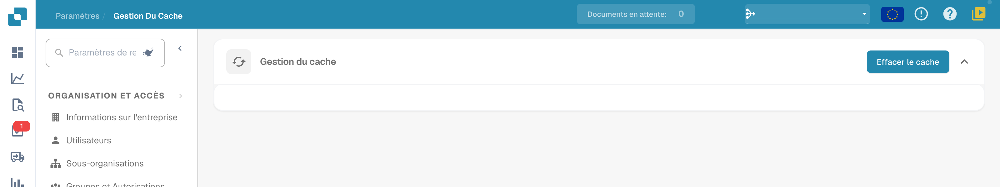

# Gestion du cache

La page **Gestion du cache** propose l’action **Effacer le cache**. La version illustrée ne présente pas de tableau d’objets, de réglage par type de cache ni de durée TTL modifiable.

<figure><figcaption>
Gestion du cache dans la version illustrée : seul Effacer le cache est proposé. Aucun objet ni réglage TTL n’est affiché ; aucune suppression de cache n’a été exécutée.
</figcaption></figure>

## Effacer le cache

Ouvrez **Paramètres → Gestion du cache**. Utilisez **Effacer le cache** uniquement si cette opération est nécessaire pour votre diagnostic et votre organisation. Vérifiez ensuite le comportement concerné et les informations disponibles dans votre environnement. La présence du bouton ne prouve pas qu’une suppression a eu lieu.

Cette page ne définit pas une politique universelle de conservation ou d’expiration. Aucun cache n’a été effacé pendant cette vérification.
