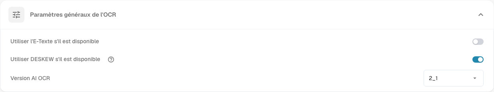

# Traitement des documents

Les paramètres de **Traitement des documents** déterminent comment DocBits lit, enrichit et exporte les documents. Ouvrez les **Paramètres** et choisissez le domaine souhaité dans **Traitement des documents**.

* [Paramètres OCR](ocr-settings.md): comment le texte des documents est lu.
* [Recherche de données de référence](master-data-lookup.md): comment les valeurs extraites sont comparées à vos données de référence.
* [Calcul de la date d'échéance](due-date-calculation.md): comment les dates d’échéance sont calculées.
* [Exportation](export.md): où et comment les documents traités sont exportés.

Par exemple, ouvrez **Paramètres OCR** pour consulter **Paramètres généraux de l'OCR**. Le paramètre **Utiliser l'E-Texte s'il est disponible** utilise le texte électronique intégré. Le paramètre **Utiliser DESKEW s'il est disponible** redresse les pages numérisées. Le paramètre **Version AI OCR** sélectionne la version du moteur de reconnaissance. Consultez [Paramètres OCR](ocr-settings.md) pour connaître les commandes en détail.

<figure><figcaption>
Les paramètres généraux d’OCR constituent un domaine du traitement des documents. Les valeurs sélectionnées dépendent de votre organisation.
</figcaption></figure>

Cette section comprend également [Importation](import/README.md), [Classification et extraction](classification-and-extraction/README.md), [Gestion des règles](rule-manager/README.md), [Listes de valeurs](list-of-values.md) et [Module](module/README.md).

Si un paramètre ne se comporte pas comme prévu, vérifiez-le d’abord avec un document de test. Une modification peut affecter tous les nouveaux documents de l’organisation.
