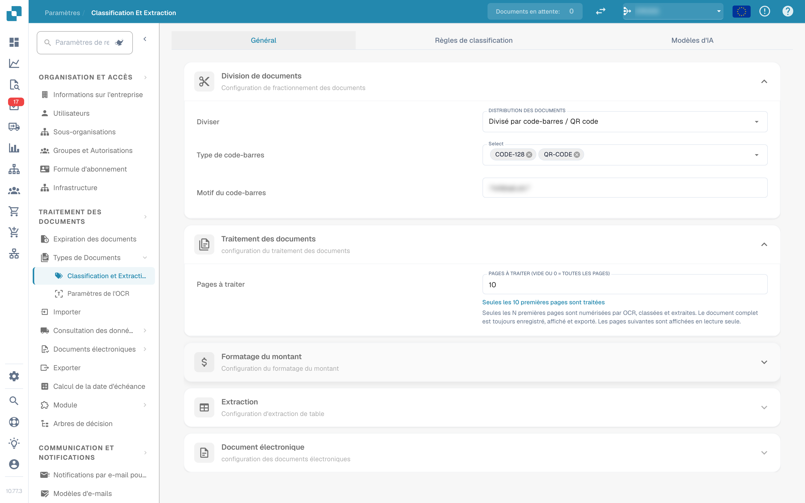
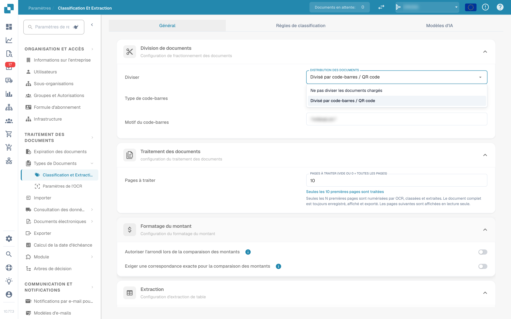
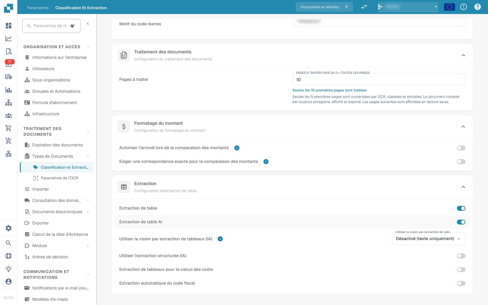
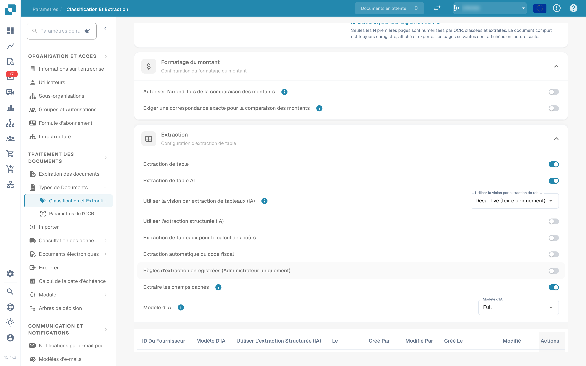
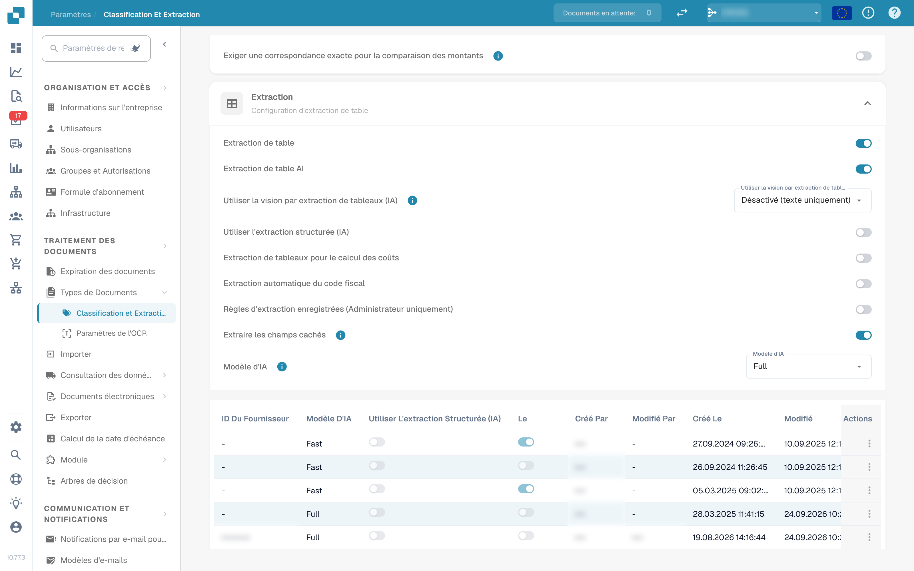
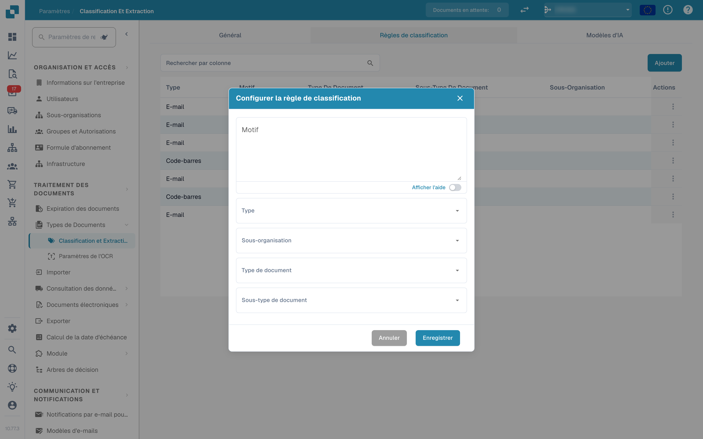
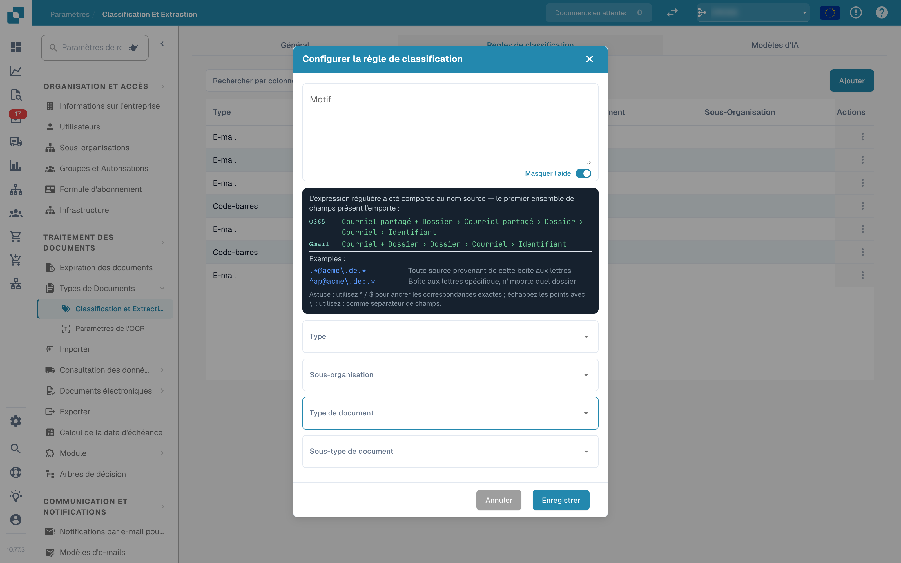
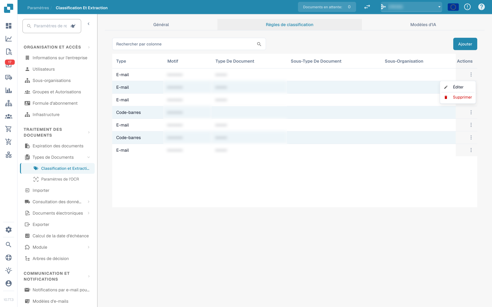
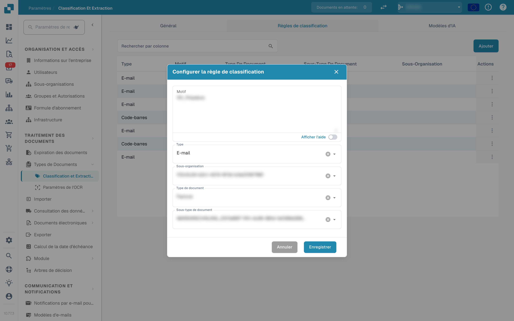
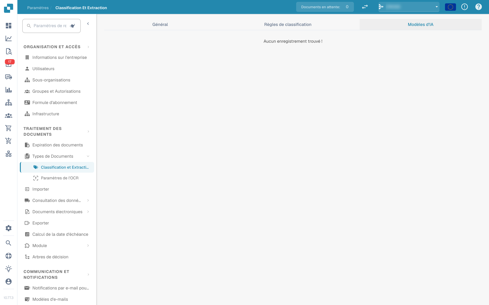

# Classification et extraction

<figure><figcaption>
Paramètres de classification et d'extraction
</figcaption></figure>

## Aperçu

Dans les paramètres **Classification et extraction**, vous pouvez :

* contrôler comment les documents importés sont **divisés** et combien de pages sont traitées
* configurer le **formatage du montant** pour la comparaison des montants
* configurer l'**extraction de table**, y compris le modèle d'IA utilisé par fournisseur
* activer ou désactiver le traitement des fichiers **ZUGFeRD** non pris en charge
* définir des **règles de classification** qui attribuent automatiquement un type de document
* consulter les **modèles d'IA** et leurs étiquettes entraînées

La page comporte trois onglets : **Général**, **Règles de classification** et **Modèles d'IA**. L'onglet *Modèles d'IA* n'apparaît que lorsque le module de modèles et d'étiquettes est activé pour votre organisation.

| Onglet | Contenu |
|---|---|
| Général | Division de documents, Traitement des documents, Formatage du montant, Extraction, Document électronique |
| Règles de classification | Règles regex qui classifient les documents selon le nom de la source |
| Modèles d'IA | Modèles entraînés sur mesure avec leurs étiquettes, types de document et priorité |

## Accès aux paramètres de classification et d'extraction

Allez dans **Paramètres → Types de Documents → Classification et Extraction**.

## Général

L'onglet **Général** regroupe les paramètres dans des sections repliables. Toutes les modifications sont enregistrées immédiatement dès que vous changez une valeur ; il n'y a pas de bouton d'enregistrement séparé.

### Division de documents

**Diviser** détermine si un document importé est divisé en plusieurs documents lorsqu'un code-barres apparaît sur l'une de ses pages. La liste déroulante propose :

* **Ne pas diviser les documents chargés** – la valeur par défaut ; le document est traité comme un seul fichier.
* **Divisé par code-barres / QR code** – le document est divisé à chaque code-barres détecté.

<figure><figcaption>
Options de division dans la section « Division de documents »
</figcaption></figure>

Lorsque **Divisé par code-barres / QR code** est sélectionné, deux champs supplémentaires apparaissent :

* **Type de code-barres** – un ou plusieurs types de code-barres à détecter, par exemple *CODE-128* ou *QR-CODE*.
* **Motif du code-barres** – une expression régulière à laquelle la valeur du code-barres doit correspondre avant que la division ne soit déclenchée. Laissez le champ vide pour diviser sur n'importe quel code-barres des types sélectionnés. Le motif est validé avant d'être enregistré ; une expression invalide est signalée immédiatement.

Après une division réussie, le document parent est supprimé et les pages continuent comme des documents distincts partageant le même lot.

### Traitement des documents

**Pages à traiter** limite le nombre de pages numérisées par OCR, classées et extraites par document.

<figure><figcaption>
Pages à traiter dans la section « Traitement des documents »
</figcaption></figure>

* Vide ou **0** signifie que toutes les pages sont traitées.
* Un nombre *N* limite l'OCR, la classification et l'extraction aux *N* premières pages. Le document complet est toujours enregistré, affiché et exporté ; les pages au-delà de la limite sont affichées en lecture seule.

### Formatage du montant

Deux commutateurs contrôlent la façon dont les montants sont comparés aux données de référence et aux commandes d'achat.

<figure><figcaption>
Section « Formatage du montant »
</figcaption></figure>

* **Autoriser l'arrondi lors de la comparaison des montants** – lorsque cette option est activée, une tolérance de ±0,5 est autorisée. Lorsqu'elle est désactivée, ±0,05 s'applique.
* **Exiger une correspondance exacte pour la comparaison des montants** – lorsque cette option est activée, les montants doivent correspondre exactement, sans aucune tolérance. Lorsqu'elle est désactivée, ±0,05 s'applique.

Un seul des deux commutateurs peut être actif à la fois ; activer l'un désactive l'autre.

### Extraction


**Conditions préalables à une extraction de table fonctionnelle**

* Le type de document possède des **colonnes de table** (Paramètres → Paramètres globaux → Types de Documents → [Colonnes de table](../../global-settings/document-types/table-columns/README.md)). Sans colonnes, il n'y a rien dans quoi extraire.
* **Extraction de table** ou **Extraction de table AI** est activée ci-dessous, pour toute l'organisation.
* Le document contient du texte lisible : l'OCR a été exécuté, ou le E-Text est utilisé pour les PDF numériques ([Paramètres OCR](../ocr-settings.md)).
* L'entraînement et les modèles d'IA sont **par fournisseur**. Une table entraînée ne s'applique qu'aux documents du fournisseur sur lequel elle a été entraînée.


Vous pouvez extraire des tables de documents en activant **Extraction de table** ou **Extraction de table AI**. Une table entraînée (qu'elle soit basée sur l'IA ou manuelle) est toujours liée à un fournisseur spécifique.

<figure><figcaption>
Commutateurs de l'extraction de table
</figcaption></figure>

**Extraction de table :** Active l'extraction de table basée sur des règles. Les tables sont entraînées par fournisseur sur l'écran de validation (*Go to table extraction view*).\
Apprenez-en plus sur l'entraînement [ici](../../../setup/document-training/training-line-fields-table-training/defining-tables-and-columns.md).

**Extraction de table AI :** Utilise l'IA pour extraire la table de n'importe quel fournisseur sans entraînement. Si les résultats pour un fournisseur ne sont pas assez précis, entraînez la table de ce fournisseur ; les règles enregistrées ont alors la priorité sur l'IA pour ce fournisseur.

**Utiliser la vision par extraction de tableaux (IA) :** L'IA lit l'image de la page au lieu de la couche de texte. Utile pour les documents numérisés et les tableaux sans structure de texte claire ; plus lent. La liste déroulante à côté du commutateur détermine l'intensité d'utilisation de l'image de la page :

* **Désactivé (texte uniquement)** – Seule la couche de texte est utilisée. C'est la valeur par défaut.
* **Images uniquement** – Seule l'image de la page est lue.
* **Hybride (texte et images)** – La couche de texte et l'image de la page sont combinées dans la même requête.
* **Auto (décidé par document)** – DocBits décide par document si la couche de texte suffit.

**Utiliser l'extraction structurée (IA) :** L'IA renvoie la table dans une structure fixe qui correspond directement aux colonnes de table configurées. Recommandé lorsque les en-têtes de colonne varient beaucoup d'un document à l'autre. Un clic sur le paramètre ouvre un aperçu des champs et des colonnes que l'IA demandera exactement : les champs d'en-tête et les colonnes de ligne sont listés avec leur source (champs standard demandés ou désactivés), ainsi que le mode de sortie attendu (par exemple *strict* – aucune colonne supplémentaire). Les champs configurés pour le type de document mais désactivés ne sont pas demandés à l'IA.

**Extraction de tableaux pour le calcul des coûts :** Lorsque cette option est activée, DocBits peut extraire des éléments de coût à partir de tables au niveau de la ligne et les classer en conséquence.\
Une explication détaillée est disponible [ici](table-extraction-for-costing-element.md).

**Extraction automatique du code fiscal :** Lorsque cette option est activée, le système remplit automatiquement le champ **Code fiscal** sur l'écran de validation, à condition qu'un champ de code fiscal soit configuré.\
Plus d'informations sur ce paramètre [ici](auto-extract-tax-code.md).

**Règles d'extraction enregistrées (Administrateur uniquement) :** Seuls les administrateurs peuvent cliquer sur *Save Rules* pendant l'entraînement des tables. Activez cette option lorsque des utilisateurs enregistrent régulièrement des règles qui perturbent l'extraction d'un fournisseur.

**Extraire les champs cachés :** Les champs marqués comme masqués dans les paramètres de champ sont également extraits. Utile lorsqu'une valeur est nécessaire pour une règle ou un export, mais ne doit pas être affichée sur l'écran de validation.

**Modèle d'IA :** Sélectionne le niveau d'IA utilisé pour l'extraction de table. Six options sont disponibles : **Full** (précision maximale, le plus lent, 2 jetons par document), **Fast** (par défaut ; 1 jeton par document), **Nexus** et **Nexus Flash** (famille de modèles alternative, en option), ainsi que **Auto** et **Auto Nexus**, où DocBits décide par document de la puissance de modèle nécessaire. La table sous le sélecteur affiche :

* quels **fournisseurs** utilisent quel modèle d'IA
* s'ils utilisent l'extraction structurée (IA) et le E-Text
* des options pour supprimer une entrée et ainsi réinitialiser le fournisseur à la valeur par défaut

Ce paramètre est expliqué en détail [ici](ai-model.md).

#### Pourquoi la table est-elle différente selon le fournisseur ?

Tout ce que DocBits apprend sur une table est stocké **par fournisseur** :

* **Règles enregistrées** (entraînement de table) : position de la table et correspondance de ses colonnes sur la mise en page de ce fournisseur.
* **Étiquettes de table IA et règles de formatage** : indications que l'utilisateur a enregistrées pour la table IA de ce fournisseur.
* **Modèle d'IA spécifique au fournisseur** : le niveau choisi pour ce fournisseur sous *More settings* sur l'écran de validation.

Ainsi, le fournisseur A avec des règles enregistrées affiche une table déterministe dans l'onglet *Extracted table* de l'écran de validation, tandis que le fournisseur B sans règles reçoit la *AI Extracted table*. Pour que le fournisseur B se comporte comme A, entraînez une fois la table de B. Pour réinitialiser un fournisseur, supprimez ses règles sur l'écran de validation ou réinitialisez ses données d'entraînement dans la table Modèle d'IA.

#### Clés de préférence

Chaque commutateur de cette section est stocké en tant que préférence de l'organisation. Utilisez la clé lorsque vous définissez la valeur via l'API (`/preferences/set_preference`), un script ou le MCP DocBits (`get_preference` / `set_preference`).

| Paramètre (libellé de l'interface) | Clé de préférence | Valeurs |
|---|---|---|
| Diviser | `SPLIT_DOCUMENT_ON_BARCODE` | `true` / `false` |
| Type de code-barres | `SPLIT_DOCUMENT_BARCODE_TYPE` | liste de noms de types de code-barres |
| Motif du code-barres | `SPLIT_DOCUMENT_BARCODE_PATTERN` | chaîne regex |
| Pages à traiter | `RESTRICT_TO_PAGES` | nombre ; vide ou `0` = toutes les pages |
| Autoriser l'arrondi lors de la comparaison des montants | `AMOUNTS_ROUNDING` | `true` / `false` |
| Exiger une correspondance exacte pour la comparaison des montants | `AMOUNTS_NO_ROUNDING` | `true` / `false` |
| Extraction de table | `TABLE_EXTRACTION_SETTING` | `true` / `false` |
| Extraction de table AI | `USE_AI_TABLE_EXTRACTION` | `true` / `false` |
| Utiliser la vision par extraction de tableaux (IA) | `TABLE_EXTRACTION_VISION_MODE` | `off` (par défaut), `vision`, `hybrid`, `auto` |
| Utiliser la vision par extraction de tableaux (IA) – ancien commutateur | `TABLE_EXTRACTION_USE_VISION` | `true` / `false` ; équivaut à `vision` |
| Utiliser l'extraction structurée (IA) | `USE_STRUCTURED_EXTRACTION` | `true` / `false` |
| Extraction de tableaux pour le calcul des coûts | `CHARGES_TABLE_EXTRACTION` | `true` / `false` |
| Extraction automatique du code fiscal | `AUTO_EXTRACT_TAX_CODE` | `true` / `false` |
| Règles d'extraction enregistrées (Administrateur uniquement) | `ONLY_ADMIN_CAN_SAVE_RULES` | `true` / `false` |
| Extraire les champs cachés | `EXTRACT_HIDDEN_FIELDS` | `true` / `false` |
| Modèle d'IA | `AI_MODEL` | `gpt-6-sol` (Full), `gpt-6-luna` (Fast), `qwen3.8-max` (Nexus), `glm-5.3-flash` (Nexus Flash), `auto` (Auto), `auto-nexus` (Auto Nexus) |
| Version de l'extraction de table (boîte de dialogue de confirmation) | `TBL_EXT_VERSION` | chaîne de version |
| Paramètres OCR → Utiliser les données d'IA pour les tables si disponibles | `USE_AI_DATA_FOR_TABLE` | `true` / `false` |
| Paramètres OCR → Utiliser le E-Text si disponible | `USE_ETEXT_IF_AVAILABLE` | `true` / `false` |

Remarques :

* Les préférences booléennes sont stockées sous forme des chaînes `true` / `false` ; une clé jamais définie compte comme `false`. Si vous envoyez `1` ou `0`, DocBits stocke `true` / `false`.
* Un `AI_MODEL` non défini signifie **Fast**.
* Un `TABLE_EXTRACTION_VISION_MODE` non défini est résolu à partir de l'ancien commutateur `TABLE_EXTRACTION_USE_VISION` : `true` donne `vision`, toute autre valeur donne `off`.
* La modification d'une clé prend effet pour les documents traités ensuite. Redémarrez un document pour le réextraire avec le nouveau paramètre.
* Les choix par fournisseur (E-Text, modèle d'IA, règles enregistrées) ne sont pas des préférences d'organisation ; ils se règlent sur l'écran de validation sous *More settings* pour un document de ce fournisseur.

### Document électronique

**Traiter les documents non pris en charge ZUGFeRD PDF :** Si cette option est activée, les versions **ZUGFeRD** non prises en charge sont traitées comme des PDF standard et le XML intégré est ignoré.

La liste des versions **ZUGFeRD** prises en charge se trouve [ici](../../global-settings/document-types/edi/zugferd/README.md).

## Règles de classification

L'onglet **Règles de classification** répertorie les règles qui attribuent automatiquement un type de document pendant le traitement. Chaque règle compare un **motif regex** au nom de la source du document et, en cas de correspondance, définit le type de document et éventuellement un sous-type de document.

Basculez vers l'onglet en cliquant sur **Règles de classification** en haut de la page.

<figure><figcaption>
Onglet « Règles de classification » avec le tableau des règles
</figcaption></figure>

Le tableau comporte une ligne par règle avec ces colonnes :

* **Type** – où le motif est appliqué. Il existe deux types : **Code-barres** et **E-mail**.
* **Motif** – l'expression régulière enregistrée pour la règle.
* **Type de document** – le type de document attribué lorsque le motif correspond.
* **Sous-type de document** – le sous-type de document attribué lorsque le motif correspond.
* **Sous-organisation** – la sous-organisation à laquelle la règle est limitée. Vide signifie que la règle s'applique à toutes les sous-organisations.
* **Actions** – le menu de ligne avec *Éditer* et *Supprimer*.

Le champ de recherche au-dessus du tableau filtre toutes les colonnes, y compris les libellés affichés des colonnes déroulantes.

### Ajouter une règle de classification

1.  Cliquez sur **Ajouter** au-dessus du tableau.

    <figure><figcaption>
Boîte de dialogue « Configurer la règle de classification »
</figcaption></figure>
2. Remplissez les champs :
   * **Motif** (obligatoire) – l'expression régulière recherchée par la règle.
   * **Type** (obligatoire) – **Code-barres** ou **E-mail**. Cela détermine le nom de source auquel le motif est comparé.
   * **Sous-organisation** *(facultatif)* – limite la règle à une sous-organisation.
   * **Type de document** – le type de document attribué lorsque le motif correspond.
   * **Sous-type de document** *(facultatif)* – un type plus précis ; la liste dépend du type de document sélectionné. Changer le type de document efface le sous-type de document.
3.  Cliquez sur **Enregistrer**.

La boîte de dialogue valide le motif avant l'enregistrement. Un motif déjà utilisé par une autre règle est refusé avec *Le motif existe déjà* ; un motif vide est refusé avec le message de champ obligatoire.

#### Aide sur le motif

Le commutateur **Afficher l'aide** sous le champ du motif ouvre une référence intégrée avec les formats de nom de source auxquels le motif est comparé :

* **O365** – `Courriel partagé + Dossier › Courriel partagé › Dossier › Courriel › Identifiant`
* **Gmail** – `Courriel + Dossier › Dossier › Courriel › Identifiant`

<figure><figcaption>
Panneau d'aide sur le motif dans la boîte de dialogue de la règle
</figcaption></figure>

Exemples donnés dans le panneau :

* `.*@acme\.de.*` – n'importe quelle source de cette boîte aux lettres
* `^ap@acme\.de:.*` – une boîte aux lettres précise, n'importe quel dossier

Astuce : utilisez `^` / `$` pour ancrer les correspondances exactes, échappez les points avec `\.` et utilisez `:` comme séparateur de champs. Le premier ensemble de champs présent dans le nom de la source l'emporte.

Si vous utilisez le type **E-mail**, le motif est comparé aux noms de boîte aux lettres et de dossier du courrier importé, et non au contenu du document.

### Modifier une règle de classification

1.  Cliquez sur les trois points dans la colonne **Actions** de la règle à modifier.

    <figure><figcaption>
Menu de ligne avec Éditer et Supprimer
</figcaption></figure>
2.  Sélectionnez **Éditer**. La boîte de dialogue s'ouvre avec les valeurs actuelles de la règle.

    <figure><figcaption>
Modification d'une règle de classification existante
</figcaption></figure>
3. Modifiez le motif, le type, la sous-organisation, le type de document ou le sous-type de document.
4.  Cliquez sur **Enregistrer**.

La même validation s'applique qu'à l'ajout : le motif ne doit pas être vide et ne doit pas dupliquer celui d'une autre règle.

### Supprimer une règle de classification

1. Cliquez sur les trois points dans la colonne **Actions**.
2. Sélectionnez **Supprimer**.

La règle est immédiatement retirée de la liste. La suppression d'une règle ne modifie pas les documents déjà classifiés avec elle.

## Modèles d'IA

L'onglet **Modèles d'IA** affiche les modèles entraînés sur mesure disponibles pour la classification des documents et leurs étiquettes. Il n'apparaît que lorsque le module de modèles et d'étiquettes est activé pour votre organisation.

<figure><figcaption>
Onglet « Modèles d'IA »
</figcaption></figure>

Si aucun modèle propre n'est disponible pour l'organisation, l'onglet affiche *Aucun enregistrement trouvé !*.

### Modèles

Chaque modèle est une entrée dépliable avec :

* le **nom du modèle** et le badge **Par défaut** sur le modèle utilisé lorsque rien d'autre ne s'applique.
* le nombre d'**étiquettes** entraînées pour ce modèle.
* par modèle, une fois déplié : **Type**, **Première page seulement** et **Version**.

Sous ces informations sont listées les étiquettes du modèle.

### Étiquettes

Les étiquettes sont ce que le modèle apprend. Chaque étiquette associe un motif reconnu par le modèle à un type de document.

* **Nom** – le nom de l'étiquette.
* **Modèle suivant** – un modèle qui poursuit le traitement de la sortie de cette étiquette.
* **Type de document** – le type de document attribué par l'étiquette.
* **Sous-type de document** – un type plus précis pour l'étiquette.
* **Priorité** – l'ordre dans lequel les étiquettes sont évaluées ; les nombres les plus bas d'abord.

Le champ de recherche au-dessus du tableau des étiquettes filtre les étiquettes du modèle sélectionné.

### Modifier une étiquette

Cliquez sur l'icône de crayon d'une ligne d'étiquette pour ouvrir la boîte de dialogue d'édition. Elle propose **Modèle suivant** et **Type de document** ; définissez l'un des deux, car la boîte de dialogue exige soit un modèle suivant, soit un type de document. Cliquez sur **Enregistrer** pour appliquer la modification.

## Pages associées

* [Modèle d'IA](ai-model.md) – les six niveaux d'extraction et comment un fournisseur obtient son propre modèle
* [Extraction automatique du code fiscal](auto-extract-tax-code.md)
* [Extraction de tableaux pour le calcul des coûts](table-extraction-for-costing-element.md)
* [Paramètres OCR](../ocr-settings.md)
