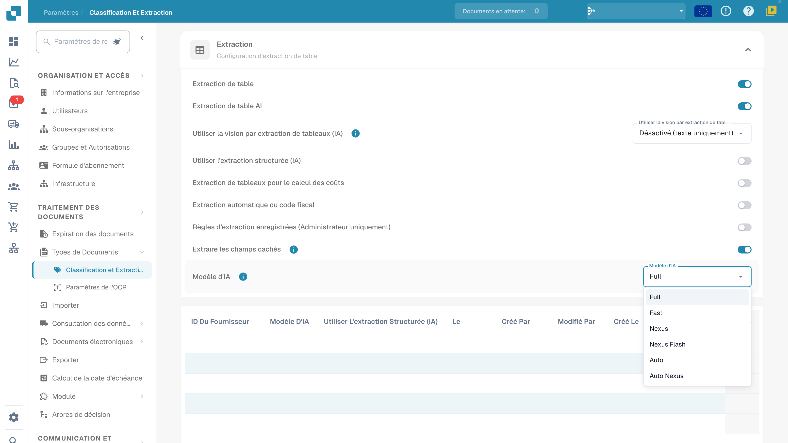

# Modèle d'IA

## Portée du réglage

Le réglage définit le modèle de l’organisation pour l’extraction des champs et des tableaux. En l’absence de préférence propre au modèle d’extraction actuel, cette configuration de l’organisation s’applique ; une valeur fournisseur non définie ne signifie pas systématiquement Fast.

## Accès

Ouvrez **Paramètres → Classification et extraction**, puis la section **Extraction** et **Modèle d’IA**.

<figure><figcaption>
Menu Modèle d’IA avec Full, Fast, Nexus, Nexus Flash, Auto et Auto Nexus. Ces noms désignent des niveaux du produit. Les lignes de préférences sont masquées ; aucun modèle ni réglage n’a été modifié.
</figcaption></figure>

## Niveaux disponibles

Le menu illustré propose **Full**, **Fast**, **Nexus**, **Nexus Flash**, **Auto** et **Auto Nexus**. Ce sont des noms de niveaux du produit. Les options, les modèles sous-jacents et les coûts peuvent changer ; un ancien nom de fournisseur ou un prix fixe ne constitue pas une garantie permanente.

Comparez les niveaux avec le même échantillon représentatif, les réponses attendues, le temps de traitement et les coûts de votre environnement. Full ne garantit pas toujours la meilleure précision, ni Fast ou Nexus Flash le traitement le plus rapide. Examinez également les résultats et les coûts des sélections Auto et Auto Nexus. Un changement de modèle ne garantit ni validation, ni rapprochement, ni approbation, ni exportation.

## Préférences du modèle d’extraction

L’écran de validation donne accès au [modèle spécifique au fournisseur](../../../../end-user-and-partner-section/end-user-section/validation-screen/supplier-specific-ai-model-for-field-and-table-extraction.md). La préférence est enregistrée pour l’organisation et le modèle d’extraction actuel (`tfidf_id`). Elle ne met pas automatiquement à jour tous les modèles du même fournisseur ni tous ses documents historiques.

Vérifiez les colonnes et les valeurs réellement présentes dans votre version. Les lignes masquées de l’illustration ne signifient pas que la table est vide.

## Supprimer une entrée

Identifiez d’abord le modèle d’extraction et l’ensemble de ses préférences. La suppression d’une entrée peut retirer plusieurs préférences de ce modèle, pas uniquement le choix du modèle d’IA. Un administrateur qui doit réaliser cette opération doit examiner sa portée et la confirmation avant de poursuivre.

Les traitements suivants utilisent la configuration de l’organisation et les valeurs de repli applicables au modèle concerné. D’autres modèles du même fournisseur peuvent conserver leurs propres préférences. La suppression ne relance pas automatiquement les documents historiques. Aucune entrée n’a été supprimée et aucune extraction après suppression n’a été testée pendant cette vérification.
