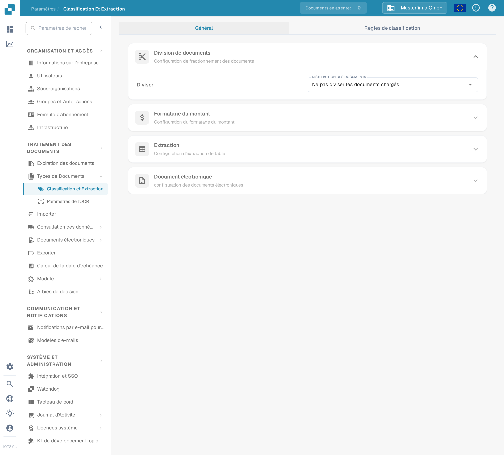
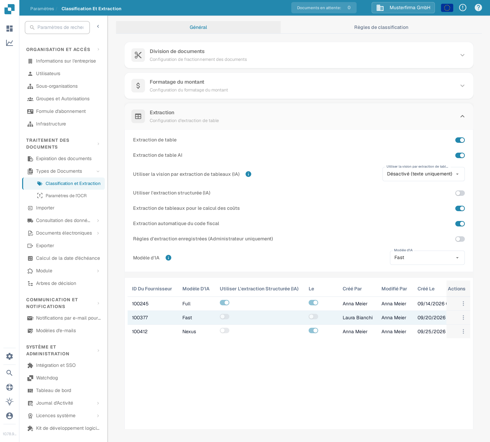
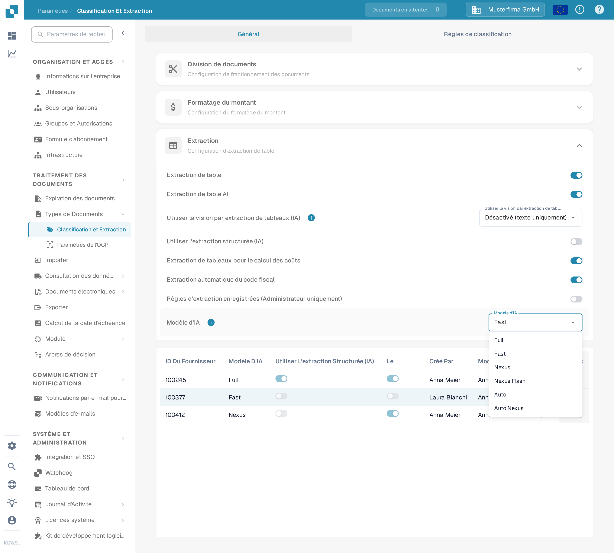
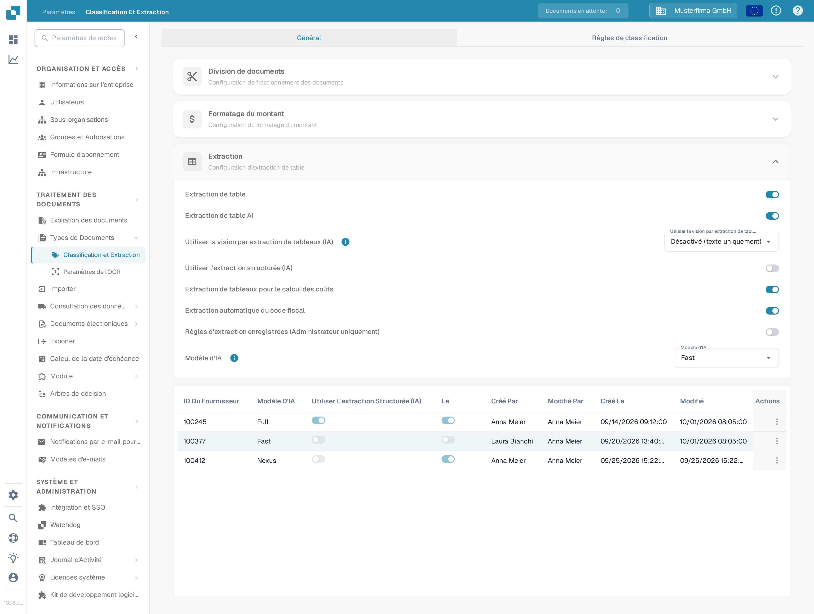
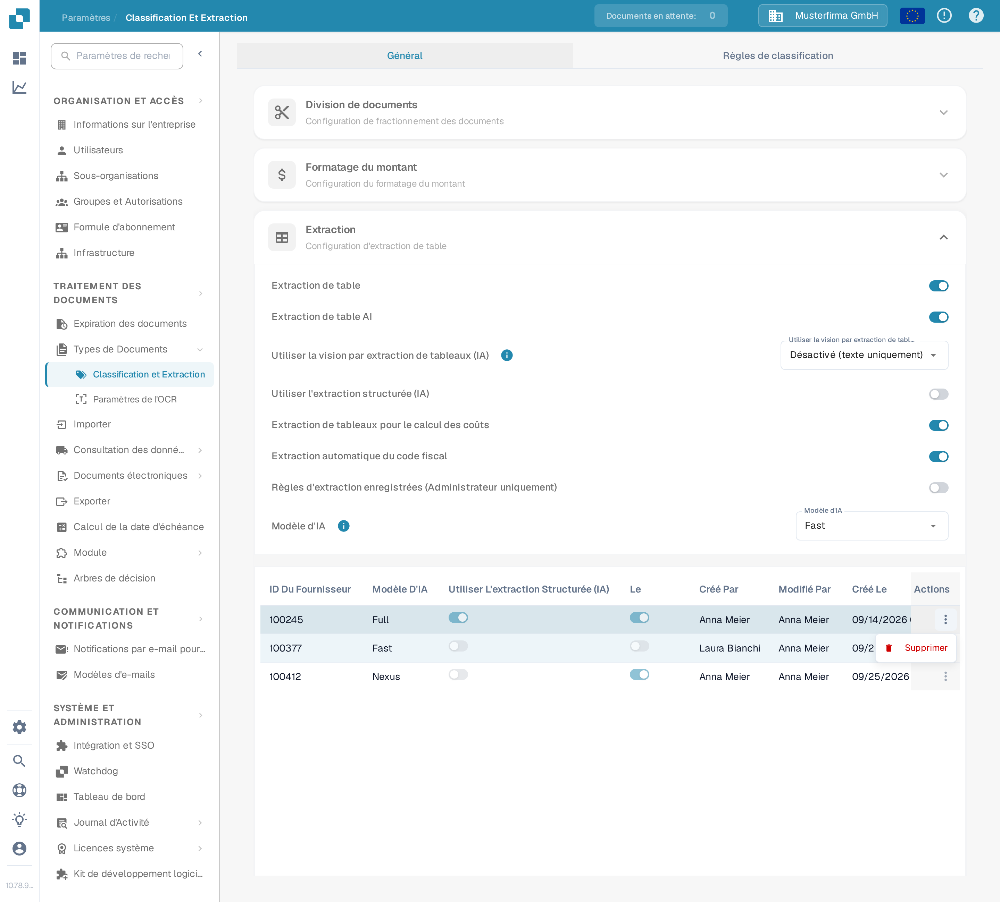
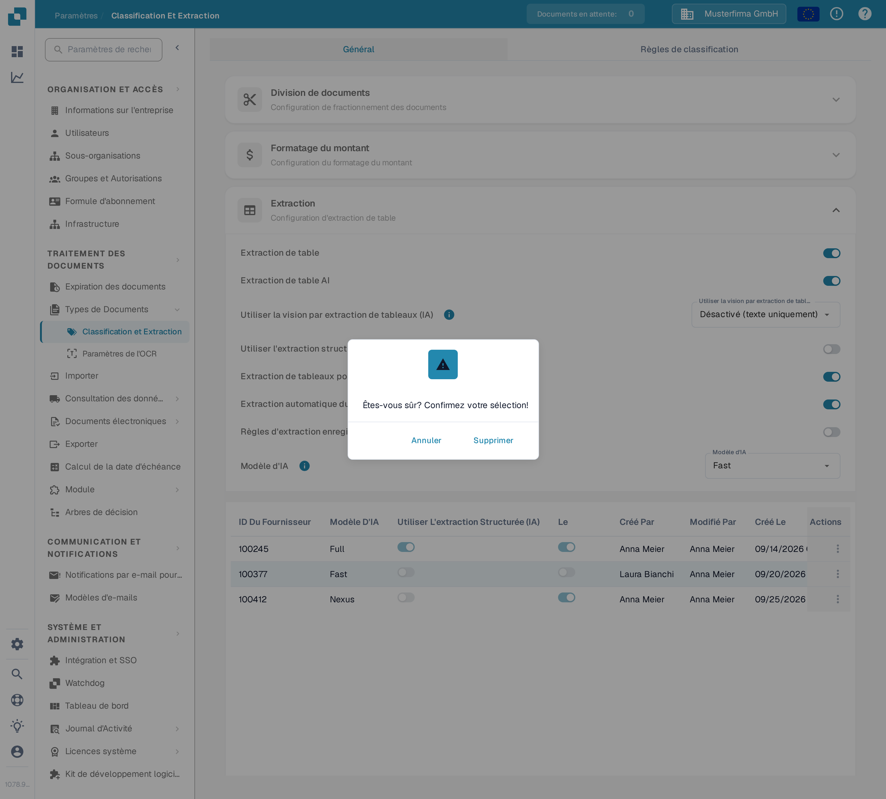

# Modèle d'IA

## Aperçu

Le paramètre **Modèle d'IA** vous permet de définir quel modèle d'IA est utilisé par défaut pour l'**extraction des champs** et l'**extraction de tableaux** lors du traitement des documents.\
Dans cette section, vous pouvez consulter le coût en tokens pour chaque modèle et voir quel modèle est actuellement assigné à chaque fournisseur.

## Comment accéder

1.  Naviguez vers **Paramètres** → **Traitement des documents** → **Classification et extraction**

    <figure><figcaption>
Ouvrez <strong>Paramètres → Traitement des documents → Classification et extraction</strong>.
</figcaption></figure>
2.  Faites défiler vers le bas jusqu'à la section **Extraction**

    <figure><figcaption>
La section <strong>Extraction</strong> contient le paramètre <strong>Modèle d'IA</strong> et le tableau d'attribution par fournisseur.
</figcaption></figure>

## Options du Modèle d'IA

DocBits propose six options de modèle d'IA pour l'extraction des champs et des tableaux. Elles diffèrent par l'équilibre entre **précision d'extraction**, **vitesse de traitement** et **coût en tokens par document** — vous pouvez ainsi adapter l'option au type de documents que vous traitez. Survolez l'icône d'information à côté du paramètre pour voir le coût en tokens de l'option actuellement sélectionnée. Si aucun modèle n'est défini pour un fournisseur, la valeur non définie équivaut à **Fast**.

* **Full** – L'option la plus approfondie, avec la plus haute précision d'extraction. Idéale pour les mises en page complexes, les scans de mauvaise qualité ou les documents où la précision prime. En tant qu'option la plus puissante, elle est aussi la plus lente, à **2 tokens par document**.
* **Fast** – Une option équilibrée qui combine une bonne précision avec un traitement plus rapide et un coût moindre. C'est le niveau par défaut : les fournisseurs sans leur propre paramètre de modèle d'IA utilisent Fast, à **1 token par document**.
* **Nexus** – Une option activée sur demande qui s'appuie sur une autre famille de modèles (Qwen 3.8 Max). Utile lorsque vous souhaitez un second avis pour les fournisseurs où Fast et Full donnent des résultats divergents, ou lorsque le modèle alternatif lit mieux une mise en page particulière, à **1 token par document**.
* **Nexus Flash** – Un niveau plus rapide de la famille Nexus (GLM-5.3 Flash). Il traite les documents plus rapidement que Nexus au même coût en tokens, à **1 token par document**.
* **Auto** – Pas un modèle à proprement parler : par document, DocBits décide si Fast suffit ou si Full est nécessaire, de sorte que les documents complexes reçoivent automatiquement le modèle le plus puissant, à **1 token par document**.
* **Auto Nexus** – Comme Auto, mais limité à la famille de modèles Nexus (Nexus Flash et Nexus). Les documents restent entièrement hors de la famille de modèles standard, à **1 token par document**.

| Option | Idéal pour | Précision | Vitesse | Coût en tokens |
|--------|------------|-----------|---------|----------------|
| **Full** | Mises en page complexes, scans médiocres, besoins de haute précision | La plus élevée | La plus lente | 2 / document |
| **Fast** | Documents courants (par défaut quand rien n'est défini) | Élevée | Rapide | 1 / document |
| **Nexus** | Fournisseurs pour lesquels la famille de modèles alternative donne de meilleurs résultats (sur activation) | Élevée | Rapide | 1 / document |
| **Nexus Flash** | Qualité Nexus avec un traitement plus rapide | Élevée | Plus rapide | 1 / document |
| **Auto** | Qualité de documents mixte sans réglage manuel | Par document | Par document | 1 / document |
| **Auto Nexus** | Décisions automatiques limitées à la famille Nexus | Par document | Par document | 1 / document |

<figure><figcaption>
Le menu déroulant <strong>Modèle d'IA</strong> avec les six options disponibles.
</figcaption></figure>

## Tableau d'Attribution du Modèle d'IA

Vous pouvez également configurer des **modèles d'IA** spécifiques au fournisseur directement dans l'**Écran de validation**, ce qui vous permet d'ajuster finement la précision de l'extraction pour des fournisseurs individuels.\
\
Pour plus d'informations, veuillez consulter la documentation correspondante [ici](../../../../end-user-and-partner-section/end-user-section/validation-screen/supplier-specific-ai-model-for-field-and-table-extraction.md).

Le tableau d'attribution affiche les paramètres du modèle d'IA pour chaque fournisseur et comprend les détails suivants :

* **ID Du Fournisseur** – L'identifiant unique du fournisseur
* **Modèle D'IA** – Le niveau de modèle d'IA actuellement assigné au fournisseur
* **Utiliser L'extraction Structurée (IA)** – Indique si l'extraction structurée est activée pour ce fournisseur
* **E-Text** – Indique si la fonctionnalité E-Text est activée
* **Créé Par / Modifié Par / Créé Le / Modifié** – Qui a défini l'entrée et quand
* **Actions** – Contient l'option de supprimer l'entrée

<figure><figcaption>
Le tableau d'attribution affiche le libellé du niveau par fournisseur, jamais l'identifiant brut du modèle.
</figcaption></figure>

### Supprimer l'entrée – Réinitialiser les paramètres spécifiques au fournisseur

Pour réinitialiser le paramètre du modèle d'IA d'un fournisseur à la valeur par défaut :

1.  Cliquez sur les trois points dans la colonne **Actions** à côté de l'entrée du fournisseur et sélectionnez **Supprimer**.

    <figure><figcaption>
Ouvrez le menu d'actions de la ligne et choisissez <strong>Supprimer</strong>.
</figcaption></figure>
2.  Une boîte de dialogue de confirmation apparaîtra—confirmez que vous souhaitez supprimer l'entrée.

    <figure><figcaption>
Confirmez la suppression dans la boîte de dialogue.
</figcaption></figure>

Une fois supprimée, l'entrée disparaît et le fournisseur revient à l'utilisation du **modèle d'IA** par défaut pour l'**extraction des champs** et l'**extraction de tableaux**.
