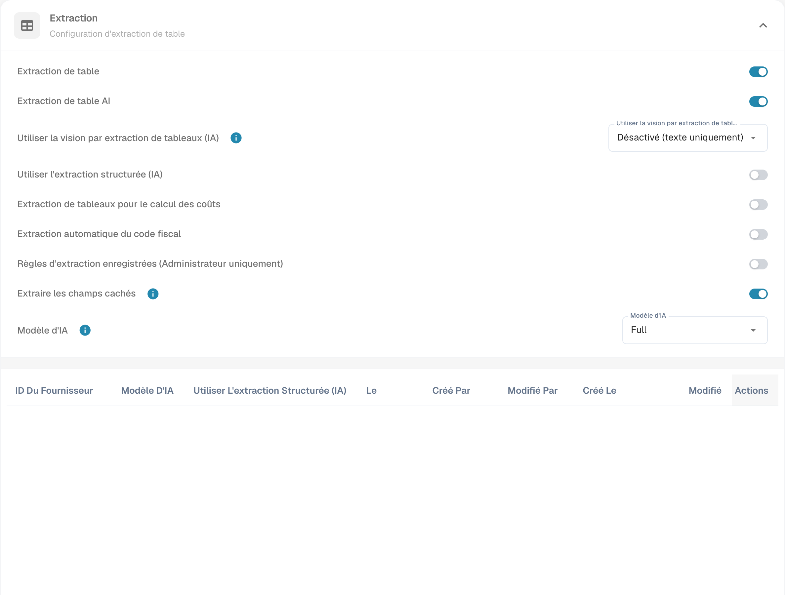

# Extraire automatiquement le code fiscal

Ouvrez les paramètres de classification et d’extraction du type de document et recherchez l’extraction automatique du code fiscal. Vérifiez la configuration prévue avant de l’activer et de l’enregistrer.

<figure><figcaption>
Paramètres d’extraction automatique du code fiscal.
</figcaption></figure>

Lorsque la fonction est active et qu’un champ de code fiscal est configuré, DocBits peut le renseigner automatiquement pendant la validation. Comparez le code obtenu au document et à la configuration ERP. L’image montre les paramètres, pas une extraction fiscale vérifiée. Le tableau conserve les codes techniques et les règles de cet exemple d’intégration ; vérifiez les valeurs propres à votre entreprise.

<table data-full-width="true"><thead><tr><th>Type de facture</th><th></th><th>Code fiscal</th><th>Ou dans le champ texte</th><th>Numéro de commande</th><th>Pays du fournisseur</th><th>Règle</th></tr></thead><tbody><tr><td>Facture de frais</td><td>Avec montant de taxe</td><td>NAGDH</td><td>LD + % (arrondi au montant absolu le plus élevé)</td><td>Vide</td><td>Les deux premiers caractères de l’identifiant fiscal  ou le pays de l’adresse fournisseur : tccom120.cadr → tccom130.cadr, champ tcom130.ccty</td><td>Lorsque le pays correspond à celui de l’entreprise</td></tr><tr><td>Facture de frais</td><td>Sans montant de taxe</td><td>NAGD0</td><td>LD + % (arrondi au montant absolu le plus élevé)</td><td>Vide</td><td>Les deux premiers caractères de l’identifiant fiscal  ou le pays de l’adresse fournisseur : tccom120.cadr → tccom130.cadr, champ tcom130.ccty</td><td>Lorsque le pays correspond à celui de l’entreprise</td></tr><tr><td>Facture de frais</td><td>Sans montant de taxe</td><td>EUDH</td><td>ED 0 %</td><td>Vide</td><td>Les deux premiers caractères de l’identifiant fiscal  ou le pays de l’adresse fournisseur : tccom120.cadr → tccom130.cadr, champ tcom130.ccty</td><td>Lorsque le pays diffère de celui de l’entreprise et appartient à l’UE dans la table des pays (tcmcs010)</td></tr><tr><td>Facture de commande</td><td>Avec montant de taxe</td><td>NAHGH</td><td>IG + % (arrondi au montant absolu le plus élevé)</td><td>Non vide</td><td>Les deux premiers caractères de l’identifiant fiscal  ou le pays de l’adresse fournisseur : tccom120.cadr → tccom130.cadr, champ tcom130.ccty</td><td>Lorsque le pays correspond à celui de l’entreprise</td></tr><tr><td>Facture de commande</td><td>Sans montant de taxe</td><td>NAHG0</td><td>IG + % (arrondi au montant absolu le plus élevé)</td><td>Non vide</td><td>Les deux premiers caractères de l’identifiant fiscal  ou le pays de l’adresse fournisseur : tccom120.cadr → tccom130.cadr, champ tcom130.ccty</td><td>Lorsque le pays correspond à celui de l’entreprise</td></tr><tr><td>Facture de commande</td><td>Avec montant de taxe</td><td>EUGH</td><td>ED 0 %</td><td>Non vide</td><td>Les deux premiers caractères de l’identifiant fiscal  ou le pays de l’adresse fournisseur : tccom120.cadr → tccom130.cadr, champ tcom130.ccty</td><td>Lorsque le pays diffère de celui de l’entreprise et appartient à l’UE dans la table des pays (tcmcs010)</td></tr><tr><td>Facture de frais</td><td>Sans montant de taxe</td><td>IMGD</td><td>ID 0 %</td><td>Vide</td><td>Les deux premiers caractères de l’identifiant fiscal  ou le pays de l’adresse fournisseur : tccom120.cadr → tccom130.cadr, champ tcom130.ccty</td><td>Lorsque le pays diffère de celui de l’entreprise et n’appartient pas à l’UE dans la table des pays (tcmcs010)</td></tr><tr><td>Facture de commande</td><td>Avec montant de taxe</td><td>IMHG</td><td>IG 0 %</td><td>Non vide</td><td>Les deux premiers caractères de l’identifiant fiscal  ou le pays de l’adresse fournisseur : tccom120.cadr → tccom130.cadr, champ tcom130.ccty</td><td>Lorsque le pays diffère de celui de l’entreprise et n’appartient pas à l’UE dans la table des pays (tcmcs010)</td></tr></tbody></table>
