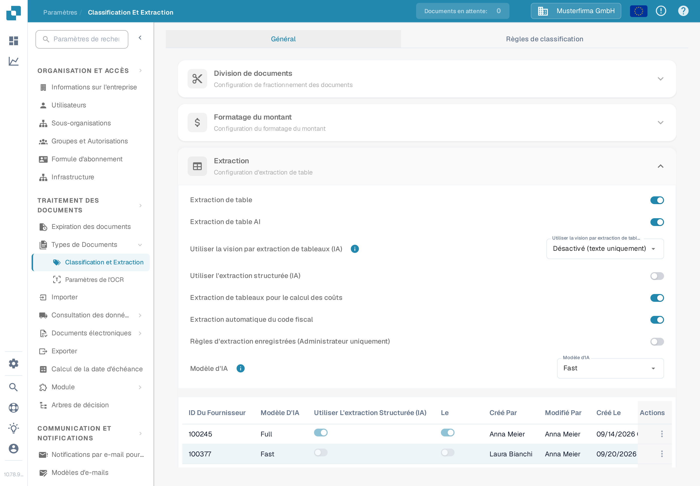

# Extraction de tableaux pour le calcul des coûts

Les éléments de coût sont des frais ou d'autres montants représentés sous forme de lignes dans le tableau de la facture. Lorsque cette fonction est activée et que le document contient des lignes extraites, DocBits peut classer ces lignes en fonction des éléments de coût configurés pour l'organisation. Un vérificateur peut corriger la classification d'une ligne dans le tableau du document.

## Activer le paramètre

1. Ouvrez **Paramètres → Traitement des documents → Classification et Extraction**.
2. Restez sur **Général** et dépliez **Extraction**.
3. Recherchez **Extraction de tableaux pour le calcul des coûts** sous les champs demandés pour l'extraction de tableaux. Un administrateur peut activer ce commutateur pour l'organisation.

<figure><figcaption>
Le commutateur est désactivé dans l'organisation de test A synthétique. Il n'a pas été modifié pour ce guide.
</figcaption></figure>


Le commutateur seul ne crée pas d'éléments de coût ni de lignes de facture. Configurez d'abord les éléments de coût et importez les données nécessaires. Le [guide de configuration des éléments de coût](../../../../infor-integration-and-configuration/importing-customer-master-data/m3/table-extraction-for-costing-element.md) présente l'exemple M3. Consultez [Classification et Extraction](README.md) pour les autres réglages d'extraction.


## Vérifier ou corriger une ligne

Ouvrez un document dont le tableau de facture contient des lignes extraites et examinez l'icône d'élément de coût à côté de la ligne concernée. Sélectionnez l'icône pour ouvrir les classifications disponibles. Choisissez l'élément de coût configuré correct, ou choisissez **Uncategorize** si la ligne est un article ordinaire. Vérifiez ensuite la ligne obtenue et les totaux avant d'enregistrer le document.

Si l'icône ou une classification est manquante, vérifiez d'abord que le document contient des lignes extraites, que la fonction est activée et qu'un élément de coût est configuré pour l'organisation. Le document de test synthétique de l'organisation A utilisé pour cette vérification de documentation n'avait pas de lignes de facture extraites ; le menu de classification n'a donc pas pu être illustré ni essayé. Les étapes ci-dessus correspondent au contrôle actuel du document ; aucune classification n'a été enregistrée lors de cette vérification.
