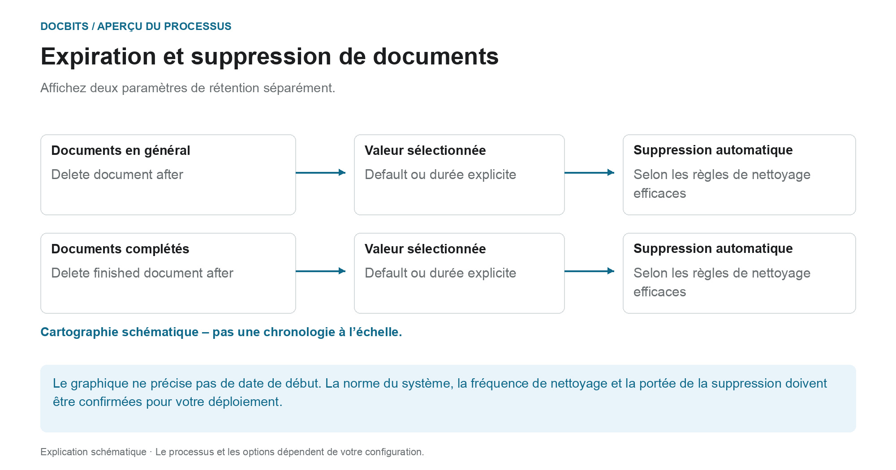

# Expiration des documents

## Deux règles de conservation au lieu d'une période de suppression générale

<figure><figcaption>
Affichez deux paramètres de rétention séparément. Le diagramme est schématique ; les paramètres actifs de votre organisation déterminent le comportement réel.
</figcaption></figure>

L'expiration des documents distingue la conservation générale des documents de la conservation des documents terminés. Vérifiez les deux paramètres ainsi que les exigences de votre processus et de l'archive cible prévue.

| Paramètre | Ce que vous devriez clarifier |
| --- | --- |
| **Delete document after** | Quelle valeur de conservation des documents est réellement efficace dans votre organisation. |
| **Delete finished document after** | Quelle valeur s'applique aux documents terminés, entièrement traités et exportés. |
| **Default** | Quelle norme système est stockée dans votre déploiement. Le nom seul n’indique pas la durée. |

Le diagramme n'est **pas une chronologie dessinée à l'échelle**. Il ne précise ni le début technique de la période de conservation ni quel paramètre est prioritaire. Une valeur déroulante à elle seule n’établit pas une heure de suppression précise à la seconde près. Pour une planification fiable, confirmez également la fréquence des opérations de nettoyage.

### Exportation, conservation et sauvegardes séparées

Une exportation réussie ne prouve pas que la copie DocBits a déjà été supprimée. À l’inverse, la suppression d’un document dans DocBits ne supprime pas un ERP stocké indépendamment ou une copie d’archive. Les sauvegardes peuvent avoir des règles de conservation distinctes ; la suppression d'un document du système actif ne prouve pas que toutes les copies de sauvegarde ont été supprimées en même temps.

Vérifiez les délais avant d’apporter des modifications et convenez de l’archive cible et du traitement des sauvegardes. La présentation du [Stockage, conservation et suppression des données](../../../security/data-storage-and-retention.md) explique les différences entre les documents, les fichiers intermédiaires OCR, les journaux et les sauvegardes.

<figure><figcaption>
Paramètres Documents Expiry
</figcaption></figure>

Sous Traitement des documents → Expiration des documents, configurez la conservation des documents. Vérifiez les paramètres effectifs, l'archive cible et la portée de suppression pour votre organisation avant de les modifier.

Deux paramètres contrôlent la suppression automatique :

| Paramètre | Ce qu'il contrôle |
|---------|------------------|
| **Delete document after** | Durée de conservation de tout document traité avant sa suppression automatique. |
| **Supprimer le document terminé après** | Durée de conservation d'un document terminé (entièrement traité et exporté) avant sa suppression automatique. |

Pour chaque paramètre, vous choisissez une durée dans la liste déroulante :

<figure><figcaption>
Durées de conservation disponibles
</figcaption></figure>

| Option | Signification |
|--------|---------|
| **Default** | Utilise la durée de conservation par défaut du système (aucune valeur personnalisée). |
| **48 Hours** | Valeur de rétention explicite de 48 heures ; confirmer séparément le début de la période et le calendrier de nettoyage. |
| **1 Week** | Valeur de rétention explicite d’une semaine. |
| **2 Weeks** | Valeur de rétention explicite de deux semaines. |
| **4 Weeks** | Valeur de rétention explicite de quatre semaines. |

Ces paramètres prennent en charge la conservation planifiée des documents. Ils ne remplacent pas la confirmation des périodes de conservation effectives, de l'archive cible et du traitement des sauvegardes pour votre organisation.
