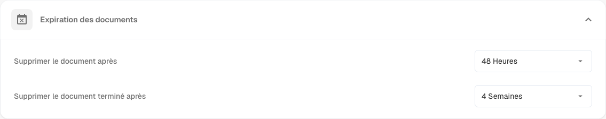
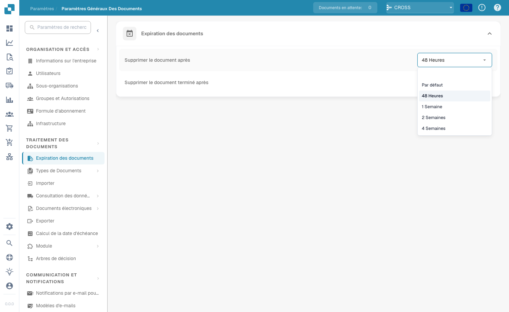

# Documents Expiry

<figure><figcaption>
Paramètres Documents Expiry
</figcaption></figure>

Sous **Document Processing → Documents Expiry**, vous définissez combien de temps DocBits conserve vos documents avant de les supprimer automatiquement. Cela vous aide à gérer l'espace de stockage, à appliquer les politiques de conservation des données et à rester en conformité avec les règles légales ou internes concernant la durée de stockage des documents.

Deux paramètres contrôlent la suppression automatique :

| Paramètre | Ce qu'il contrôle |
|---------|------------------|
| **Delete document after** | Durée de conservation de tout document traité avant sa suppression automatique. |
| **Delete finished document after** | Durée de conservation d'un document terminé (entièrement traité et exporté) avant sa suppression automatique. |

Pour chaque paramètre, vous choisissez une durée dans la liste déroulante :

<figure><figcaption>
Durées de conservation disponibles
</figcaption></figure>

| Option | Signification |
|--------|---------|
| **Default** | Utilise la durée de conservation par défaut du système (aucune valeur personnalisée). |
| **48 Hours** | Suppression 48 heures après le traitement. |
| **1 Week** | Suppression après une semaine. |
| **2 Weeks** | Suppression après deux semaines. |
| **4 Weeks** | Suppression après quatre semaines. |

Ces deux paramètres garantissent que les documents ne sont pas conservés dans le système plus longtemps que nécessaire, ce qui évite une consommation de stockage inutile et garde le flux de traitement des documents sans encombrement. Ils sont particulièrement importants pour les organisations qui doivent respecter des exigences réglementaires spécifiques en matière de conservation des documents.
