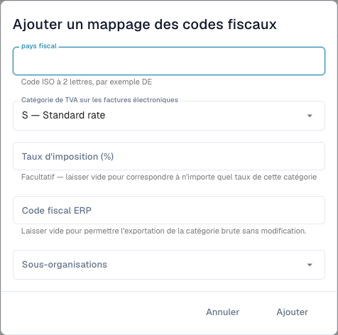

# Associer les catégories de TVA des factures électroniques aux codes ERP

<figure><figcaption>
Formulaire de correspondance fiscale avant l’enregistrement. Certaines descriptions de catégories restent en anglais dans l’interface actuelle ; les codes techniques sont inchangés.
</figcaption></figure>

Une facture électronique peut contenir une catégorie de TVA comme **S** au lieu du code fiscal ERP. La correspondance définit cette conversion. Elle est distincte des corrections de montants fiscaux et des règles de validation.

## Conditions

Vous devez avoir un accès administrateur, le pays fiscal, la catégorie et le taux de la facture ainsi qu'un code ERP valide convenu avec son administrateur. Confirmez organisation et sous-organisation. La page doit exister dans votre version.

## Ajouter et contrôler

1. Ouvrez **Paramètres → Documents électroniques → Correspondance des codes fiscaux** et examinez les entrées.
2. Choisissez **Ajouter un mappage des codes fiscaux**.
3. Saisissez le pays fiscal avec son code ISO à deux lettres, par exemple `DE`.
4. Choisissez la catégorie : **S** taux standard, **Z** taux zéro, **E** exonéré ou **O** hors champ fiscal. Ne les interchangez pas pour contourner une erreur.
5. Saisissez un pourcentage pour un taux précis. Un taux vide accepte tous les taux de cette catégorie, comme indiqué dans le formulaire.
6. Saisissez le code fiscal ERP et les sous-organisations concernées. Un code ERP vide autorise explicitement l'export de la catégorie brute ; utilisez-le seulement si la destination l'accepte.
7. Ajoutez puis vérifiez pays, catégorie, taux, code ERP, périmètre et état actif enregistrés.
8. Testez une facture représentative vers une destination contrôlée. Vérifiez le code réel dans l'ERP et sa réponse, ainsi que le cas d'une correspondance absente/incorrecte.

Une facture allemande `S` à taux `19` exige le code configuré pour ce cas. Prenez le vrai code dans votre ERP ; un exemple n'est pas une valeur de production par défaut.

## Résoudre une erreur

Comparez pays, catégorie, taux, périmètre et activation. Vérifiez la réponse d'intégration avant de répéter un export au résultat incertain. Supprimer la correspondance affecte les opérations futures, sans annuler les exports passés.

Voir [Validation des factures électroniques](validation-rules.md) et [Exportation](../export.md).
