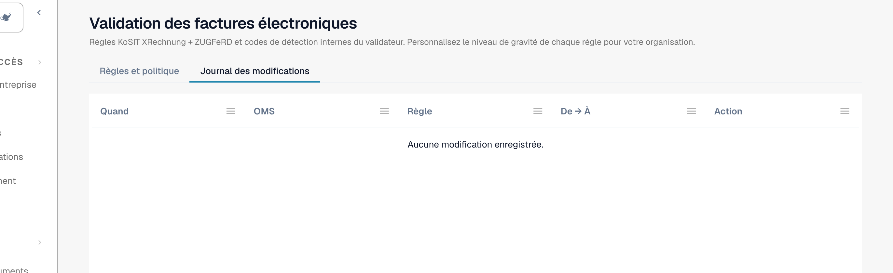

# Journal des modifications

Le **Journal des modifications** enregistre chaque modification des paramètres de validation. Il fait partie de [Validation des factures électroniques](validation-rules.md). Seuls les administrateurs de l'organisation peuvent le consulter.

Ouvrez l'onglet **Journal des modifications** à côté de **Règles et politique**.

<figure><figcaption>
Le journal des modifications avec quatre exemples d'entrées. Le nom de l'utilisateur est remplacé par un nom d'exemple.
</figcaption></figure>

| Colonne | Ce qu'elle affiche |
| --- | --- |
| **Quand** | L'heure de la modification. |
| **OMS** | L'utilisateur qui a effectué la modification. |
| **Règle** | Le paramètre ou la règle modifié. |
| **De → À** | L'ancienne et la nouvelle valeur. |
| **Action** | Le type de modification. Les lignes issues de l'assistant de configuration peuvent être ouvertes pour voir chaque modification. |

La liste affiche 50 entrées par page.

Chaque modification dans le tableau [Validation pour chaque type de document](validation-per-document-type.md) crée une entrée après votre confirmation.
