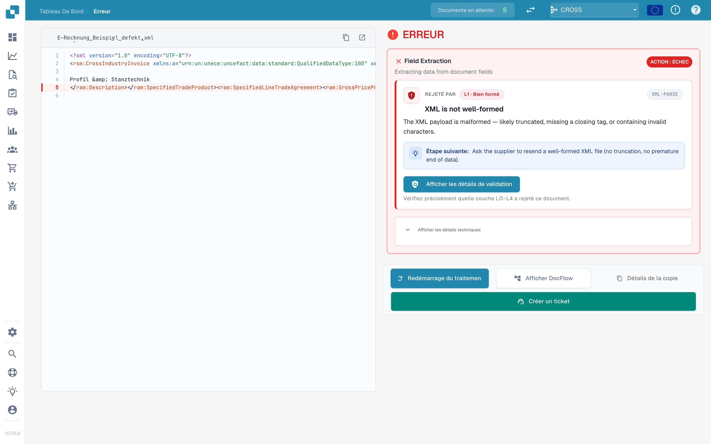
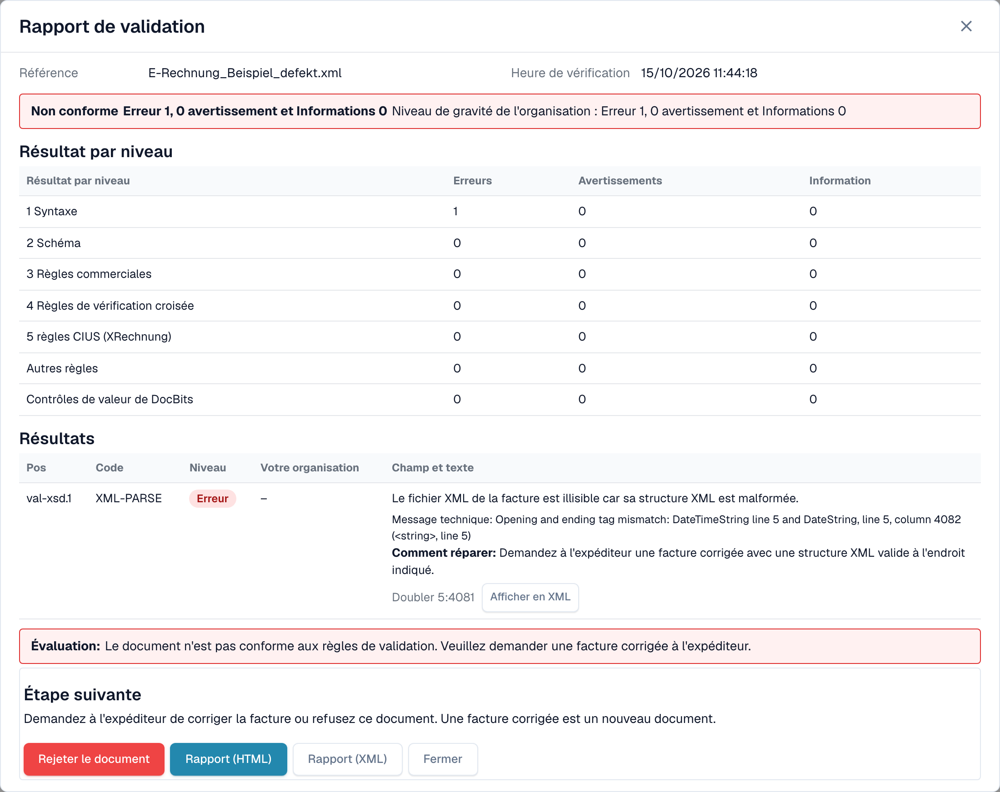

# L'écran d'erreur d'une facture électronique rejetée

Lorsque vous importez une facture électronique erronée, DocBits ne la perd pas. Le document reçoit le statut **Erreur**, et l'écran d'erreur vous indique ce qui ne va pas, où, et ce qu'il faut faire ensuite. Cette page présente deux exemples : un fichier XML mal formé et une facture qui enfreint une règle commerciale.

> Une facture reçoit le statut **Erreur** uniquement lorsque la validation est **activée** et **bloquante** pour son type de document. Voir [Validation pour chaque type de document](validation-per-document-type.md).

## Exemple 1 : le fichier XML est endommagé

Un fournisseur envoie un fichier XML dans lequel une balise fermante ne correspond pas à la balise ouvrante. Le fichier ne peut pas être lu, et DocBits s'arrête donc au premier contrôle, **L1 · Bien formé**.

<figure><figcaption>
L'écran d'erreur d'un fichier XML endommagé. La ligne défectueuse est marquée dans le XML. Fichier d'exemple avec des données fictives.
</figcaption></figure>

L'écran comporte deux parties :

* **À gauche : le fichier XML.** DocBits affiche le fichier avec les numéros de ligne. La ligne qui pose problème est marquée en rouge. Utilisez les boutons au-dessus du fichier pour copier le XML ou l'ouvrir dans un nouvel onglet.
* **À droite : l'explication.** La carte **Rejeté par** indique le contrôle qui a arrêté le fichier (ici **L1 · Bien formé**) et le code de la règle (ici `XML-PARSE`). Vous voyez ensuite un titre (*XML is not well-formed*), une courte explication et le bloc **Étape suivante**. Ces textes s'affichent en anglais dans l'application.

Sélectionnez **Afficher les détails de validation** pour ouvrir le [rapport de validation](validation-report.md) complet.

<figure><figcaption>
Le rapport du fichier endommagé : une erreur au niveau 1 Syntaxe, avec le message technique et la position
</figcaption></figure>

Le rapport indique la position exacte (ici ligne 5, colonne 4081) et fournit le message technique de l'analyseur XML. Sélectionnez **Afficher en XML** pour accéder directement à cette ligne. L'indication **Comment réparer** vous invite à demander un fichier corrigé à l'expéditeur.

## Exemple 2 : la facture enfreint une règle commerciale

Le XML est correct, mais un champ obligatoire est manquant. Par exemple, le vendeur ne peut pas être identifié parce qu'aucun identifiant de vendeur, identifiant d'enregistrement ou identifiant de TVA n'est présent (règle `BR-CO-26`).

<figure><figcaption>
L'écran d'erreur pour une erreur de règle commerciale : la couche <strong>L3 · Règles commerciales</strong>, le code de la règle et une étape suivante
</figcaption></figure>

Ici, la carte indique la couche **L3 · Règles commerciales** et le code `BR-CO-26`. Le rapport liste tous les résultats de la facture, voir [Rapport de validation](validation-report.md).

## Les boutons sous la carte

| Bouton | Ce qu'il fait |
| --- | --- |
| **Redémarrage du traitement** | Relance le traitement du document, par exemple après avoir modifié un paramètre. Le contrôle utilise les paramètres actuels. |
| **Afficher DocFlow** | Affiche le workflow du document. |
| **Détails de la copie** | Copie les détails de l'erreur, par exemple pour un message à votre administrateur. |
| **Créer un ticket** | Ouvre un ticket de support avec les détails de l'erreur. |

Sélectionnez **Afficher les détails techniques** sur la carte pour obtenir les informations techniques brutes.

## Que faire ensuite

* **Erreurs :** demandez une facture corrigée à l'expéditeur, ou [rejetez le document](validation-next-step-and-reject.md). Une facture corrigée est un nouveau document.
* **Uniquement des avertissements :** le document n'est pas bloqué. Vous pouvez continuer.

## Pages associées

* [Rapport de validation](validation-report.md) : tous les résultats, niveau par niveau.
* [Étape suivante et rejet d'un document](validation-next-step-and-reject.md)
* [Validation pour chaque type de document](validation-per-document-type.md) : activer la validation et définir le blocage.
