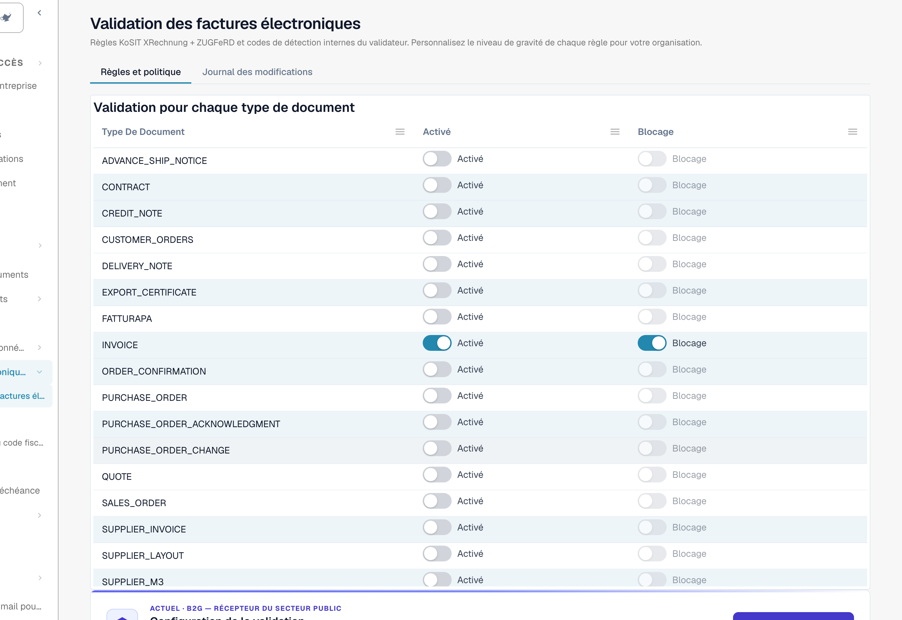
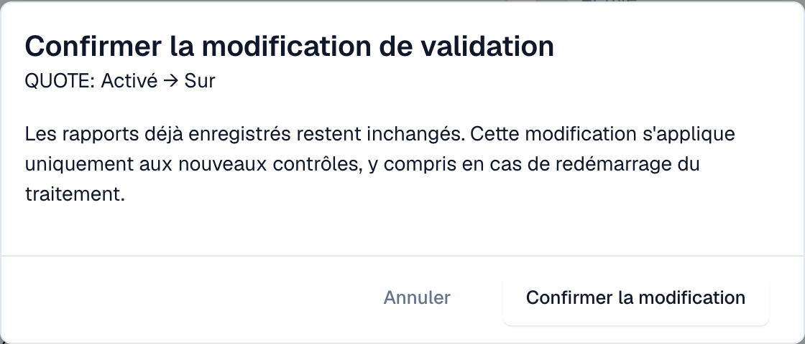

# Validation pour chaque type de document

Les administrateurs décident, pour chaque type de document, si DocBits valide les factures électroniques entrantes et si un contrôle échoué bloque le document. Chaque modification est confirmée et inscrite dans le [journal des modifications](validation-change-log.md).

> Seuls les **administrateurs de l'organisation** peuvent modifier ces paramètres. Les autres utilisateurs voient le tableau en lecture seule, ou ne le voient pas.

## Le tableau

Accédez à **Paramètres → Documents électroniques → Validation des factures électroniques**. L'onglet **Règles et politique** commence par le tableau **Validation pour chaque type de document**.

<figure><figcaption>
Une ligne par type de document avec les interrupteurs Activé et Blocage. Exemple d'organisation.
</figcaption></figure>

| Interrupteur | Ce qu'il fait |
| --- | --- |
| **Activé** | DocBits valide chaque facture électronique entrante de ce type de document et enregistre un [rapport de validation](validation-report.md). |
| **Blocage** | Un résultat de type erreur arrête le document. Il obtient le statut **Erreur**. Lorsque le blocage est désactivé, DocBits enregistre le rapport et le document continue. Vous ne pouvez activer **Blocage** que si **Activé** est activé. |

Si un type de document a des exceptions pour des sous-types, le tableau affiche une remarque à ce sujet.

## Modifier un paramètre

1. Cliquez sur l'interrupteur que vous voulez modifier.
2. DocBits affiche **Confirmer la modification de validation** avec le type de document et la modification, par exemple *QUOTE: Activé → Sur*.

<figure><figcaption>
Chaque modification demande une confirmation
</figcaption></figure>

3. Lisez la remarque : **Les rapports déjà enregistrés restent inchangés.** La modification s'applique uniquement aux nouveaux contrôles, y compris en cas de redémarrage du traitement d'un document.
4. Cliquez sur **Confirmer la modification**, ou sur **Annuler** pour conserver l'ancien paramètre.

Si vous n'avez pas l'autorisation, DocBits affiche un message indiquant qu'un administrateur de l'organisation est requis, et rien ne change.

## Pages associées

* [Validation des factures électroniques](validation-rules.md)
* [Journal des modifications](validation-change-log.md)
* [Configuration de la validation et versions acceptées](validation-setup.md)
* [Rapport de validation](validation-report.md)
* [Activer ou désactiver la validation des factures électroniques](README.md#activer-ou-desactiver-la-validation-des-factures-electroniques)
