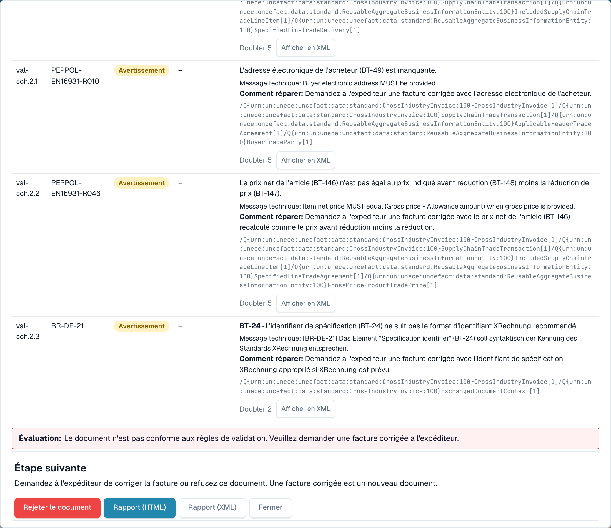
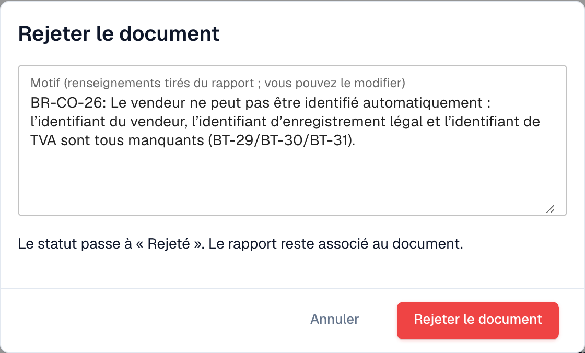

# Étape suivante et rejet d'un document

Après la lecture du [rapport de validation](validation-report.md), le rapport vous indique quoi faire. Vous pouvez aussi rejeter le document.

## Que faire ensuite

<figure><figcaption>
L'évaluation, l'étape suivante et les boutons à la fin du rapport
</figcaption></figure>

L'**Évaluation** indique en une phrase si la facture est conforme. Le bloc **Étape suivante** vous dit quoi faire :

| Résultat                          | Étape suivante                                                                                                      |
| --------------------------------- | ------------------------------------------------------------------------------------------------------------------- |
| Au moins une **erreur**           | Demandez à l'expéditeur une facture corrigée, ou refusez le document. Une facture corrigée est un nouveau document. |
| Uniquement des **avertissements** | Vous pouvez poursuivre avec le document.                                                                            |

Les boutons à la fin du rapport :

* **Rejeter le document** : ouvre la boîte de dialogue de rejet (voir ci-dessous).
* **Rapport (HTML)** et **Rapport (XML)** : téléchargent le rapport, par exemple pour l'envoyer au fournisseur.
* **Fermer** : revient au document.

## Rejeter un document

<figure><figcaption>
Le motif est repris des erreurs du rapport. Vous pouvez le modifier.
</figcaption></figure>

1. Dans le rapport, cliquez sur **Rejeter le document**.
2. Vérifiez le **Motif**. DocBits le remplit à partir des erreurs du rapport. Vous pouvez modifier le texte.
3. Cliquez sur **Rejeter le document** pour confirmer. Le statut passe à **Rejeté**. Le motif est enregistré comme note et le rapport reste associé au document.

Cliquez sur **Annuler** pour laisser le document tel quel.

> Seuls les utilisateurs autorisés à modifier les documents voient **Rejeter le document**. Le bouton est masqué lorsque le document est déjà rejeté ou terminé.
