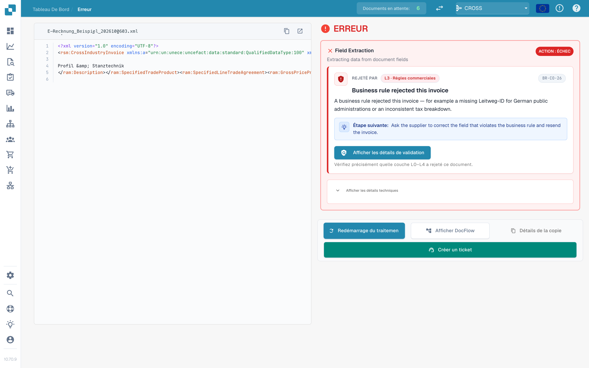
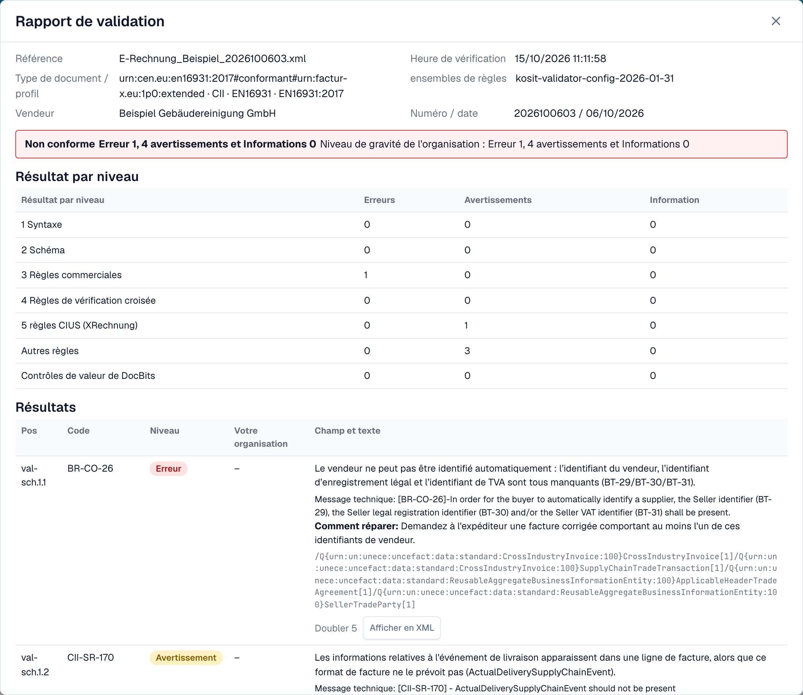
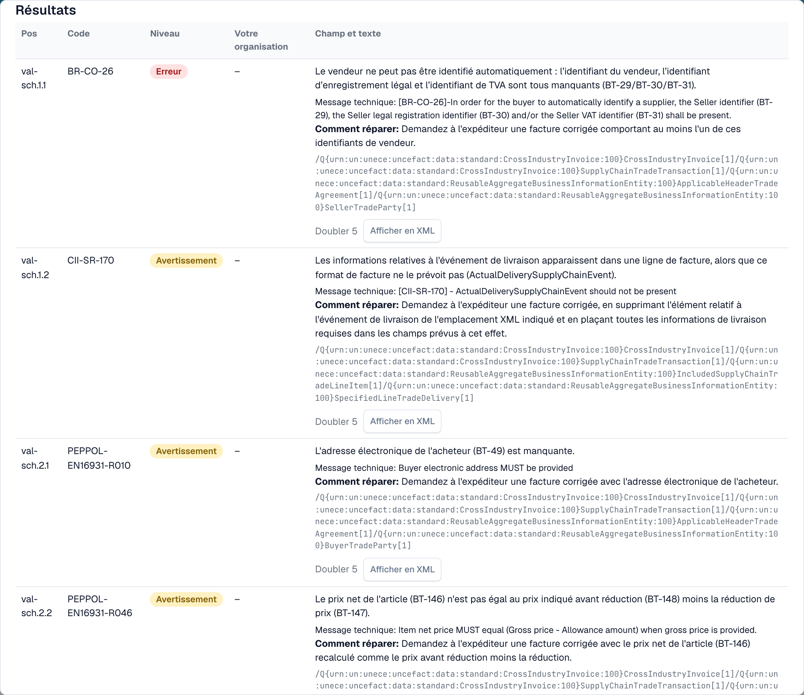

# Rapport de validation

Lorsque DocBits rejette une facture électronique, vous pouvez lire exactement pourquoi. Le **rapport de validation** liste chaque résultat en langage clair, vous indique quoi corriger et affiche l'étape suivante. Vous l'ouvrez depuis le document, pas depuis les paramètres. L'écran où vous le trouvez est décrit dans [L'écran d'erreur d'une facture électronique rejetée](validation-error-screen.md).

Cette page s'adresse aux personnes qui traitent les factures. Les administrateurs définissent les règles sur la page [Validation des factures électroniques](./) et choisissent pour chaque type de document si un contrôle échoué bloque la facture, voir [Validation pour chaque type de document](validation-per-document-type.md).

## Quand un document passe en erreur

Si la validation est **activée** et **bloquante** pour le type de document, une facture avec un résultat bloquant obtient le statut **Erreur**. Ouvrez le document depuis le tableau de bord. La vue d'erreur affiche le XML à gauche et le motif à droite.

<figure><figcaption>
La vue d'erreur : le XML de la facture et le premier résultat bloquant avec une étape suivante. Exemple de facture avec des noms fictifs.
</figcaption></figure>

La carte de droite indique la couche qui a rejeté la facture (par exemple **L3 · Règles commerciales**), le code de la règle (par exemple `BR-CO-26`), une courte explication et une **Étape suivante**. Cliquez sur **Afficher les détails de validation** pour ouvrir le rapport complet.

## Lire le rapport

<figure><figcaption>
Le haut du rapport : données du fichier, verdict et résultat pour chaque niveau
</figcaption></figure>

Le rapport commence par les informations sur le fichier :

| Champ                         | Ce qu'il affiche                                                                          |
| ----------------------------- | ----------------------------------------------------------------------------------------- |
| **Référence**                 | Le nom de fichier de la facture.                                                          |
| **Heure de vérification**     | Le moment où DocBits a exécuté le contrôle. Un rapport enregistré ne change plus ensuite. |
| **Type de document / profil** | Le format de la facture, par exemple CII et EN 16931.                                     |
| **ensembles de règles**       | La version des ensembles de règles utilisés par DocBits.                                  |
| **Vendeur**                   | Le vendeur, lu dans le XML.                                                               |
| **Numéro / date**             | Le numéro et la date de la facture, lus dans le XML.                                      |

Sous ces informations, vous voyez le **verdict**, par exemple **Non conforme**, avec le nombre d'erreurs, d'avertissements et d'informations. Si votre organisation a modifié la gravité d'une règle, une seconde ligne **Niveau de gravité de l'organisation** affiche les nombres selon les paramètres de votre organisation.

### Résultat par niveau

Le tableau **Résultat par niveau** indique combien d'erreurs, d'avertissements et d'informations chaque contrôle a trouvés. Les contrôles s'appuient les uns sur les autres :

| Niveau                               | Ce qu'il vérifie                                                           |
| ------------------------------------ | -------------------------------------------------------------------------- |
| **1 Syntaxe**                        | Le XML est bien formé.                                                     |
| **2 Schéma**                         | La structure respecte le schéma XML officiel.                              |
| **3 Règles commerciales**            | Les champs obligatoires sont présents et corrects (règles `BR-…`).         |
| **4 Règles de vérification croisée** | Les champs sont cohérents entre eux, par exemple les totaux.               |
| **5 règles CIUS (XRechnung)**        | Les règles allemandes supplémentaires de XRechnung.                        |
| **Autres règles**                    | Des règles supplémentaires, par exemple les règles PEPPOL.                 |
| **Contrôles de valeur de DocBits**   | Des contrôles ajoutés par DocBits, par exemple l'IBAN et le numéro de TVA. |

> Pour les factures au profil EN 16931 ou EXTENDED, les règles propres à XRechnung sont affichées comme **avertissements**, et non comme erreurs.

## Les résultats

<figure><figcaption>
Chaque résultat comporte un code, un niveau, un texte lisible et une indication pour le corriger
</figcaption></figure>

Chaque résultat correspond à une ligne :

* **Pos** et **Code** : la position dans le rapport et le code de la règle, par exemple `BR-CO-26`.
* **Niveau** : **Erreur**, **Avertissement** ou **Information**.
* **Votre organisation** : le niveau selon les paramètres de votre organisation. Un tiret signifie que votre organisation n'a pas modifié le niveau.
* **Champ et texte** : le problème en langage clair, le champ concerné (par exemple _BT-29 Seller identifier_), le message technique du validateur et **Comment réparer**.
* **Doubler** et **Afficher en XML** : cliquez sur **Afficher en XML** pour fermer le rapport et accéder à la ligne dans la visionneuse XML.

DocBits propose des textes en langage clair pour les règles les plus courantes. Pour une règle sans texte de ce type, le rapport affiche le message technique du validateur.

## Suite

* [Étape suivante et rejet d'un document](validation-next-step-and-reject.md) : que faire après la lecture du rapport.

## Pages associées

* [Validation des factures électroniques](./) : versions et profils acceptés, gravité de chaque règle.
* [Validation pour chaque type de document](validation-per-document-type.md) : activer la validation et définir le blocage.
* [Routage des notifications](../notification-routing.md) : qui traite quel résultat.
