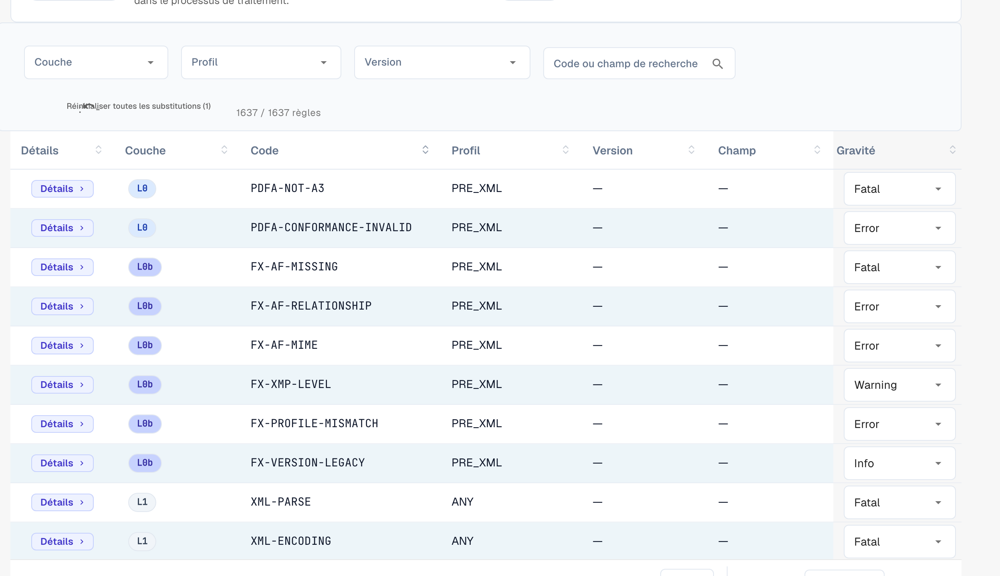

# Gravité des règles

Chaque règle de validation a une gravité. Vous pouvez modifier la gravité de chaque règle pour votre organisation. Cette page fait partie de [Validation des factures électroniques](./). Seuls les administrateurs de l'organisation peuvent modifier les gravités.

<figure><figcaption>
Le tableau complet des règles avec remplacement de gravité par règle
</figcaption></figure>

Le tableau des règles répertorie toutes les règles de validation (plus de 1 600 au total). Filtrez par **Couche (Layer)**, **Profil** ou **Version**, ou recherchez par code ou champ. Pour chaque règle, vous pouvez remplacer la **Gravité** dans le menu déroulant afin de l'adapter à la politique de votre organisation — par exemple, rétrograder une règle de `ERROR` à `WARNING` pour qu'elle ne rejette plus le document.

La signification de **FATAL**, **ERROR**, **WARNING** et **INFO** est expliquée sur [Configuration de la validation et versions acceptées](validation-setup.md#profils-acceptes-et-modele-de-gravite). Une gravité modifiée apparaît aussi dans le [rapport de validation](validation-report.md) dans la colonne **Votre organisation**.
