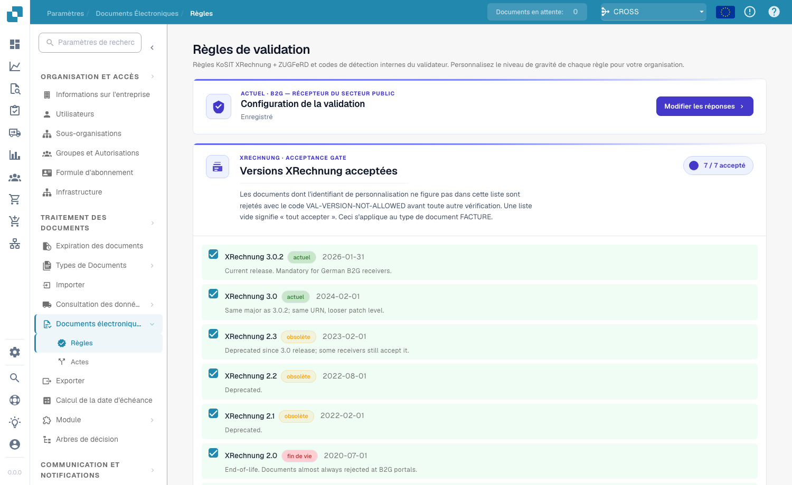
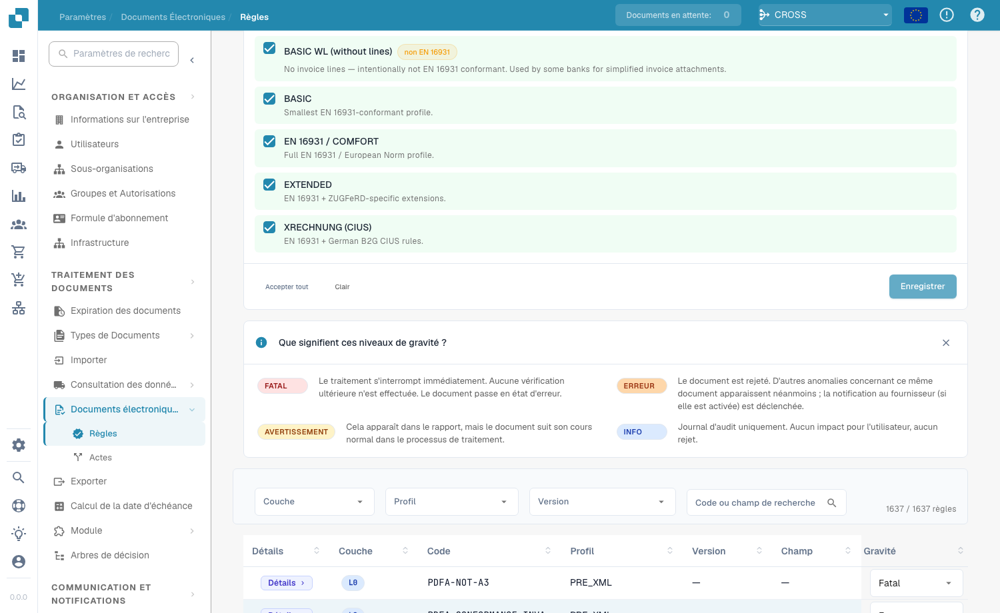

# Configuration de la validation et versions acceptées

Cette page explique l'assistant de configuration, les versions XRechnung acceptées et les profils acceptés de la page [Validation des factures électroniques](validation-rules.md). Seuls les administrateurs de l'organisation peuvent modifier ces paramètres.

## Configuration de la validation

<figure><figcaption>
Configuration de validation et versions XRechnung acceptées
</figcaption></figure>

La carte **Configuration de la validation** affiche votre profil de validation actuel (par exemple *B2G — Public Sector Receiver*). Cliquez sur **Modifier les réponses** pour relancer l'assistant de configuration et changer la norme par rapport à laquelle vous validez.

## Versions XRechnung acceptées

La porte **Versions XRechnung acceptées** répertorie chaque version de XRechnung. Cochez les versions que vous acceptez : les documents dont le CustomizationID est en dehors de cette liste sont rejetés avec `VAL-VERSION-NOT-ALLOWED` avant toute autre vérification. Une liste vide signifie « tout accepter ». Chaque version est étiquetée **current**, **deprecated** ou **EOL** avec sa date de publication.

## Profils acceptés et modèle de gravité

<figure><figcaption>
Profils acceptés et signification de chaque gravité
</figcaption></figure>

Choisissez les **profils** que vous acceptez (BASIC WL, BASIC, EN 16931 / COMFORT, EXTENDED, XRECHNUNG (CIUS)) à l'aide de **Tout accepter** / **Effacer**, puis **Enregistrer**.

Chaque règle de validation a une **gravité** qui détermine ce qui se passe lorsqu'elle se déclenche :

| Gravité | Effet |
|---------|-------|
| **FATAL** | Arrête immédiatement le traitement. Aucune couche suivante n'est vérifiée ; le document passe en Erreur. |
| **ERROR** | Le document est rejeté. Les autres résultats du même document sont tout de même affichés ; la notification au fournisseur (si activée) se déclenche. |
| **WARNING** | Apparaît dans le rapport de validation, mais le document poursuit normalement le flux. |
| **INFO** | Journal d'audit uniquement. Aucun effet visible pour l'utilisateur ni rejet. |

### Ce que modifie l'assistant

La carte **Configuration de la validation** plus bas sur la page ouvre un assistant avec **Modifier les réponses**. L'assistant remplace l'ensemble des règles personnalisées de votre organisation. DocBits vous avertit avant l'enregistrement. Vérifiez attentivement l'étape de révision et d'application.

Suite : [Gravité des règles](validation-rule-severities.md) et [Validation pour chaque type de document](validation-per-document-type.md).
