# Exportation

## Aperçu

La page Exportation affiche toutes les configurations d'exportation configurées, y compris si elles sont actives ou inactives. À partir de là, les utilisateurs peuvent :

* Consulter et gérer les configurations d'exportation existantes
* Créer de nouvelles connexions d'exportation (par exemple, vers **Infor**, **Infor & IDM**, **Webhook** ou **SFTP**)
* Modifier ou supprimer les configurations d'exportation existantes

## Où le trouver

Vous pouvez le trouver sous : **Paramètres** → **Traitement des documents** → **Exportation**

<figure>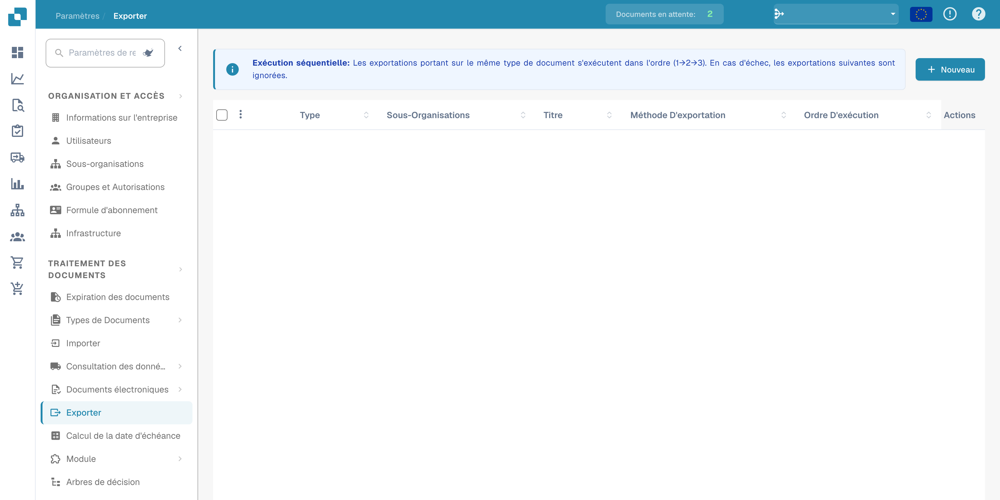<figcaption>
Accès à la configuration des exports depuis les paramètres.
</figcaption></figure>

## **Utilisation de la page Exportation**

Lorsque vous ouvrez la page Exportation, vous verrez une liste de toutes les configurations d'exportation existantes.

Chaque ligne de la liste affiche :

* **Indicateur de statut**
  * **Vert** signifie que l'exportation est active
  * **Rouge** signifie que l'exportation est désactivée
* **Nom** – le nom de la configuration d'exportation
* **Type de document** – le type de document pour lequel l'exportation est configurée
* **Sous-organisation** – si l'exportation est limitée à une sous-organisation spécifique
* **Méthode d'exportation** – où le document sera envoyé (par exemple, Infor, IDM, SFTP)
* **Actes** – boutons pour **modifier, supprimer** ou **activer/désactiver** la configuration

#### **Règles importantes pour la configuration d'exportation**

Pour chaque **type de document** **au sein d'une organisation ou sous-organisation donnée**, les règles suivantes s'appliquent :

* Vous ne pouvez avoir qu'**une seule exportation Infor active**
* Vous ne pouvez avoir qu'**une seule exportation non-Infor active** (par exemple, Webhook, SFTP)

Cependant, il est possible d'avoir :

* **Une exportation Infor active** _et_ **une exportation non-Infor active** en même temps pour le même type de document
* **Différentes configurations d'exportation pour différentes sous-organisations** — par exemple, une exportation Infor pour Sous-Org A et une autre exportation Infor pour Sous-Org B

## **Créer une nouvelle exportation**

Pour créer une nouvelle exportation :

1. Cliquez sur le bouton **« Nouveau »**.

<figure>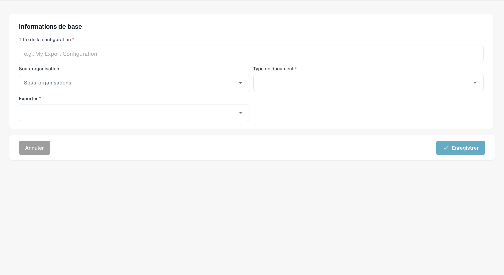<figcaption>
Brouillon non enregistré d’une configuration d’export.
</figcaption></figure>

2. Sélectionnez le **Type d'exportation** que vous souhaitez configurer (par exemple, Infor, IDM, SFTP).
3. Remplissez les champs requis en fonction du type d'exportation.
4. Enregistrez la configuration.

## Options d'exportation

#### Webhook

Webhook

<figure>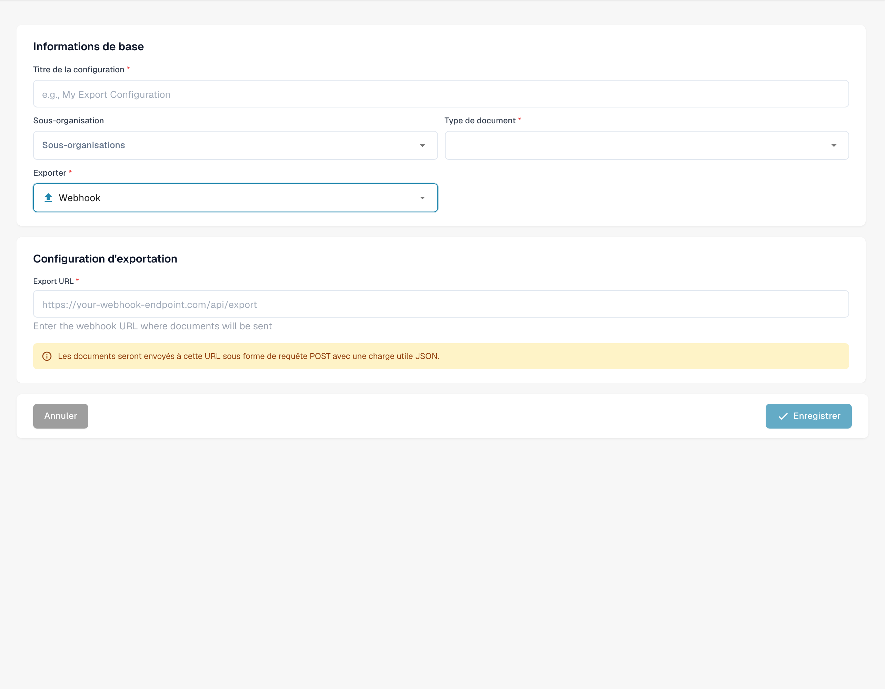<figcaption>
Brouillon de configuration d’export par Webhook.
</figcaption></figure>

**Descriptions des champs**

* **Titre** Le nom de la configuration d'exportation. Il apparaîtra dans la liste des exportations.
* **Sous-organisation** _(optionnel)_ Un menu déroulant avec toutes les sous-organisations disponibles.
  * Si laissé vide : s'applique à l'organisation principale.
  * Si sélectionné : l'exportation ne s'appliquera qu'à la sous-organisation choisie.
* **Type de document** Menu déroulant listant tous les types de documents disponibles. Cela détermine à quel type de document cette configuration d'exportation s'applique.
* **Export URL** L'URL de destination où le document doit être exporté.

#### SFTP

SFTP

<figure>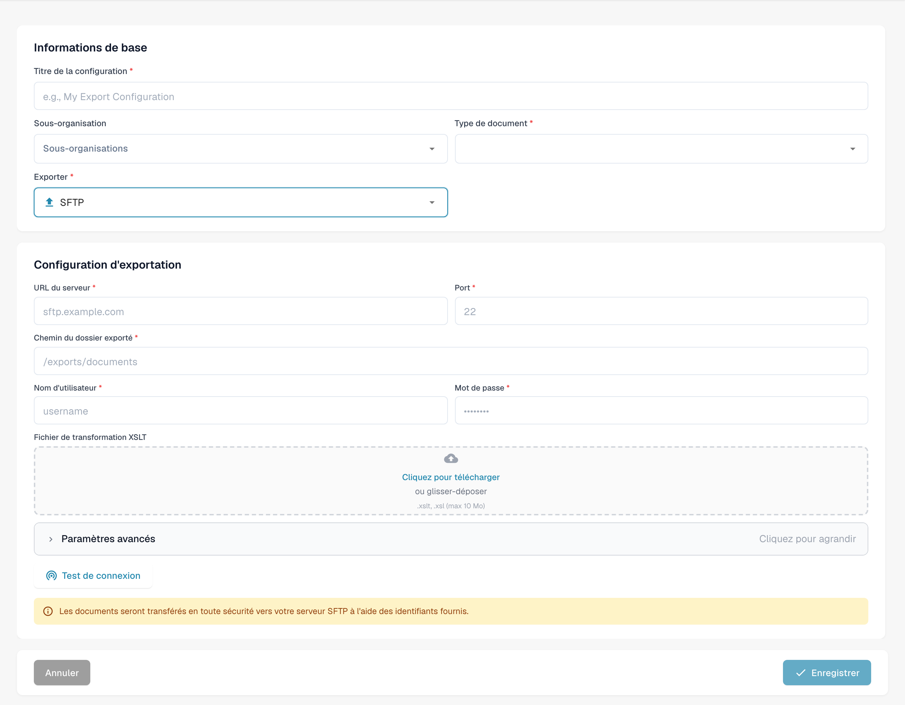<figcaption>
Brouillon de configuration d’export par SFTP.
</figcaption></figure>

**Descriptions des champs**

* **Titre** Le nom de la configuration d'exportation. Il apparaîtra dans la liste des exportations.
* **Sous-organisation** _(optionnel)_ Un menu déroulant avec toutes les sous-organisations disponibles.
  * Si laissé vide : s'applique à l'organisation principale.
  * Si sélectionné : l'exportation ne s'appliquera qu'à la sous-organisation choisie.
* **Type de document** Menu déroulant listant tous les types de documents disponibles. Cela détermine à quel type de document cette configuration d'exportation s'applique.
* **Nom d'utilisateur** Le nom d'utilisateur utilisé pour s'authentifier auprès du serveur SFTP.
* **Mot de passe** Le mot de passe correspondant pour le compte SFTP. Assurez-vous que le compte dispose d'un accès en écriture au dossier spécifié.
* **URL du serveur** Le nom d'hôte ou l'adresse IP du serveur SFTP cible.
* **Port** Le port utilisé pour se connecter au serveur SFTP.
* **Dossier** Le chemin sur le serveur SFTP où les documents doivent être téléchargés (par exemple, `/incoming/invoices/`). Doit exister et être accessible en écriture.
*   **XSLT File (Optionnel)**

    Le **fichier XSLT** permet la transformation du format d'exportation par défaut de DocBits.

    * **Quand l'utiliser :** Uniquement si le système récepteur nécessite une structure différente ou un formatage spécifique différent du format par défaut de DocBits.
    * **Laissez-le vide** si le format d'exportation par défaut répond aux exigences.

**Paramètres avancés :**

* **Mode d'exportation du nom de fichier** Spécifie si le fichier exporté conserve son nom de fichier original ou est renommé en utilisant l'ID de document DocBits.
* **Inclure l'historique du document** Lorsqu'il est activé, le fichier exporté inclura l'historique du document basé sur les journaux disponibles dans le tableau de bord.

<figure>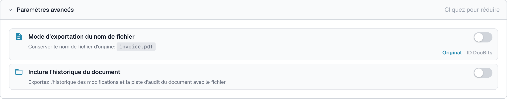<figcaption>
Options avancées d’export SFTP non enregistrées.
</figcaption></figure>

#### Exportation Infor vers SFTP

Exportation Infor vers SFTP

<figure>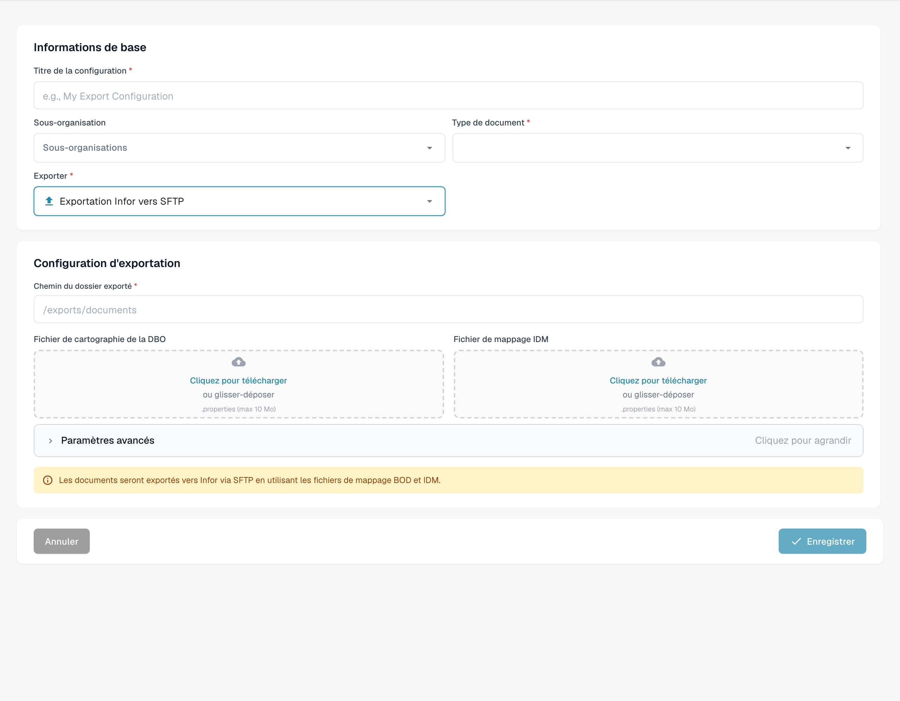<figcaption>
Brouillon d’export par Infor SFTP.
</figcaption></figure>

**Descriptions des champs**

* **Titre** Le nom de la configuration d'exportation. Il apparaîtra dans la liste des exportations.
* **Sous-organisation** _(optionnel)_ Un menu déroulant avec toutes les sous-organisations disponibles.
  * Si laissé vide : s'applique à l'organisation principale.
  * Si sélectionné : l'exportation ne s'appliquera qu'à la sous-organisation choisie.
* **Type de document** Menu déroulant listant tous les types de documents disponibles. Cela détermine à quel type de document cette configuration d'exportation s'applique.
* **Fichier de mappage IDM** Sélectionnez un fichier de mappage dans le gestionnaire de fichiers. [Besoin d'aide pour en créer un ? Consultez le Guide de Mappage IDM](../../../infor-integration-and-configuration/exporting-to-infor/creating-an-idm-mapping-file.md)
* **Fichier de cartographie de la DBO** Sélectionnez un fichier de mappage dans le gestionnaire de fichiers. [Besoin d'aide pour en créer un ? Consultez le Guide de Mappage BOD](../../../infor-integration-and-configuration/exporting-to-infor/creating-a-bod-mapping-file.md)
* **Dossier** Le chemin sur le serveur SFTP où les documents doivent être téléchargés (par exemple, `/incoming/invoices/`). Doit exister et être accessible en écriture.

#### **SMB**

SMB

<figure>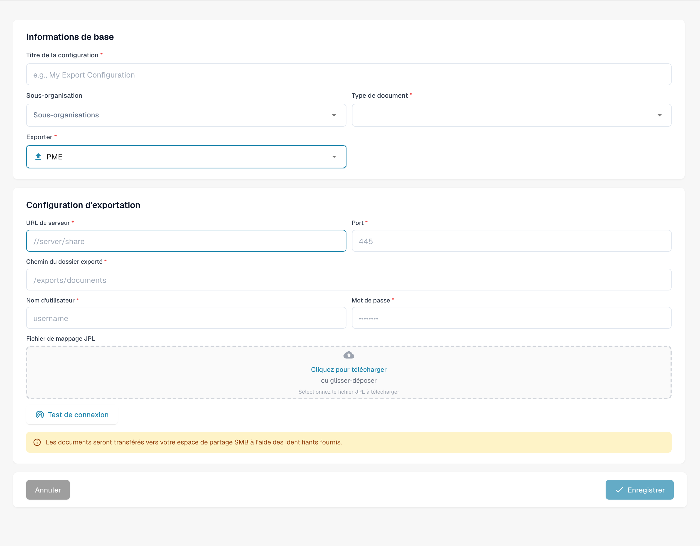<figcaption>
Brouillon d’export par SMB ; conservez le protocole prévu.
</figcaption></figure>

**Descriptions des champs**

* **Titre** Le nom de la configuration d'exportation. Il apparaîtra dans la liste des exportations.
* **Sous-organisation** _(optionnel)_ Un menu déroulant avec toutes les sous-organisations disponibles.
  * Si laissé vide : s'applique à l'organisation principale.
  * Si sélectionné : l'exportation ne s'appliquera qu'à la sous-organisation choisie.
* **Type de document** Menu déroulant listant tous les types de documents disponibles. Cela détermine à quel type de document cette configuration d'exportation s'applique.
* **Nom d'utilisateur** Le nom d'utilisateur utilisé pour se connecter au partage SMB.
* **Mot de passe** Le mot de passe correspondant pour l'authentification SMB.
* **URL du serveur** L'adresse du serveur SMB.
* **Port** Numéro de port utilisé pour accéder au partage SMB.
* **Dossier** Le chemin du dossier dans le partage SMB où les documents doivent être enregistrés (par exemple, `/incoming/invoices/`). Doit exister et être accessible en écriture.
*   **JPL Mapping File (Optionnel)**

    Le **fichier JPL** est utilisé pour définir une transformation des données exportées avant qu'elles ne soient écrites dans le partage SMB.

    * **Quand l'utiliser :** Uniquement lorsque les données du document exporté doivent être ajustées pour correspondre au formatage externe ou aux attentes du système.
    * **Laissez-le vide** si aucune transformation n'est nécessaire.

#### **Infor IDM**

Infor IDM

<figure>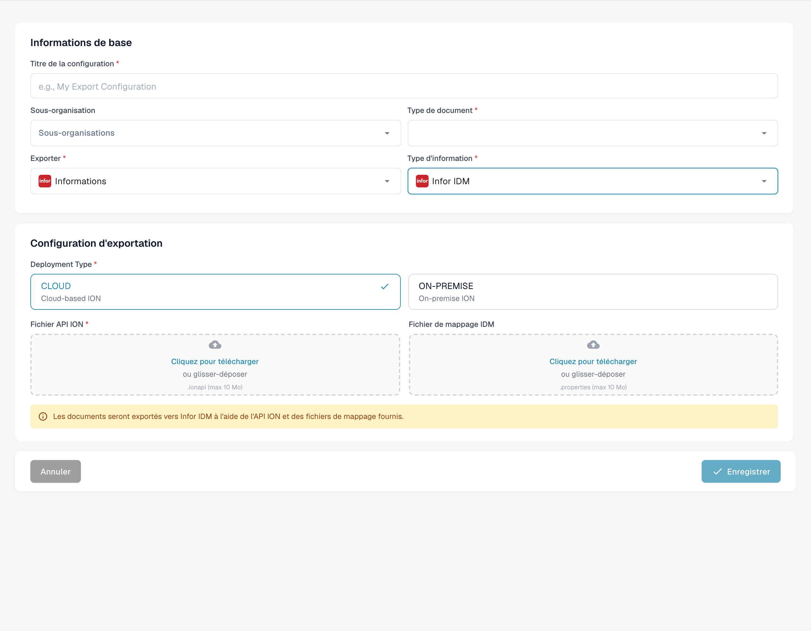<figcaption>
Brouillon d’export vers Infor IDM.
</figcaption></figure>

**Descriptions des champs**

* **Titre** Le nom de la configuration d'exportation. Il apparaîtra dans la liste des exportations.
* **Sous-organisation** _(optionnel)_ Un menu déroulant avec toutes les sous-organisations disponibles.
  * Si laissé vide : s'applique à l'organisation principale.
  * Si sélectionné : l'exportation ne s'appliquera qu'à la sous-organisation choisie.
* **Type de document** Menu déroulant listant tous les types de documents disponibles. Cela détermine à quel type de document cette configuration d'exportation s'applique.
* **Fichier de mappage ION** Sélectionnez un fichier de mappage dans le gestionnaire de fichiers.
* **Fichier de mappage IDM** Sélectionnez un fichier de mappage dans le gestionnaire de fichiers. [Besoin d'aide pour en créer un ? Consultez le Guide de Mappage IDM](../../../infor-integration-and-configuration/exporting-to-infor/creating-an-idm-mapping-file.md)
* **Cloud / On-Prem Toggle** Un commutateur pour indiquer le type de déploiement Infor :
  * **Déploiement dans le cloud** : Sélectionnez ceci si vous êtes client Infor CloudSuite.
  * **On-Prem** : Sélectionnez ceci si Infor est auto-hébergé.

#### **Infor ION**

Infor ION

<figure>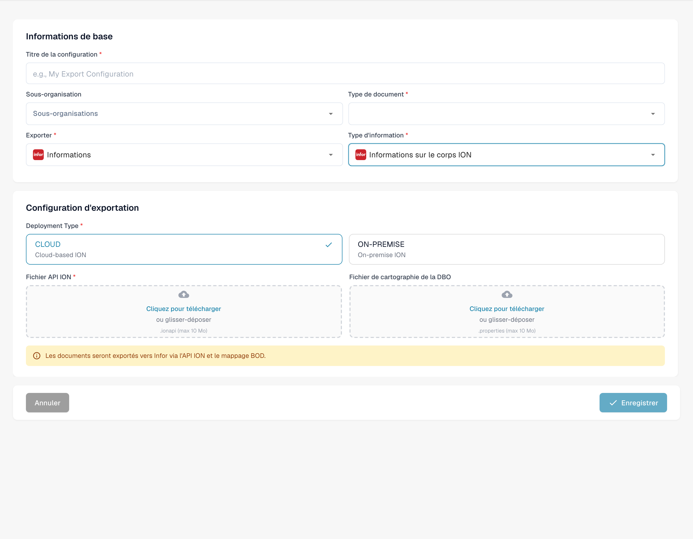<figcaption>
Brouillon d’export vers Infor ION.
</figcaption></figure>

**Descriptions des champs**

* **Titre** Le nom de la configuration d'exportation. Il apparaîtra dans la liste des exportations.
* **Sous-organisation** _(optionnel)_ Un menu déroulant avec toutes les sous-organisations disponibles.
  * Si laissé vide : s'applique à l'organisation principale.
  * Si sélectionné : l'exportation ne s'appliquera qu'à la sous-organisation choisie.
* **Type de document** Menu déroulant listant tous les types de documents disponibles. Cela détermine à quel type de document cette configuration d'exportation s'applique.
* **Fichier de mappage ION** Sélectionnez un fichier de mappage dans le gestionnaire de fichiers.
* **Fichier de cartographie de la DBO** Sélectionnez un fichier de mappage dans le gestionnaire de fichiers. [Besoin d'aide pour en créer un ? Consultez le Guide de Mappage BOD](../../../infor-integration-and-configuration/exporting-to-infor/creating-a-bod-mapping-file.md)
* **Cloud / On-Prem Toggle** Un commutateur pour indiquer le type de déploiement Infor :
  * **Déploiement dans le cloud** : Sélectionnez ceci si vous êtes client Infor CloudSuite.
  * **On-Prem** : Sélectionnez ceci si Infor est auto-hébergé.

#### Infor IDM + ION BOD

Infor IDM + ION BOD

<figure>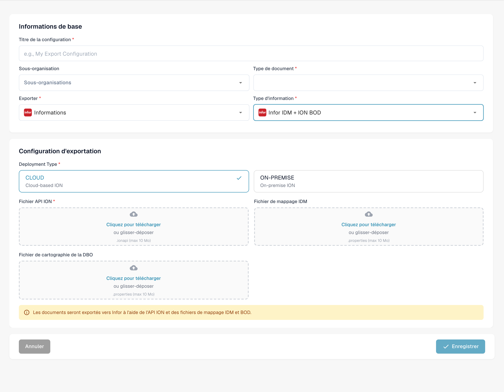<figcaption>
Brouillon d’export vers Infor IDM ION BOD.
</figcaption></figure>

**Descriptions des champs**

* **Titre** Le nom de la configuration d'exportation. Il apparaîtra dans la liste des exportations.
* **Sous-organisation** _(optionnel)_ Un menu déroulant avec toutes les sous-organisations disponibles.
  * Si laissé vide : s'applique à l'organisation principale.
  * Si sélectionné : l'exportation ne s'appliquera qu'à la sous-organisation choisie.
* **Type de document** Menu déroulant listant tous les types de documents disponibles. Cela détermine à quel type de document cette configuration d'exportation s'applique.
* **Fichier de mappage ION** Sélectionnez un fichier de mappage dans le gestionnaire de fichiers.
* **Fichier de mappage IDM** Sélectionnez un fichier de mappage dans le gestionnaire de fichiers. [Besoin d'aide pour en créer un ? Consultez le Guide de Mappage IDM](../../../infor-integration-and-configuration/exporting-to-infor/creating-an-idm-mapping-file.md)
* **Fichier de cartographie de la DBO** Sélectionnez un fichier de mappage dans le gestionnaire de fichiers. [Besoin d'aide pour en créer un ? Consultez le Guide de Mappage BOD](../../../infor-integration-and-configuration/exporting-to-infor/creating-a-bod-mapping-file.md)
* **Cloud / On-Prem Toggle** Un commutateur pour indiquer le type de déploiement Infor :
  * **Déploiement dans le cloud** : Sélectionnez ceci si vous êtes client Infor CloudSuite.
  * **On-Prem** : Sélectionnez ceci si Infor est auto-hébergé.

### Pour les clients Infor CloudSuite

#### Infor IDM + LN

Infor IDM + LN

<figure>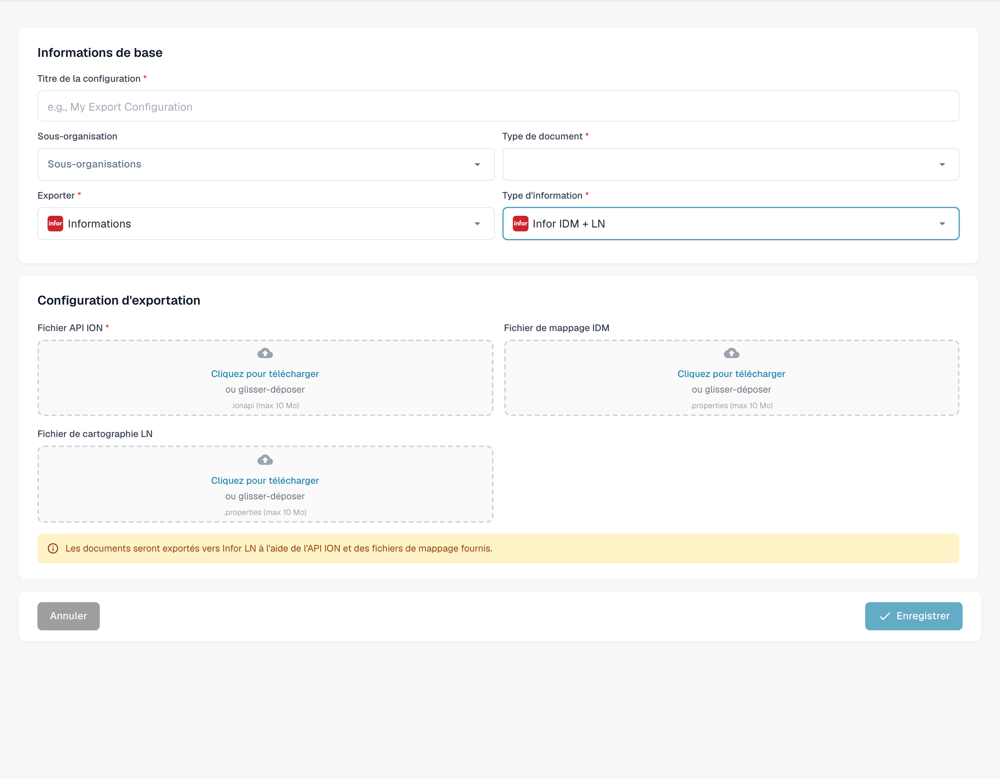<figcaption>
Brouillon d’export vers Infor IDM LN.
</figcaption></figure>

**Descriptions des champs**

* **Titre** Le nom de la configuration d'exportation. Il apparaîtra dans la liste des exportations.
* **Sous-organisation** _(optionnel)_ Un menu déroulant avec toutes les sous-organisations disponibles.
  * Si laissé vide : s'applique à l'organisation principale.
  * Si sélectionné : l'exportation ne s'appliquera qu'à la sous-organisation choisie.
* **Type de document** Menu déroulant listant tous les types de documents disponibles. Cela détermine à quel type de document cette configuration d'exportation s'applique.
* **Fichier de mappage ION** Sélectionnez un fichier de mappage dans le gestionnaire de fichiers.
* **Fichier de mappage IDM** Sélectionnez un fichier de mappage dans le gestionnaire de fichiers. [Besoin d'aide pour en créer un ? Consultez le Guide de Mappage IDM](../../../infor-integration-and-configuration/exporting-to-infor/creating-an-idm-mapping-file.md)
* **Fichier de cartographie LN** Sélectionnez un fichier de mappage dans le gestionnaire de fichiers. [Besoin d'aide pour en créer un ? Consultez l'Exemple de Mappage LN](../../../infor-integration-and-configuration/exporting-to-infor/ln/example-export-ln/)

#### Infor IDM + M3

Infor IDM + M3

<figure>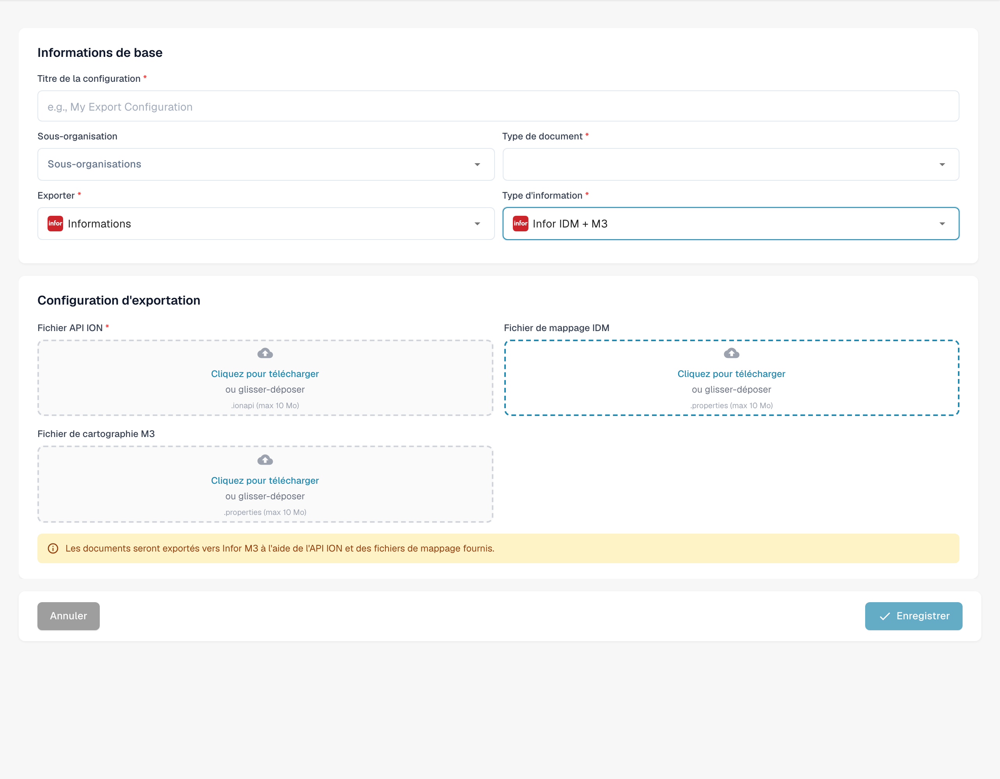<figcaption>
Brouillon d’export vers Infor IDM M3.
</figcaption></figure>

**Descriptions des champs**

* **Titre** Le nom de la configuration d'exportation. Il apparaîtra dans la liste des exportations.
* **Sous-organisation** _(optionnel)_ Un menu déroulant avec toutes les sous-organisations disponibles.
  * Si laissé vide : s'applique à l'organisation principale.
  * Si sélectionné : l'exportation ne s'appliquera qu'à la sous-organisation choisie.
* **Type de document** Menu déroulant listant tous les types de documents disponibles. Cela détermine à quel type de document cette configuration d'exportation s'applique.
* **Fichier de mappage ION** Sélectionnez un fichier de mappage dans le gestionnaire de fichiers.
* **Fichier de mappage IDM** Sélectionnez un fichier de mappage dans le gestionnaire de fichiers. [Besoin d'aide pour en créer un ? Consultez le Guide de Mappage IDM](../../../infor-integration-and-configuration/exporting-to-infor/creating-an-idm-mapping-file.md)
* **Fichier de cartographie M3** Sélectionnez un fichier de mappage dans le gestionnaire de fichiers. [Besoin d'aide pour en créer un ? Consultez l'Exemple de Mappage M3](../../../infor-integration-and-configuration/exporting-to-infor/m3/example-export-m3.md)

#### Infor IDM + M3 (toml)

Infor IDM + M3 (toml)

<figure>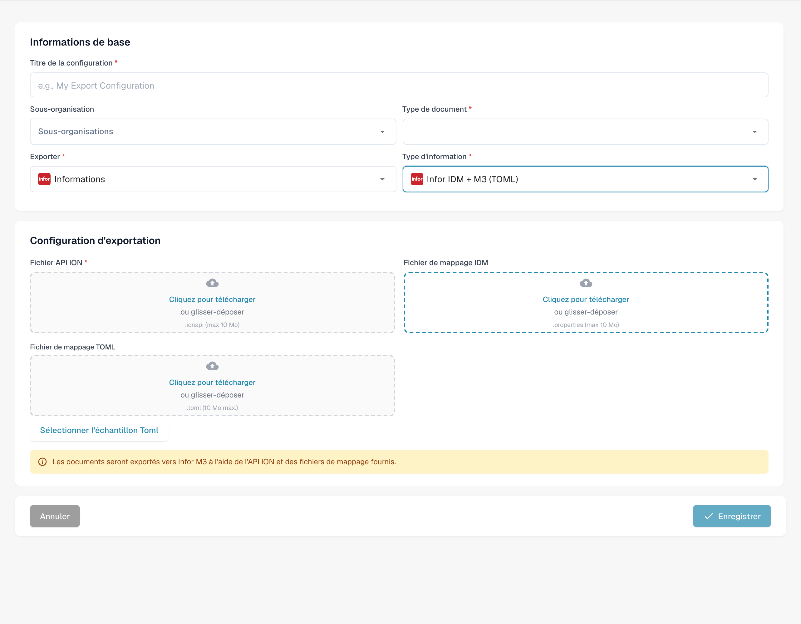<figcaption>
Brouillon d’export vers Infor IDM M3 avec TOML.
</figcaption></figure>

**Descriptions des champs**

* **Titre** Le nom de la configuration d'exportation. Il apparaîtra dans la liste des exportations.
* **Sous-organisation** _(optionnel)_ Un menu déroulant avec toutes les sous-organisations disponibles.
  * Si laissé vide : s'applique à l'organisation principale.
  * Si sélectionné : l'exportation ne s'appliquera qu'à la sous-organisation choisie.
* **Type de document** Menu déroulant listant tous les types de documents disponibles. Cela détermine à quel type de document cette configuration d'exportation s'applique.
* **Fichier de mappage ION** Sélectionnez un fichier de mappage dans le gestionnaire de fichiers.
* **Fichier de mappage IDM** Sélectionnez un fichier de mappage dans le gestionnaire de fichiers. [Besoin d'aide pour en créer un ? Consultez le Guide de Mappage IDM](../../../infor-integration-and-configuration/exporting-to-infor/creating-an-idm-mapping-file.md)
* **Fichier de mappage M3 TOML** Sélectionnez un fichier de mappage dans le gestionnaire de fichiers ou utilisez l'option sélectionner Toml pour utiliser un toml créé avec le gestionnaire de règles. [Besoin d'aide pour en créer un ? Consultez le Guide du Gestionnaire de Règles](rule-manager/)

## Tutoriel vidéo: Configurer et tester un export ERP

Le personnage et la voix sont synthétiques. La capture montre la véritable interface de test DocBits avec des factures de formation synthétiques.


Configurer et tester un export ERP


[Voir avec sous-titres et chapitres](https://docbits-videos.fra1.cdn.digitaloceanspaces.com/settings-assistant/erp-export-admin/v1/fr.html)

Certains libellés natifs peuvent rester dans une autre langue. Les identifiants techniques des champs sont conservés.

J’utilise une configuration et un type de document réservés au test. Les factures contiennent des données fictives. Notre récepteur de test vérifie la transmission des données, sans effectuer de comptabilisation dans un ERP de production. Je ne modifie pas les autres intégrations.

Dans la configuration d'exportation, je vérifie le type de document, l'organisation et le type d'exportation. Cet exemple utilise Generic API dans le cloud. Les identifiants JSON et le mappage de champs TOML sont des fichiers séparés. Dans les vrais projets, le système cible, les permissions et la sous-organisation doivent correspondre au processus prévu.

<figure>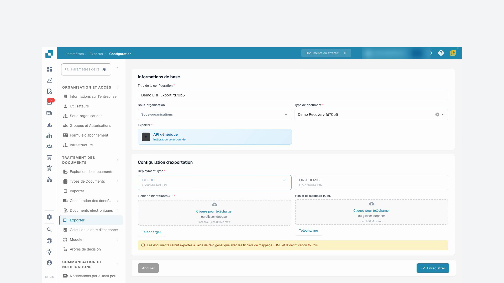<figcaption>
Configuration d’export limitée au type de document de formation
</figcaption></figure>

Dans le mappage corrigé, le champ DocBits invoice_id fournit le numéro de facture envoyé au récepteur de test. Le fournisseur, le montant total et la devise sont aussi associés. Ce test porte sur les données d’en-tête. Les lignes de facture et la comptabilisation ERP demandent des contrôles métier distincts pour chaque projet.

J'importe le fichier TOML corrigé et j'enregistre la configuration. Ensuite, je la rouvre et je vérifie que la modification est enregistrée. Les identifiants de test restent inchangés ; les identifiants de production ne doivent pas apparaître dans la vidéo.

Je reviens à la facture de test dont l’exportation a échoué et je redémarre l’exportation exactement une fois. J’attends la fin du traitement. L’acceptation de la demande ne prouve pas à elle seule que la transmission a réussi.

DocBits affiche maintenant la facture comme terminée. Je vérifie aussi l'accusé de réception du récepteur de test. Le numéro de facture, le fournisseur, le montant et la devise correspondent à la facture de test. L’authentification et la transmission ont réussi. Le récepteur de test ne confirme aucune comptabilisation dans l’ERP.

<figure>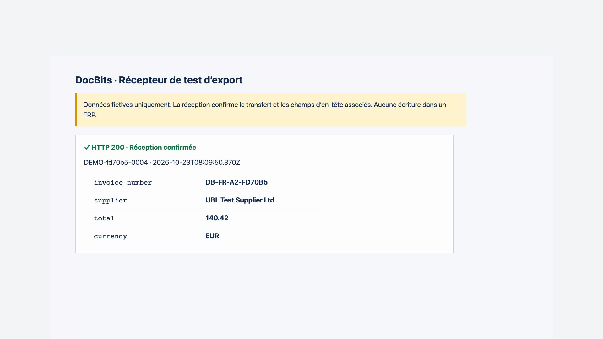<figcaption>
Réception réelle par le destinataire de test ; aucune écriture dans l’ERP
</figcaption></figure>
