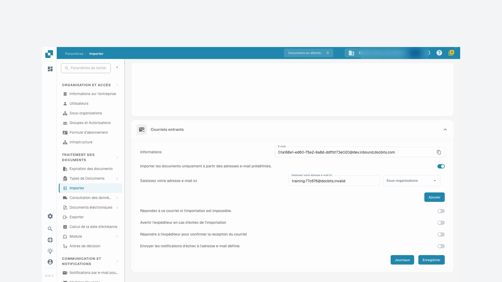
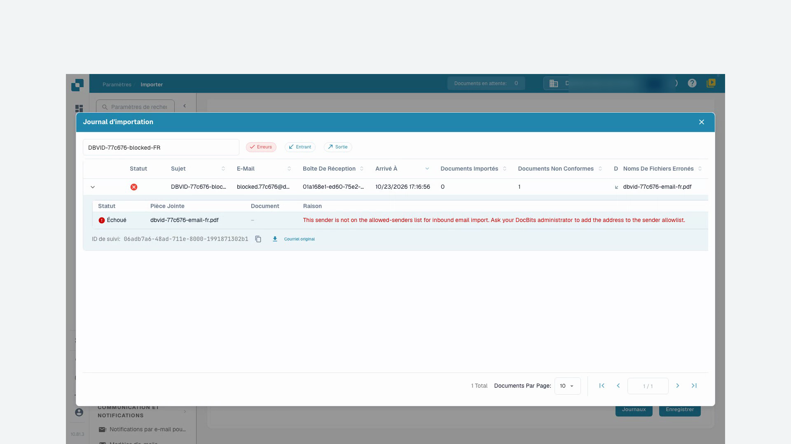

# Importation

Les paramètres d’importation déterminent le traitement des documents et permettent de configurer leur réception automatique par FTP ou par e-mail. Ouvrez **Paramètres → Traitement des documents → Importation**.

## Options des documents

Vérifiez la limite de pages, le délai de paiement par défaut en jours et le format de date. Les pages dépassant la limite configurée peuvent être supprimées. La valeur par défaut documentée pour cette fonction est de 60 pages ; confirmez la configuration de votre organisation avant l’importation.

## Importation FTP

Un serveur FTP compatible, des identifiants autorisés et un dossier d’importation dédié accessible au compte du serveur sont nécessaires.

<figure><figcaption>
Vue d’ensemble des connexions d’import FTP.
</figcaption></figure>

### Configurer une connexion

Créez une connexion. L’assistant commence par la configuration du serveur, puis propose les options et la configuration d’importation.

<figure><figcaption>
Configuration du serveur dans l’assistant d’import FTP.
</figcaption></figure>

| Paramètre | Signification |
| --- | --- |
| Protocole et port | Choisissez FTP, FTPS ou SFTP et le port confirmé par l’administrateur du serveur. |
| Serveur et identifiants | Adresse du serveur et compte autorisé à lire le dossier d’importation. |
| Motifs de noms de fichiers | Limitent l’importation aux noms correspondants. |
| Sous-organisation | Détermine l’affectation des documents importés. |
| Clé API | Si elle est proposée, elle doit correspondre à la bonne organisation. Ne publiez pas sa valeur. |
| Dossier principal et dossier d’importation | Indiquent l’emplacement des fichiers sur le serveur. |
| Archivage après importation | Déplace les fichiers correctement importés vers le dossier d’archive indiqué. Le compte doit disposer des droits nécessaires. |
| Inclure les sous-dossiers | Étend la recherche aux dossiers enfants. |

Vérifiez toutes les étapes avant d’enregistrer. Confirmez ensuite séparément si la connexion est active. Les actions disponibles comprennent le test de connexion, les journaux, l’activation, la désactivation, la modification et la suppression. Consultez le résultat du test et les journaux avant l’importation régulière. Les images montrent la liste et le début de l’assistant sans enregistrement, pas une connexion au serveur vérifiée.

## Importation des e-mails {#email-import}

Une connexion récupère les documents d’une boîte propre par IMAP ou OAuth Microsoft365. Le transfert vers une adresse fournie par DocBits est une méthode distincte ; consultez [E-mails entrants](../module/inbound-emails.md).

### Pièces jointes prises en charge

Les types importés comprennent `.pdf`, `.tiff` / `.tif`, `.eml`, `.dat`, `.xml`, `.edi` et `.purchaseorder`.

Outre le type déclaré par le serveur de messagerie, DocBits reconnaît les documents par leur contenu réel. Cela compte lorsqu’une pièce jointe transférée reçoit le type générique `application/octet-stream` au lieu de `application/pdf` ou `application/xml`.

* Les messages `.eml` transférés et les pièces jointes Outlook `winmail.dat` (TNEF) sont décompressés pour importer les documents contenus.
* Un XML de type générique est reconnu par la déclaration `<?xml`, avec un BOM initial UTF-8 ou UTF-16 (LE/BE). Actuellement, seules ces codifications BOM sont détectées automatiquement par le contenu. Un nom se terminant par `.xml` permet l’importation indépendamment de l’encodage.
* Les images intégrées, comme les logos de signature et les graphiques PNG, JPG, GIF ou BMP, sont ignorées et ne comptent pas comme échecs d’importation.
* Si l’adresse entrante active une réponse en cas d’échec d’importation, la notification est envoyée à l’adresse de réponse configurée.

### Connexion IMAP

Créez une connexion dans la section d’importation des e-mails et choisissez IMAP. Vérifiez le chiffrement SSL ou TLS, le serveur, le port, le nom de configuration ou d’utilisateur, l’adresse e-mail et le mot de passe. Sélectionnez la sous-organisation et l’adresse des notifications d’erreur. Si une clé API apparaît, confirmez le contexte de l’organisation.

Après création, vous pouvez sélectionner le dossier de messagerie et le déplacement des messages traités vers un autre dossier. Si ces options ne sont pas encore disponibles, modifiez la connexion enregistrée. Selon la configuration, vous pouvez aussi fusionner les documents joints, envoyer une confirmation à l’expéditeur et bloquer les noms de fichiers en double. Vérifiez l’objet et le message de confirmation avant de l’activer.

L’enregistrement et l’activation sont distincts. Le menu peut proposer le test de connexion, les journaux de connexion et d’importation, la modification, l’activation, la désactivation et la suppression.

### OAuth Office365

Créez une connexion e-mail et choisissez OAuth Office365. Lancez l’authentification Microsoft. Si un code d’appareil apparaît, copiez celui de DocBits dans la page Microsoft indiquée et connectez-vous au bon compte. Revenez dans DocBits pour terminer l’authentification.

Vérifiez la sous-organisation, le dossier, la boîte partagée facultative, le dossier de destination des messages traités et l’adresse des notifications d’erreur. Confirmez aussi l’acheminement vers DocBits ou AI Workforce si cette option est proposée. Enregistrez puis choisissez le moment d’activer ou de lancer l’importation. OAuth Office365 – Tenant exige les données d’inscription de l’application de l’organisation ; confirmez-les avec l’administrateur et consultez [E-mails entrants](../module/inbound-emails.md).

### Journaux d’importation

Les journaux de connexion aident à diagnostiquer les communications ; les journaux d’importation montrent les résultats antérieurs. Le journal agrégé de la section e-mail couvre les connexions configurées. Vous pouvez filtrer par objet ou expéditeur, trier avec les en-têtes et modifier l’ordre des colonnes. Examinez le message avant de répéter l’importation.

## Tutoriel vidéo: Boîte de réception et recherche d'erreurs


Boîte de réception et recherche d'erreurs


[Voir avec sous-titres et chapitres](https://docbits-videos.fra1.cdn.digitaloceanspaces.com/settings-assistant/email-import-admin/v2/fr.html)

Certains libellés natifs peuvent rester dans une autre langue. Les identifiants techniques des champs sont conservés.

Sous les paramètres et l'importation, j'utilise l'adresse entrante DocBits dans cet exemple. Une boîte aux lettres directement connectée est une méthode d'importation distincte. Pour la formation, je travaille dans une organisation de démonstration dédiée avec des factures synthétiques. Les notifications restent désactivées.

Je contrôle d'abord l'adresse de réception affichée et le périmètre. L'adresse appartient exactement à cette organisation et à son environnement. Pour une autre entreprise ou un environnement de production, j'utilise toujours l'adresse qui y est réellement affichée.

Ici, je limite la réception à notre expéditeur de test approuvé. Je ne choisis l'affectation à une sous-organisation que si elle fait partie du processus prévu. J'enregistre le paramètre et je l'ouvre à nouveau. L'expéditeur autorisé a été conservé ; les e-mails de réponse automatique restent désactivés dans cette formation.

<figure><figcaption>
Expéditeur autorisé enregistré, notifications désactivées
</figcaption></figure>

Pour cette formation, un message de test a été transmis directement au traitement des e-mails entrants de DocBits. Ce test ne confirme pas la réception d'un e-mail externe. Dans le journal, je vérifie l'objet, l'expéditeur et la pièce jointe importée. Je contrôle ensuite le document réellement créé.

J'ouvre le document correspondant et je compare la pièce jointe PDF avec la facture dans DocBits. Le nom du fichier, le numéro de facture, le fournisseur et le montant doivent correspondre. Un import réussi ne dit rien sur une approbation ou une écriture ERP.

Un deuxième test contrôlé provient d'un expéditeur non autorisé. Dans le journal, je cherche spécifiquement cette réception et j'active le filtre d'erreur. Les détails nomment l'expéditeur rejeté. Je vérifie la cause à l'aide de l'objet et de l'identifiant de trace, au lieu de relancer l'importation plusieurs fois.

Dans un cas réel, je clarifie d'abord si cet expéditeur est même autorisé. Une modification approuvée de la liste des expéditeurs est enregistrée et vérifiée à nouveau. Ensuite, je contrôle une nouvelle réception de test unique jusqu'au document créé. Pour les erreurs techniques, je transmets l'identifiant de trace et le message d'erreur concret.

<figure><figcaption>
Import échoué avec pièce jointe, motif et identifiant de suivi
</figcaption></figure>
