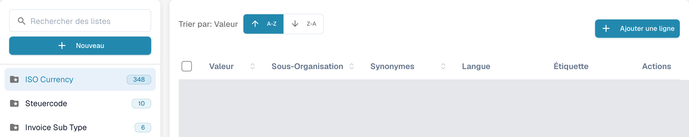
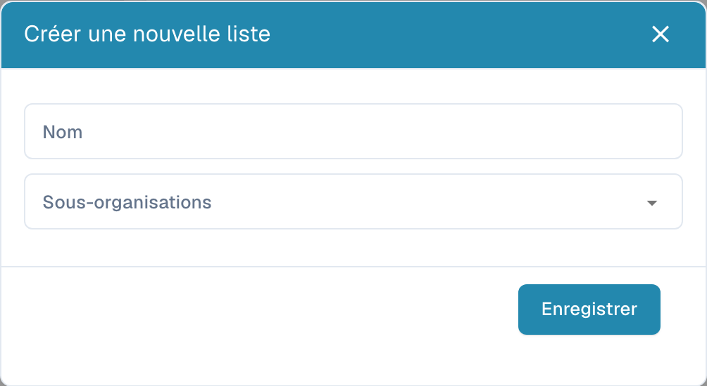
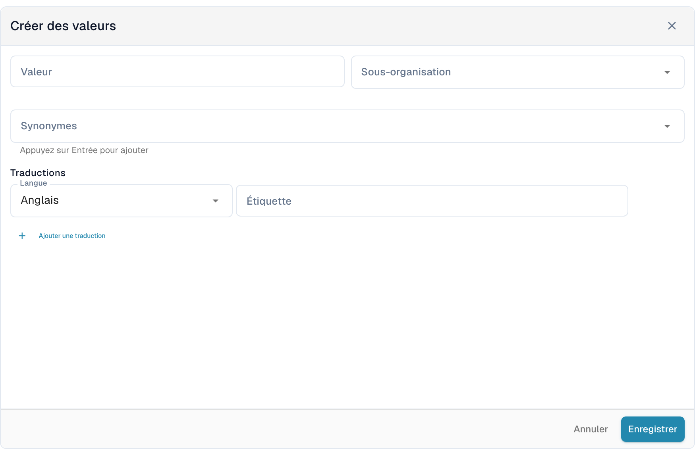

# Listes de valeurs

## Tutoriel vidéo : données de base et listes de valeurs


Sources de données de base, listes de valeurs et paramètres des données de base dans DocBits


La vidéo présente les sources de données de base, les listes de valeurs et les paramètres des données de base d'un type de document.

Les listes de valeurs proposent des options prédéfinies pour les champs des documents. Un champ peut utiliser une liste pendant la validation. Les libellés peuvent être traduits ; la valeur technique reste identique dans toutes les langues.

## Ouvrir les listes

Dans les paramètres, ouvrez la consultation des données de base et sélectionnez les listes de valeurs. Le champ **Rechercher des listes**, à gauche, permet de trouver une liste. Sélectionnez son nom pour ouvrir ses entrées à droite. Le dossier avec une étoile identifie une liste système ; le nombre à côté du nom indique le nombre d’entrées chargées.

<figure><figcaption>
Vue des listes de valeurs avec les noms configurés masqués.
</figcaption></figure>

<figure><figcaption>
La liste système sélectionnée ouvre la table des entrées. A-Z et Z-A trient les valeurs ; Ajouter une ligne ouvre le formulaire. Les valeurs et noms personnalisés sont masqués ; les noms des listes système, comme ISO Currency, sont des données existantes.
</figcaption></figure>

## Créer une liste

1. Sélectionnez **Nouveau** au-dessus des noms des listes.
2. Saisissez le **Nom** et sélectionnez, si nécessaire, les **Sous-organisations** pour limiter le périmètre de la liste.
3. **Enregistrer** crée la liste. Le **X** ferme la boîte de dialogue sans créer de liste.

<figure><figcaption>
Nouveau ouvre la boîte de dialogue vide Créer une nouvelle liste avec Nom, Sous-organisations, X et Enregistrer. Cette vue ne montre pas une liste enregistrée.
</figcaption></figure>

Pour supprimer une liste créée par votre organisation, utilisez l’option de suppression du menu à trois points à côté de son nom et confirmez uniquement la liste prévue. Les listes système ne proposent pas ce menu de suppression et ne peuvent pas être supprimées.

## Ajouter et modifier les entrées

1. Sélectionnez la liste à gauche, puis **Ajouter une ligne** au-dessus de sa table.
2. Saisissez la **Valeur** stockée et, si nécessaire, sa **Sous-organisation**.
3. Ajoutez les **Synonymes** souhaités. Validez chacun avec **Entrée** pour qu’il soit ajouté au champ.
4. Sous **Traductions**, sélectionnez une **Langue** et saisissez une **Étiquette** non vide. Une nouvelle entrée nécessite au moins une traduction complète.
5. **Enregistrer** crée l’entrée. **Annuler** ou le **X** ferme le formulaire sans l’enregistrer.

<figure><figcaption>
Ajouter une ligne ouvre Créer des valeurs sous la table : Valeur, Sous-organisation, Synonymes, Langue, Étiquette et Ajouter une traduction. Enregistrer crée l’entrée ; Annuler abandonne le brouillon non enregistré.
</figcaption></figure>

Pour modifier une entrée, sélectionnez sa ligne ou l’option de modification dans **Actions**. Les champs protégés restent en lecture seule ; la valeur stockée peut également être verrouillée lorsqu’il existe déjà des traductions. **Annuler** abandonne les modifications non enregistrées.

L’option de duplication du menu de la ligne crée une autre entrée. Pour plusieurs entrées, cochez leurs cases et utilisez le bouton de copie au-dessus de la table. La suppression est disponible pour les entrées de votre organisation et retire l’entrée sélectionnée ; les entrées système ne proposent pas cette action. Une liste système peut contenir des entrées protégées et des entrées de votre organisation.

## Importer un fichier CSV

Cette interface ne propose pas l’ancien import CSV depuis le menu **Actions**. Les anciennes étapes de chargement CSV ne s’appliquent pas à cet écran ; utilisez **Ajouter une ligne** pour y saisir des valeurs.

## Ajouter des traductions

Dans le formulaire de l’entrée, sélectionnez **Langue** et saisissez l’**Étiquette**. Utilisez **Ajouter une traduction** pour ajouter une autre langue et son étiquette. Complétez ou retirez les lignes de traduction supplémentaires laissées vides avant d’enregistrer. Lorsqu’une ligne de traduction peut être retirée, sa corbeille la retire d’abord du formulaire ; enregistrez pour appliquer la modification.

Le texte affiché peut varier selon la langue, mais la valeur technique reste identique. Sans étiquette pour la langue active, la valeur technique est affichée. Les entrées système et les traductions héritées peuvent comporter des champs protégés ; modifiez uniquement les données de votre organisation dont les champs sont éditables.
