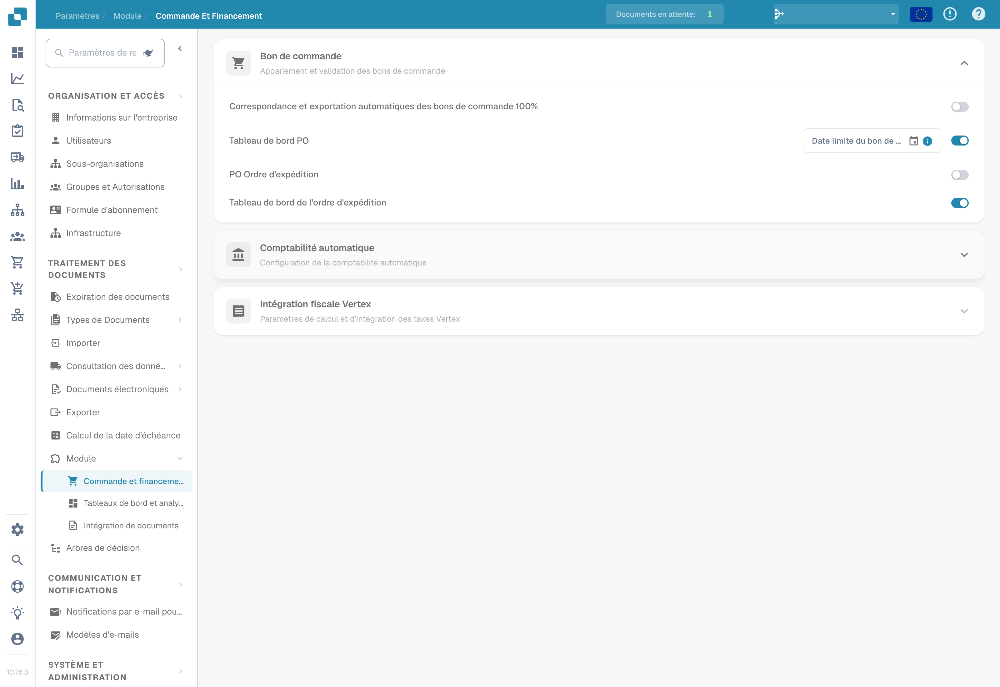
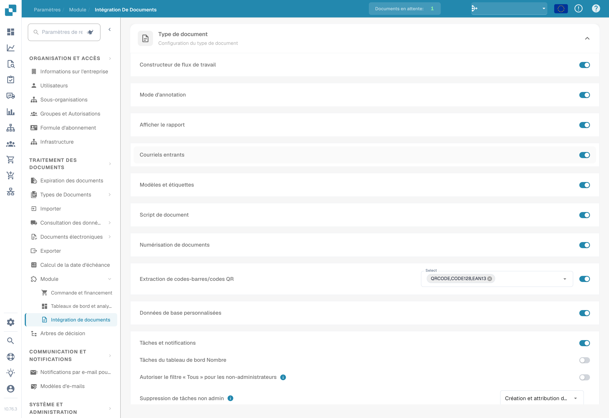
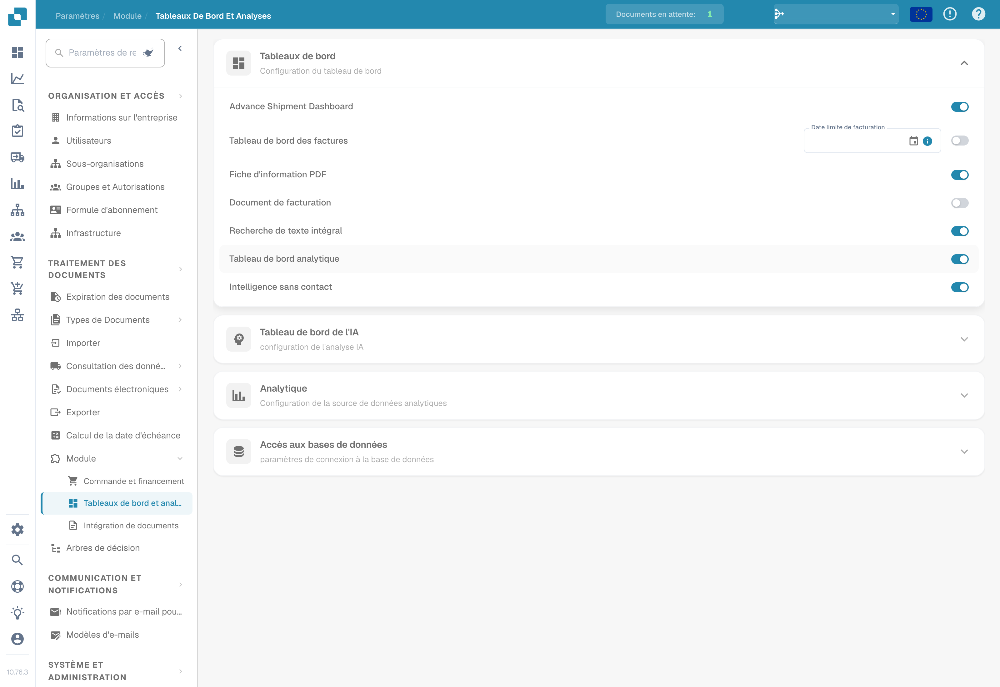

# Module

<figure><figcaption>
Modules — commande et financement. Les interrupteurs sont affichés dans leur état existant ; aucune option n’a été modifiée.
</figcaption></figure>

La page Module vous permet d'activer ou de désactiver des fonctionnalités optionnelles dans DocBits. Chaque section regroupe des modules apparentés qui peuvent être activés ou désactivés.

## Commande fournisseur

Paramètres de PO Matching et de validation.

| Paramètre | Description |
|---------|-------------|
| **Auto Export if PO matched 100%** | Exporte automatiquement le document lorsque le rapprochement avec le bon de commande atteint 100 %. |
| **PO Dashboard** | Active le tableau de bord des bons de commande. Comprend un champ **PO Date Limit** pour restreindre les données de bons de commande par date. |
| **PO Shipment Order** | Active le traitement des ordres d'expédition liés aux bons de commande. |
| **Tableau de bord des commandes d'expédition** | Active un tableau de bord dédié aux ordres d'expédition. |

## Comptabilisation automatique

| Paramètre | Description |
|---------|-------------|
| **Auto Accounting** | Active la comptabilisation automatique des documents. Sélectionnez le type d'ERP (p. ex. LN, M3). |

## Tableaux de bord

| Paramètre | Description |
|---------|-------------|
| **Tableau de bord avancé des expéditions** | Tableau de bord pour le suivi des activités d'expédition avancées. |
| **Invoice Dashboard** | Tableau de bord pour le suivi et l'analyse des factures. |
| **Recherche en texte intégral** | Active la recherche en texte intégral dans les documents. |
| **Analytics Dashboard** | Active le tableau de bord de présentation des analyses. |

## Accès à la base de données

| Paramètre | Description |
|---------|-------------|
| **DB Access** | Active l'accès direct à la base de données pour l'organisation. |

## Tableau de bord IA

| Paramètre | Description |
|---------|-------------|
| **AI Document Warehouse** | Analyses de l'entrepôt de documents basées sur l'IA. |
| **Dashboard v2** | Tableau de bord mis à jour avec des fonctionnalités améliorées. |
| **Clickhouse Direct Access** | Active l'accès direct à la base de données Clickhouse. |
| **Supplier Statistics** | Active les statistiques et les rapports au niveau des fournisseurs. |

## Expédition et fournisseur

| Paramètre | Description |
|---------|-------------|
| **Supplier Portal** | Active le portail fournisseurs pour la collaboration avec les fournisseurs. |

## Type de document

| Paramètre | Description |
|---------|-------------|
| **Workflow Builder** | Permet de créer et de personnaliser les workflows de traitement des documents. |
| **Annotation Mode** | Permet aux utilisateurs d'annoter les documents dans la vue de validation. |
| **Show Report** | Active la génération de rapports pour les documents. |
| **Inbound Emails** | Active la gestion des e-mails entrants par type de document. |
| **Models & Labels** | Gère les modèles d'IA et les libellés pour la reconnaissance des documents. |
| **Document Script** | Active les scripts personnalisés pour le traitement des documents. |
| **Document Scan** | Active la fonctionnalité de numérisation de documents. |
| **Bar-Code/QR Code Extraction** | Extrait les données des codes-barres/codes QR des documents. Sélectionnez les types de codes pris en charge. |
| **Données de base personnalisées** | Active les champs de données de base personnalisés. |
| **Tasks & Notifications** | Active les fonctionnalités de gestion des tâches et de notification. Comprend l'option **Dashboard Tasks Count**. |
| **DocBits Operator** | Active la fonctionnalité d'automatisation du navigateur DocBits Operator. |
| **DocNet** | Active la mise en réseau de documents DocNet. |
| **IDM ACL Updater** | Met à jour les listes de contrôle d'accès d'Infor Document Management. Téléversez un fichier ION-Mapping et configurez les correspondances entre Infor-Doctype et ACL. |
| **Barcode Assignment** | Active l'affectation de codes-barres aux documents. |
| **Définir le signe négatif pour les notes de crédit** | Applique automatiquement le signe négatif aux montants des avoirs. |

## Flux de connexion BOD

| Paramètre | Description |
|---------|-------------|
| **BOD Connection Stream** | Active l'intégration BOD (Business Object Document). Affiche le **Stream Name** utilisé pour la connexion. |

## Analytique

| Paramètre | Description |
|---------|-------------|
| **Use PostgreSQL for Quality Analytics** | Permet de basculer entre Prometheus (temps réel, réinitialisé à chaque déploiement) et PostgreSQL (persistant sur 90 jours, analyse des tendances, champs les moins performants). |

## Intégration fiscale Vertex

| Paramètre | Description |
|---------|-------------|
| **Vertex Tax Integration** | Active le calcul des taxes Vertex. Configurez **Base URL**, **Client ID** et **Client Secret**. Utilisez **Test Connection** pour vérifier. |

<figure><figcaption>
Modules — intégration de documents, dont les données de base personnalisées. Aucun interrupteur n’a été modifié.
</figcaption></figure>

<figure><figcaption>
Modules — tableaux de bord et analyses. Certaines désignations de modules restent des noms de produit en anglais.
</figcaption></figure>
