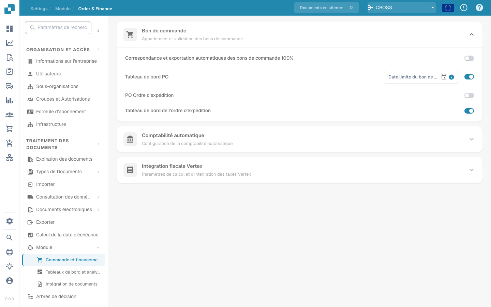

# IDM ACL Updater

## Vue d’ensemble

Le module ACL-Updater est responsable de la mise à jour et de la gestion des listes de contrôle d'accès (ACL) au sein de DocBits. Cela garantit que les autorisations et mesures de sécurité appropriées sont en place pour l’accès et la gestion des documents.

## Instructions d’activation

Pour activer le module ACL-Updater, suivez ces étapes :

1. Navigate to **Settings**.
2. Select **Document Processing**.
3. Select **Module**.
4. Go to **Document Type**.
5. Activez le **IDM ACL-Updater** en activant le curseur correspondant.

Une fois le module activé, vous pouvez sélectionner un **ION Mapping File** à utiliser.

<figure><figcaption></figcaption></figure>

### Ajouter les informations ACL

Pour ajouter des informations ACL, cliquez sur le bouton **Ajouter**. Vous pouvez ensuite spécifier les détails suivants :

* **IDM Document Type**
* **Current IDM ACL Status**
* **New IDM ACL Status**

<figure><figcaption></figcaption></figure>

