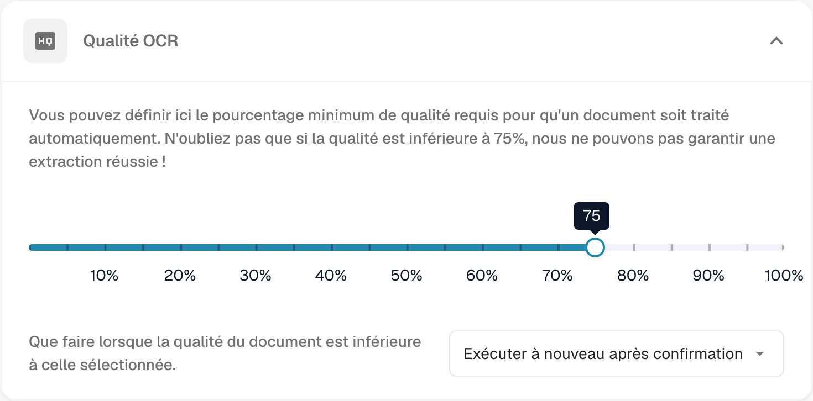
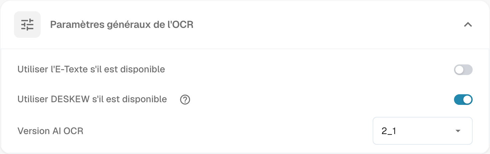
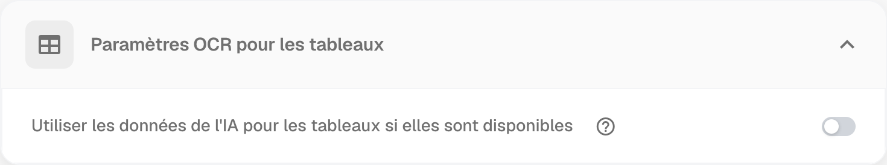
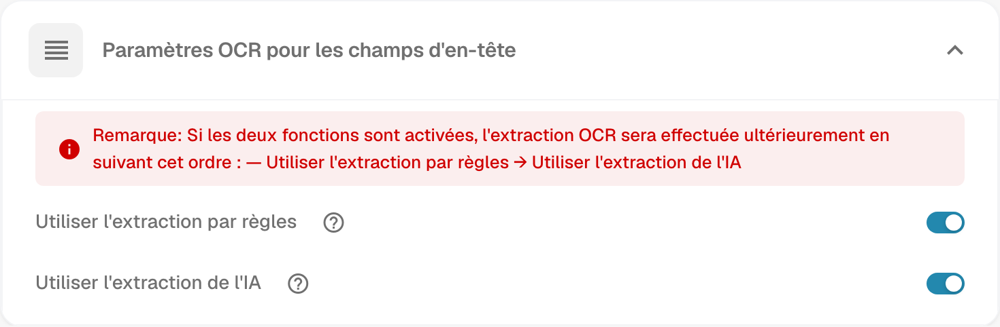

# Paramètres OCR


DocBits OCR & E-Text expliqués : paramètres, qualité et extraction d'en-tête


## Vue d’ensemble

Les paramètres **OCR (reconnaissance optique de caractères)** déterminent la façon dont DocBits reconnaît le texte pendant le traitement des documents. Vous pouvez définir un seuil de qualité, utiliser le texte électronique intégré au document, choisir la version du moteur OCR et configurer l’extraction des tableaux et des champs d’en-tête.

## Accéder aux paramètres OCR

Ouvrez **Paramètres → Traitement des documents → Paramètres OCR**.

## Qualité OCR

Réglez le curseur pour définir la qualité minimale requise pour le traitement OCR. Déplacez-le vers la gauche pour réduire le seuil ou vers la droite pour l’augmenter.

Lorsque la qualité du document est inférieure au seuil sélectionné, choisissez le comportement souhaité :

* **Exécuter quand même** : le document est traité malgré sa qualité inférieure au seuil.
* **Exécuter à nouveau après confirmation** : DocBits demande une confirmation avant de poursuivre le traitement.
* **Lancer une erreur** : le traitement s’arrête et un message indique que le seuil de qualité n’est pas atteint.

<figure><figcaption>
Qualité OCR : seuil minimal et comportement lorsque la qualité du document est insuffisante.
</figcaption></figure>

Les valeurs et les options affichées dans les captures illustrent la configuration observée ; elles ne constituent pas des valeurs par défaut pour toutes les organisations.

## Paramètres généraux de l’OCR

* **Utiliser l’E-Texte s’il est disponible** : DocBits utilise le texte électronique intégré, par exemple dans un PDF, au lieu d’effectuer une reconnaissance optique. L’extraction directe du texte peut améliorer la vitesse et la précision du traitement.
* **Utiliser DESKEW s’il est disponible** : DocBits redresse les images numérisées inclinées pour améliorer la reconnaissance du texte.
* **Version AI OCR** : sélectionnez la version du moteur OCR à utiliser. Ce réglage peut servir à comparer les résultats ou à examiner un problème de performances ou de précision avec la version sélectionnée.

<figure><figcaption>
Paramètres généraux de l’OCR : E-Texte, redressement DESKEW et version du moteur AI OCR.
</figcaption></figure>

## Paramètres OCR pour les tableaux

**Utiliser les données de l’IA pour les tableaux si elles sont disponibles** permet d’utiliser les données OCR des tableaux plutôt que le texte électronique intégré, même lorsque **Utiliser l’E-Texte s’il est disponible** est activé.

<figure><figcaption>
Paramètres OCR pour les tableaux : utilisation des données de l’IA lorsqu’elles sont disponibles.
</figcaption></figure>

## Paramètres OCR pour les champs d’en-tête

* **Utiliser l’extraction par règles** : DocBits applique les règles d’extraction prédéfinies pour identifier les champs d’en-tête.
* **Utiliser l’extraction de l’IA** : DocBits utilise l’IA pour détecter et extraire les champs d’en-tête.

Lorsque les deux options sont activées, l’ordre d’exécution est le suivant : **extraction par règles → extraction de l’IA**.

<figure><figcaption>
Paramètres OCR pour les champs d’en-tête : extraction par règles et extraction de l’IA.
</figcaption></figure>

Pour obtenir de meilleurs résultats et un comportement cohérent, activez les deux options afin de combiner l’extraction par règles et l’extraction de l’IA. Vérifiez les résultats sur vos documents avant de retenir la configuration adaptée.
