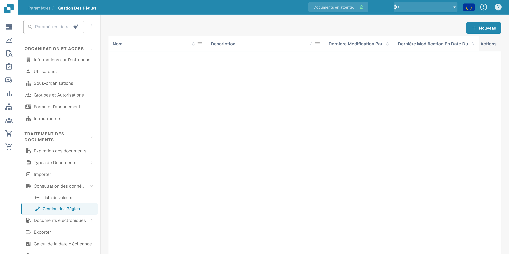
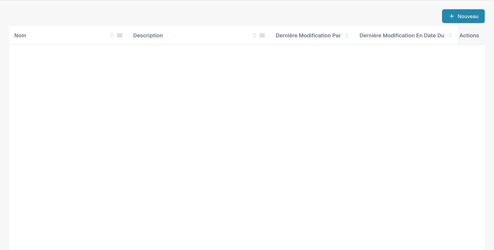
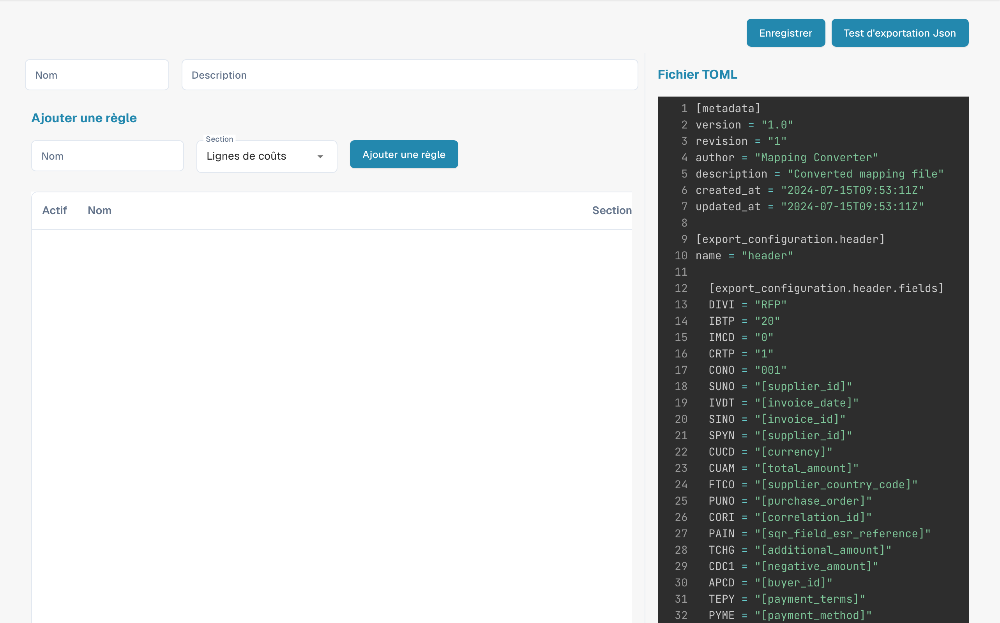

# Gestion des règles

<figure><figcaption>
Gestion des règles avec les noms configurés masqués.
</figcaption></figure>

Rule Management vous permet de créer et de gérer des règles de résolution de conflits basées sur TOML, utilisées lors du PO matching et de l'export des documents. Chaque jeu de règles définit la manière dont DocBits traite les écarts entre les données de la facture et celles du bon de commande.

## Liste des règles

Le tableau principal affiche toutes les configurations de règles :

| Colonne | Description |
|--------|-------------|
| **Nom** | Le nom du jeu de règles. Les éléments marqués **défaut** sont des modèles fournis par le système. |
| **Description** | Un résumé de ce que couvre le jeu de règles. |
| **Dernière modification par** | L'utilisateur qui a modifié ce jeu de règles en dernier. |
| **Dernière modification en date du** | Horodatage de la dernière modification. |
| **Actes** | Menu à trois points pour modifier, copier ou supprimer. |

Cliquez sur **+ New** pour créer un nouveau jeu de règles, ou cliquez sur un nom existant pour ouvrir l'éditeur de règles.

---

## Référence de la structure des règles

Cette section fournit une explication détaillée des règles de résolution de conflits utilisées dans le système de facturation DocBits. Ces règles sont conçues pour traiter automatiquement les écarts entre les détails de la facture et les données du bon de commande (PO), afin de garantir un rapprochement financier exact. Le système applique ces règles pour traiter les lignes de facture, les frais et les taxes, et génère les ajustements ou notes appropriés si nécessaire.

## Structure des règles

### 1. Métadonnées

• version : identifie la version du fichier de mapping.

• revision : numéro de révision pour le suivi des modifications.

• author : indique le créateur du fichier de mapping.

• description : brève description de l'objet du fichier.

• created_at & updated_at : horodatages de la création et de la dernière mise à jour du fichier.

### 2. Configuration de l'export

La section de configuration de l'export définit le mapping entre les champs de données du système et les champs correspondants dans les fichiers d'export.

• Header : définit les champs d'en-tête des données de facture exportées.

• Tax Lines : spécifie les champs des lignes de taxe dans l'export.

• Order Header Charges : mappe les champs relatifs aux frais supplémentaires au niveau de l'en-tête de commande.

• Receipt Lines : mappe les champs des lignes individuelles d'une réception.

• Order Line Charges : définit les champs des frais liés à des lignes de commande spécifiques.

• Cost Lines : spécifie les champs des lignes de répartition des coûts.

• Debit Note & Credit Note : définit les champs pour la génération de notes de débit et d'avoirs en cas d'écarts.

### 3. Règles de résolution de conflits

Ces règles traitent les écarts entre les données de la facture et les données correspondantes du bon de commande. Chaque règle se compose de plusieurs éléments :

• Name : le nom descriptif de la règle, qui indique le type d'écart qu'elle traite.

• Section : indique à quelle partie de la facture (p. ex. receipt_lines, line_charges) la règle s'applique.

• Active : valeur booléenne (true ou false) indiquant si la règle est actuellement active.

• Match Criteria : conditions qui déclenchent la règle sur la base de comparaisons entre les données réelles de la facture et les données attendues du bon de commande.

• Actions : définit ce que le système doit faire lorsque la règle est déclenchée, notamment ajuster des valeurs, appliquer des frais ou générer des avoirs/notes de débit.

## Éléments communs des règles

### Opérateurs de comparaison

Ces opérateurs définissent la manière dont les valeurs réelles de la facture sont comparées aux valeurs attendues du bon de commande :

• equal

• greater than

• greater than or equal to

• less than

• less than or equal to

• within tolerance

• outside tolerance

### Statut d'approbation

Indique si un écart est approuvé ou non :

• approved

• rejected

• any

### Types d'action

Définit les actions spécifiques à exécuter lorsqu'un écart est détecté :

• receipt line

• cost line

• header charge

• line charge

• tax line

• debit note receipt line

• debit note cost line

• debit note header charge

• debit note line charge

• credit note receipt line

• credit note cost line

• credit note header charge

• credit note line charge

• credit note tax line

### Exemples de règles

#### [Cas 1, 2, 3 : quantité et prix unitaire dans la tolérance](transactionconfig-pro-template/case-1-2-3-quantity-and-unit-price-within-tolerance.md)

• Objectif : traite les scénarios où la quantité et le prix unitaire de la facture sont tous deux dans les limites de tolérance acceptées par rapport au bon de commande.

• Action : le système accepte les valeurs de la facture et calcule le montant total.

#### [Cas 4, 5 : quantité dans la tolérance, prix unitaire hors tolérance (approuvé)](./#case-4-5-quantity-within-tolerance-unit-price-outside-tolerance-approved)

• Objectif : s'applique lorsque la quantité est dans la tolérance mais que le prix unitaire est hors tolérance et a été approuvé.

• Action : le système ajuste le prix unitaire pour qu'il corresponde au bon de commande et applique les frais de ligne nécessaires.

#### [Cas 6 : quantité dans la tolérance, prix unitaire hors tolérance négative (rejeté)](transactionconfig-pro-template/case-6-quantity-within-tolerance-unit-price-outside-negative-tolerance-rejected.md)

• Objectif : traite les cas où le prix unitaire est inférieur à celui attendu et hors de la plage de tolérance, ce qui entraîne un rejet.

• Action : le système ajuste le prix unitaire pour qu'il corresponde au bon de commande, génère un avoir pour la différence et applique des frais d'en-tête si nécessaire.

### Gestion des frais et des taxes

### Tolérance des frais par unité

• Les règles de cette catégorie traitent les écarts de frais par unité, avec des actions spécifiques selon que les frais sont dans ou hors de la tolérance et qu'ils sont approuvés ou rejetés.

### Ajustements des lignes de taxe

• Ces règles gèrent les écarts de taxes en ajustant les lignes de taxe ou en générant les avoirs ou notes de débit correspondants, selon les différences entre les données de taxe de la facture et du bon de commande.

### Enums et options

• Enums : listes de valeurs prédéfinies garantissant la cohérence entre les règles (p. ex. opérateurs de comparaison, types d'approbation).

• Options : choix prédéfinis pour le traitement des quantités ou des prix unitaires, offrant de la flexibilité dans la définition des règles.

## Explication des captures d'écran

### Capture d'écran 1 : interface Rule Management

<figure><figcaption>
Vue d’ensemble de la gestion des règles et de ses actions.
</figcaption></figure>

Cette capture d'écran montre l'interface Rule Management, où les administrateurs peuvent consulter et gérer toutes les règles de résolution de conflits. Les éléments clés sont les suivants :

• Add Rule Button : permet d'ajouter de nouvelles règles.

• List of Rules : affiche toutes les règles actives avec des détails tels que le nom, la section et le statut d'activation.

• Section Dropdown : filtre les règles selon la section à laquelle elles s'appliquent (p. ex. Receipt Lines, Line Charges).

### Capture d'écran 2 : modification détaillée d'une règle

<figure><figcaption>
Éditeur de règles TOML avec un exemple de configuration technique.
</figcaption></figure>

Cette capture d'écran illustre la vue détaillée d'une règle en cours de modification. Les éléments clés sont les suivants :

• Criteria Section : définit les conditions dans lesquelles la règle est déclenchée. Par exemple, les critères peuvent préciser que si la quantité et le prix unitaire diffèrent du bon de commande mais restent dans la tolérance, la règle doit être appliquée.

• Actions Section : spécifie les actions à exécuter lorsque les critères sont remplis. Cela peut inclure l'ajustement des lignes de facture, la génération d'avoirs ou de notes de débit, ou l'application de frais supplémentaires.

• Document Type and Costing Elements : permet à l'administrateur de mapper des actions spécifiques à des types de documents et à des éléments de coût, ce qui offre de la flexibilité pour traiter différents scénarios.
