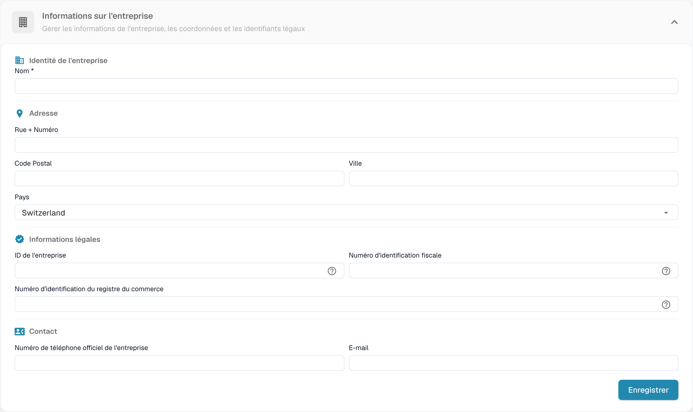
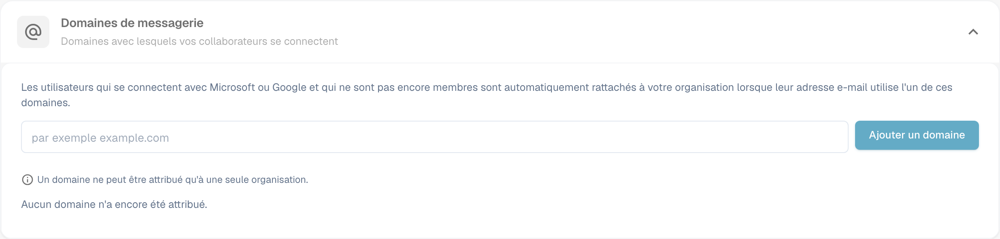

# Informations sur l’entreprise

## Tutoriel vidéo : entreprise, abonnement et audit


Informations sur l'entreprise, formule d'abonnement et journaux d'audit dans DocBits


La vidéo présente les informations et les préférences de l'entreprise, la formule d'abonnement, l'activité de connexion et les journaux d'audit.

<figure><figcaption>
Informations sur l’entreprise avec les valeurs de l’organisation masquées.
</figcaption></figure>

La page Company Information vous permet de gérer le profil de votre entreprise, vos préférences et les détails de votre abonnement. Elle est organisée en plusieurs sections :

## Informations sur l’entreprise

Cette section contient les données de base de votre entreprise, regroupées en quatre zones :

### Identité de l’entreprise

* **Nom** *(obligatoire)* : la dénomination légale de votre entreprise.

### Adresse

* **Rue + Numéro** : l'adresse postale de votre entreprise.
* **Code Postal** : le code postal.
* **Ville** : le nom de la ville.
* **Pays** : sélectionnez votre pays dans la liste déroulante.

### Informations juridiques

* **ID de l'entreprise** : un identifiant unique de votre entreprise, utilisé pour les intégrations et comme référence interne.
* **Numéro d'identification fiscale** : votre numéro d'identification fiscale pour les rapports financiers.
* **Numéro d'identification du registre du commerce** : votre numéro de registre du commerce pour la documentation légale.

### Contact

* **Téléphone officiel de l’entreprise** : le numéro de téléphone principal de votre entreprise.
* **E-mail** : l'adresse e-mail principale utilisée pour les communications officielles.

Après avoir saisi ou mis à jour des champs, cliquez sur **Enregistrer** pour appliquer vos modifications. Les icônes **?** à côté des identifiants légaux affichent des indications supplémentaires sur le champ. Sélectionnez le titre de la section pour développer ou réduire le formulaire.

## Domaines de messagerie

Les administrateurs de l'organisation peuvent ouvrir **Paramètres → Informations sur l’entreprise → Domaines de messagerie** pour gérer les domaines utilisés pour l'affectation automatique à l'organisation. Lorsqu'une personne se connecte avec Microsoft ou Google et n'est pas encore membre d'une organisation, DocBits peut l'affecter à cette organisation si son adresse e-mail utilise l'un des domaines listés. Un domaine ne peut appartenir qu'à une seule organisation.

<figure><figcaption>
Configuration des domaines de courriel de l’entreprise.
</figcaption></figure>

Saisissez uniquement le domaine, par exemple `example.com`, dans le champ, puis sélectionnez **Ajouter un domaine** ou appuyez sur Entrée. Le premier domaine devient le domaine principal. Si plusieurs domaines sont listés, utilisez **Faire primaire** sur une autre ligne pour modifier le domaine principal, ou l'icône de corbeille pour supprimer un domaine. Les erreurs, telles qu'un domaine non valide, un fournisseur de messagerie personnelle ou un domaine déjà affecté ailleurs, apparaissent sous le champ de saisie. **Aucun domaine attribué pour le moment** signifie que cette organisation n'a aucune règle de domaine.

Avant d'ajouter un domaine, vérifiez quelle organisation doit recevoir les nouvelles connexions. Pour gérer les appartenances existantes, poursuivez avec [Users](../groups-users-and-permissions/users/README.md).

## Préférences de l’entreprise

Configurez les paramètres par défaut applicables à toute l'entreprise :

* **Modèle de date** : choisissez le format d'affichage des dates dans DocBits (p. ex. `%m/%d/%Y`, `%d.%m.%Y`).
* **Formatage du montant** : sélectionnez le format numérique des montants (p. ex. Deutsch pour `1.000,00`, English pour `1,000.00`).
* **Nouvelle boîte de dialogue d'information sur la version** : active ou désactive l'affichage d'une notification aux utilisateurs lors de la publication d'une nouvelle version de DocBits.

Cliquez sur **Enregistrer** après avoir effectué des modifications.

## Couleur de l’application

Personnalisez la couleur principale de l'interface DocBits. C'est utile pour distinguer visuellement différents environnements (p. ex. dev et production).

* **Couleur** : saisissez un code couleur hexadécimal (p. ex. `#2388AE`) ou utilisez le sélecteur de couleur.
* Cliquez sur **Enregistrer** pour appliquer, ou sur **Réinitialiser** pour rétablir la couleur par défaut.

## Formule d’abonnement

Consultez vos plans d'abonnement actifs et leurs détails :

* **Nom de l’offre** : le nom de chaque plan actif (p. ex. DocBits, DocFlow Users, DocSearch).
* **jours restants** : le nombre de jours restants avant l'expiration du plan.
* **Start Date / End Date** : la période d'abonnement.
* **Nombre d’utilisateurs** : le nombre total d'utilisateurs de votre organisation.
* **Nombre de sous-organisations** : le nombre de sous-organisations configurées.
* **Nombre de fournisseurs** : le nombre de fournisseurs enregistrés.

## Utilisation de l’abonnement

Suivez votre consommation mensuelle de jetons et de workflows :

| Colonne | Description |
|--------|-------------|
| **Taper** | Le type d'utilisation (Document ou Workflow). |
| **From / To** | Les dates de la période de facturation. |
| **Jetons utilisés** | Le nombre de jetons consommés pendant la période en cours. |
| **Jetons restants** | Les jetons encore disponibles pendant la période en cours. |

Utilisez le bouton **Sélectionner** pour filtrer par plages de dates spécifiques.
