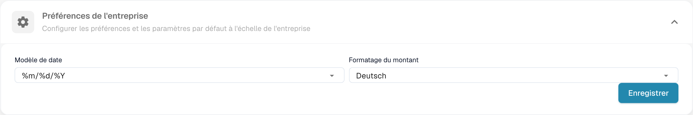
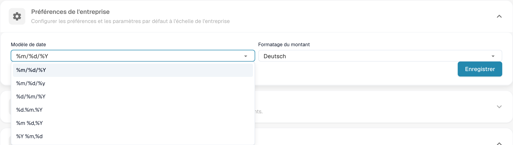

# Préférences de l’entreprise

## Tutoriel vidéo : entreprise, abonnement et audit


Informations sur l'entreprise, formule d'abonnement et journaux d'audit dans DocBits


La vidéo présente les informations et les préférences de l'entreprise, la formule d'abonnement, l'activité de connexion et les journaux d'audit.

Dans les informations de l’entreprise, ouvrez les préférences pour définir les formats de date et de montant de votre organisation.

<figure><figcaption>
Préférences de l’entreprise et formats des montants et dates.
</figcaption></figure>

Choisissez un format de date adapté aux documents. Les symboles `%d`, `%m` et `%Y` sont des codes techniques du format.

<figure><figcaption>
Sélection du format de date dans les préférences de l’entreprise.
</figcaption></figure>

Le format des montants est indépendant ; son nom configuré peut rester inchangé. Vérifiez les deux formats avant l’enregistrement. L’ancien dialogue de notification de version ne fait pas partie de cette vue actuelle. Aucune préférence n’a été modifiée pour ces images.


