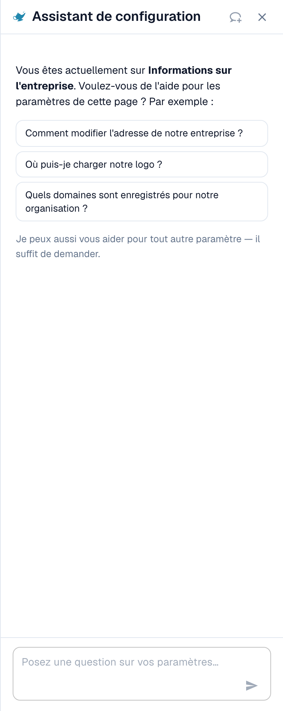
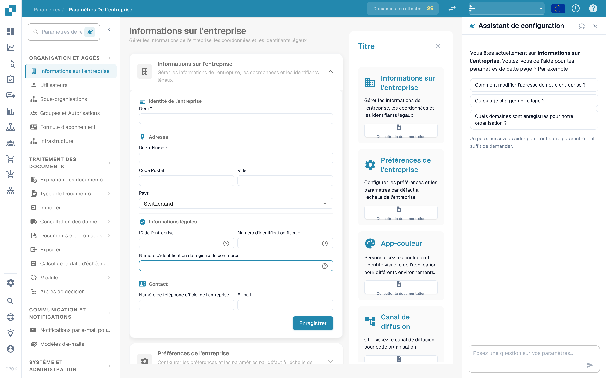

# Assistant de paramètres

L'**Assistant de paramètres** (Settings Assistant) est un panneau de discussion intégré à la zone Paramètres. Vous posez une question en langage courant, et il lit la configuration de votre organisation, répond et vous conduit directement au bon paramètre. Il peut aussi vous avertir lorsque quelque chose dans votre configuration a cessé de fonctionner et, avec votre confirmation, modifier un paramètre à votre place.

Il est le plus utile lorsque vous savez **ce que** vous voulez (« arrêter de scinder les documents sur les codes-barres ») mais pas **où** se trouve le paramètre, ou lorsque vous vous demandez **pourquoi** quelque chose ne se produit pas (« Pourquoi le rapprochement avec le BC n'est-il pas actif ? »).

<figure><figcaption>
L'Assistant de paramètres sur la page Informations sur l'entreprise : un message d'accueil pour la page actuelle, trois exemples de questions et le champ de question. Une carte d'avertissement apparaît au-dessus du message d'accueil lorsqu'une importation a cessé de fonctionner (voir <a href="settings-assistant-chat.md#constats-lassistant-vous-avertit">Constats</a>).
</figcaption></figure>

L'assistant est **désactivé par défaut**. Cette page montre où l'activer et comment l'ouvrir. Ce que vous pouvez lui demander, et ce qu'il peut modifier, est décrit dans la page [Assistant de paramètres : ce que peut faire le chat](settings-assistant-chat.md).

## Qui peut l'utiliser

* L'**administrateur de l'organisation** active ou désactive l'assistant pour toute l'organisation.
* Une fois activé, chaque administrateur qui peut ouvrir les **Paramètres** peut afficher ou masquer le panneau pour lui-même.
* Les modifications (appliquer une recommandation, désactiver ou supprimer une connexion d'importation, créer une règle) sont réservées aux **administrateurs de l'organisation**. Les autres utilisateurs reçoivent le message *Réservé aux administrateurs.* (Available to administrators only.)

## L'activer

1. Allez dans **Paramètres → Paramètres globaux → Informations sur l'entreprise**. L'en-tête de la page affiche **Paramètres de l'entreprise** (Company Settings).
2. Ouvrez la section **Assistants**.
3. Activez **Activer l'assistant de paramètres** (Enable the settings assistant).

<figure><figcaption>
La section Assistants. L'assistant de paramètres a son propre interrupteur. L'assistant de validation et la voix off des explications sont des fonctions distinctes.
</figcaption></figure>

Un court message confirme **Assistant de paramètres activé** (Settings assistant enabled). Le paramètre est désactivé par défaut. Tant qu'il est désactivé, le panneau et son bouton n'apparaissent nulle part.


L'**Assistant de validation** de la même section est une fonction différente. Il explique les champs bloquants à l'intérieur d'un document et ne peut modifier aucun paramètre. Activer l'un des deux n'affecte pas l'autre.


## Ouvrir et fermer le panneau

Sur chaque page de la zone Paramètres, vous trouvez un petit **bouton en forme de lampe de génie** à côté du champ de recherche des paramètres. Cliquez dessus pour **afficher** ou **masquer** l'assistant.

<figure><figcaption>
L'assistant se trouve sur le <strong>côté droit</strong> de chaque page Paramètres : la navigation à gauche, la page au milieu, l'assistant à côté. Ici sur <strong>Paramètres de l'entreprise → Informations sur l'entreprise</strong>. Le bouton pour l'afficher ou le masquer est l'icône de lampe à côté de <strong>Rechercher dans les paramètres</strong> (Search Settings) en haut de la navigation.
</figcaption></figure>

* Le panneau mémorise votre choix par utilisateur, il reste donc ouvert la prochaine fois que vous revenez.
* Sur un grand écran (1 280 pixels et plus), il se place à côté de la page. Vous pouvez faire glisser son bord pour modifier la largeur.
* Sur un écran étroit, il s'ouvre en superposition. **Échap** ou un clic à l'extérieur le ferme.
* **Nouvelle discussion** (New chat ; l'icône de bulle de dialogue dans l'en-tête) efface la conversation. La conversation survit aussi à un rechargement de la page, mais pas à la fermeture de l'onglet du navigateur.

## Et ensuite

* Posez votre première question : voir [Assistant de paramètres : ce que peut faire le chat](settings-assistant-chat.md).
* L'assistant fonctionne avec le niveau d'IA **Fast** (rapide). Il n'existe aucun paramètre d'organisation pour choisir un autre modèle.

## Dépannage

| Problème | Cause et solution |
| --- | --- |
| Il n'y a pas de bouton en forme de lampe de génie dans la zone Paramètres | L'interrupteur de l'organisation est désactivé. Un administrateur de l'organisation l'active sous **Informations sur l'entreprise → Assistants** |
| La section **Assistants** est absente dans Informations sur l'entreprise | Seuls les administrateurs de l'organisation la voient |
| Le panneau indique **L'assistant est en cours de configuration** (The assistant is being set up) | La fonction n'est pas encore disponible dans votre environnement |
| Le panneau est là, mais les réponses indiquent *Réservé aux administrateurs.* | Votre compte n'est pas administrateur de l'organisation |

## Pages connexes

* [Assistant de paramètres : ce que peut faire le chat](settings-assistant-chat.md)
* [Préférences de l'entreprise](company-preferences.md)
