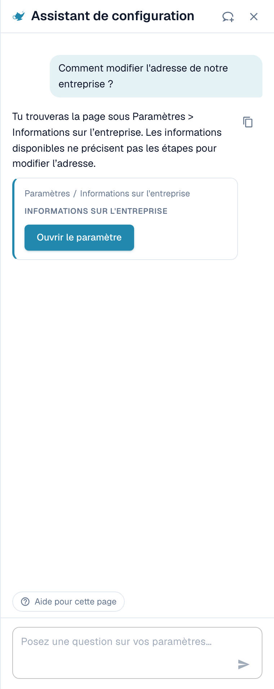
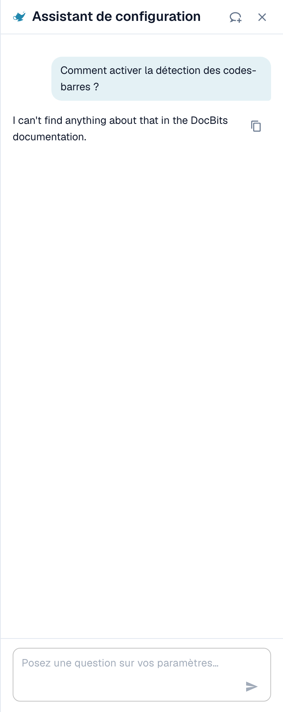
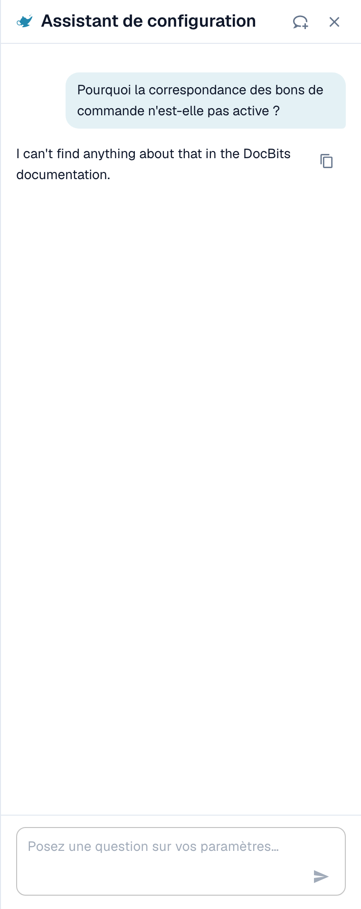
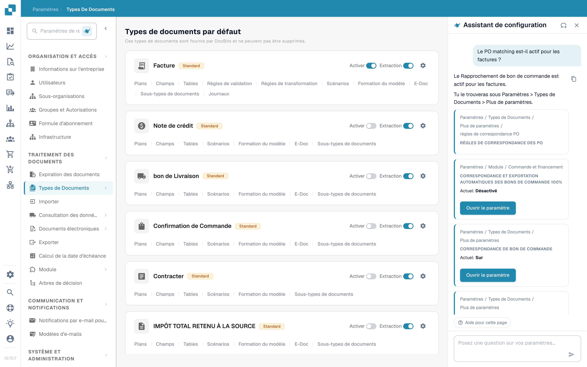
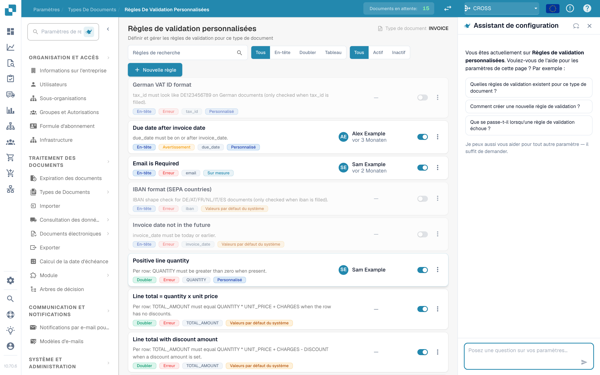
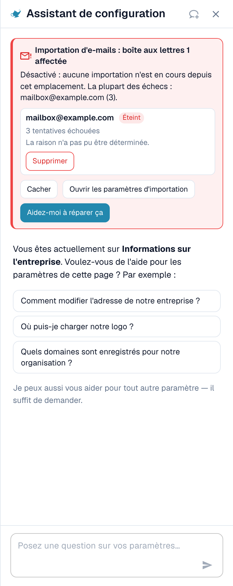

# Assistant de paramètres : ce que peut faire le chat

## Vue d'ensemble

Le chat de l'**Assistant de paramètres** répond aux questions sur vos paramètres, vous avertit lorsqu'une importation cesse de fonctionner et, avec votre confirmation, modifie un paramètre à votre place. Avant de l'utiliser, un administrateur doit [activer l'assistant](./).

### Ce qu'il peut faire

| Vous voulez…                            | Exemple                                                                              | Ce que vous obtenez                                                                                                                             |
| --------------------------------------- | ------------------------------------------------------------------------------------ | ----------------------------------------------------------------------------------------------------------------------------------------------- |
| Trouver un paramètre                    | « Où trouver les paramètres d'importation par e-mail ? »                             | Le chemin (par exemple Paramètres / Importation), un bouton **Ouvrir le paramètre** (Open setting) qui saute au paramètre et le met en évidence |
| Comprendre un paramètre                 | « Comment activer la détection des codes-barres ? »                                  | Une courte explication de chaque paramètre correspondant : quand l'activer, quand le laisser désactivé                                          |
| Vérifier votre configuration            | « Pourquoi le rapprochement avec le BC n'est-il pas actif ? »                        | La valeur actuelle de chaque paramètre associé dans votre organisation (**Actuel : activé** ou **Actuel : désactivé**) et lequel vous bloque    |
| Repérer une importation défaillante     | Une carte rouge en haut du panneau                                                   | Quelle boîte mail ou connexion FTP échoue, à quelle fréquence, et une raison probable                                                           |
| Modifier un paramètre en toute sécurité | **Désactiver** (Switch off) sur une boîte mail défaillante dans une carte de constat | Un aperçu de la modification. Rien n'est enregistré avant votre confirmation. Chaque modification peut être annulée.                            |
| Découvrir une page                      | **Regarder l'explication en vidéo** (Watch video explanation)                        | Une courte vidéo pour la page où vous vous trouvez (disponible pour certaines pages)                                                            |


L'assistant fonctionne avec le niveau d'IA **Fast** (rapide). Il n'existe aucun paramètre d'organisation pour choisir un autre modèle.


## Poser des questions

Saisissez une question dans le champ en bas (« Posez une question sur vos paramètres… ») et appuyez sur **Entrée**. L'assistant montre ce qu'il fait (« Lecture de la configuration… », « Recherche dans la documentation… », « Rédaction de la réponse… ») et vous pouvez l'arrêter à tout moment avec **Arrêter** (Stop).

### Le panneau sait sur quelle page vous êtes

Lorsque vous ouvrez le panneau sur une page de paramètres, il vous accueille pour **cette page** et propose trois questions adaptées. Ce sont de vrais exemples :

| Page                          | Exemples de questions                                                                                                                                                                                 |
| ----------------------------- | ----------------------------------------------------------------------------------------------------------------------------------------------------------------------------------------------------- |
| Informations sur l'entreprise | « Comment modifier l'adresse de notre entreprise ? », « Où téléverser notre logo ? », « Quels domaines sont enregistrés pour notre organisation ? »                                                   |
| Importation                   | « L'importation par e-mail est-elle active pour nous ? », « À quelle adresse e-mail envoyons-nous les documents ? », « Comment configurer une importation FTP ou SFTP ? »                             |
| Classifier et extraire        | « Quel modèle d'IA est utilisé pour l'extraction ? », « La scission des documents sur les codes-barres est-elle active pour nous ? », « Puis-je utiliser un autre modèle d'IA pour un fournisseur ? » |
| Utilisateurs                  | « Comment inviter un nouvel utilisateur ? », « Comment faire d'un utilisateur un administrateur ? », « Comment désactiver un utilisateur ? »                                                          |
| Vue d'ensemble des paramètres | « Comment activer la détection des codes-barres ? », « Pourquoi le rapprochement avec le BC n'est-il pas actif ? », « Où trouver les paramètres d'importation par e-mail ? »                          |

Cliquez sur une question et elle est envoyée immédiatement. Sous les trois questions, le panneau indique _Je peux aussi vous aider pour tout autre paramètre — il suffit de demander._ Pendant une conversation, la pastille **Aide pour cette page** (Help with this page) reste en bas et demande « Que puis-je configurer sur cette page ? ».

### Exemple 1 : Trouver un paramètre

Vous demandez **« Comment modifier l'adresse de notre entreprise ? »**

<figure><figcaption>
La réponse nomme l'endroit, et la carte vous donne le chemin exact et un bouton <strong>Ouvrir le paramètre</strong>.
</figcaption></figure>

La réponse indique où se trouve l'adresse. La carte en dessous montre le chemin (**Paramètres / Paramètres de l'entreprise**) et le bouton **Ouvrir le paramètre**. Cliquez dessus : DocBits ouvre la page, fait défiler jusqu'au paramètre et le met en évidence pendant quelques secondes.

### Exemple 2 : Comprendre un paramètre qui a plusieurs noms

Vous demandez **« Comment activer la détection des codes-barres ? »**

<figure><figcaption>
Lorsqu'un mot correspond à plusieurs paramètres, l'assistant les liste chacun avec <strong>Activer lorsque</strong> (Enable when) et <strong>Laisser désactivé lorsque</strong> (Leave off when).
</figcaption></figure>

« Détection des codes-barres » peut désigner trois paramètres différents, l'assistant demande donc _Vouliez-vous dire : Extraction des codes QR, Attribution des codes-barres ou Scinder le document sur le code-barres ?_ et explique chacun :

* **Extraction des codes QR** (QR Code Extraction) : lit automatiquement les codes-barres et codes QR pris en charge pendant le traitement. Activez-la lorsque vos documents portent des codes utiles.
* **Attribution des codes-barres** (Barcode Assignment) : permet à un réviseur d'attribuer à la main des valeurs de codes-barres décodées à des champs pendant la validation. Elle exige que l'extraction détecte d'abord le code et ne rend pas le traitement touchless.
* **Scinder le document sur le code-barres** (Split Document on Barcode) : scinde un fichier téléversé en documents séparés aux pages de séparation. N'utilisez-la que lorsque les codes de séparation sont fiables.

### Exemple 3 : Découvrir pourquoi quelque chose ne se produit pas

Vous demandez **« Pourquoi le rapprochement avec le BC n'est-il pas actif ? »**

<figure><figcaption>
Pour une question « pourquoi », l'assistant lit votre configuration et montre chaque paramètre avec sa valeur <strong>Actuelle</strong>.
</figcaption></figure>

L'assistant lit les paramètres de votre organisation et rapporte ce qu'il a trouvé. Dans cet exemple, le rapprochement avec le BC est **activé** pour les quatre types de documents, et le paramètre **Exportation automatique si BC rapproché à 100 %** est **désactivé**, donc le rapprochement et l'exportation automatiques ne s'exécutent pas. Chaque carte affiche **Actuel : activé / désactivé** et un bouton **Ouvrir le paramètre**, pour que vous puissiez corriger tout de suite.

### Exemple 4 : Rapprochement avec le BC

Vous ouvrez **Paramètres → Types de documents** et demandez **« Le rapprochement avec le BC est-il actif pour les factures ? »** (cette question fait aussi partie des trois suggestions de cette page).

<figure><figcaption>
La page <strong>Types de documents</strong> avec l'assistant à droite. La réponse indique que <strong>le rapprochement avec le BC est actif pour les factures dans votre organisation</strong> et montre trois paramètres associés : <strong>Rapprochement avec le BC</strong> (Actuel : activé), les <strong>règles de rapprochement du BC</strong> et <strong>Exportation automatique si BC rapproché à 100 %</strong> (Actuel : désactivé).
</figcaption></figure>

L'assistant lit le paramètre du type de document et ajoute les paramètres qui s'y rattachent. Dans cet exemple, le rapprochement est activé, mais l'exportation automatique après une correspondance à 100 % est désactivée, de sorte que les factures rapprochées attendent encore une personne. Chaque carte a un bouton **Ouvrir le paramètre**.

* Pour les **règles de rapprochement et les tolérances**, utilisez la page [Règles de correspondance des bons de commande](../../document-types/more-settings/purchase-order/purchase-order-matching-rules.md).
* Pour voir **pourquoi les documents d'un fournisseur ne sont pas rapprochés**, ouvrez [Touchless Intelligence : Diagnostic du rapprochement avec le BC](../../../../analytics-dashboard/touchless-intelligence/touchless-po-matching-diagnosis.md). Elle montre le motif, les documents concernés et le flux de décision.

### Exemple 5 : Validation des champs (règles de validation personnalisées)

Sur la page **Paramètres → Types de documents → Règles de validation personnalisées**, le panneau vous accueille pour cette page et suggère trois questions.

<figure><figcaption>
La page <strong>Règles de validation personnalisées</strong> avec l'assistant à droite. La liste des règles est au milieu, les trois suggestions du panneau sont : <strong>Quelles règles de validation existent pour ce type de document ?</strong>, <strong>Comment créer une nouvelle règle de validation ?</strong> et <strong>Que se passe-t-il lorsqu'une règle de validation échoue ?</strong>
</figcaption></figure>

Utilisez ici l'assistant pour **trouver** le bon paramètre et pour apprendre ce que fait une règle. Pour **créer ou modifier** une règle, travaillez sur la page elle-même : voir [Règles de validation personnalisées](../../document-types/custom-validation-rules.md) et [Dupliquer une règle de validation personnalisée](../../document-types/duplicate-a-custom-validation-rule.md). Si l'assistant crée une règle pour vous, la règle est toujours créée **inactive**, et c'est vous qui l'activez.


Ne confondez pas les **Règles de validation personnalisées** (règles pour les champs d'un type de document) avec la **Validation des factures électroniques** (le contrôle des fichiers XRechnung, ZUGFeRD et Factur-X). Ce sont deux pages différentes.


### Exemple 6 : D'autres questions à essayer

* « Quel modèle d'IA est utilisé pour l'extraction ? »
* « La scission des documents sur les codes-barres est-elle active pour nous ? »
* « Comment désactiver un utilisateur ? »
* « Où définir la durée de conservation des documents ? »
* « Quels paramètres influencent le taux touchless ? »
* « Montrez-moi une capture d'écran des paramètres du portail fournisseur. »


Si une question sort de la zone des paramètres, ou si l'assistant ne trouve rien à ce sujet dans les informations DocBits dont il dispose, il le dit. Par exemple, une question sur un sujet qui n'est pas un paramètre renvoie _Je ne trouve rien sur … dans les informations DocBits disponibles ici_ avec un lien vers la page la plus proche. Il ne devine pas.


### Liens et captures d'écran dans les réponses

* Les réponses peuvent contenir des liens **Voir la documentation** (View documentation). Ils pointent uniquement vers docs.docbits.com et s'ouvrent dans un nouvel onglet. Les liens vers la documentation apparaissent lorsque la recherche dans la documentation est disponible pour votre environnement.
* Les réponses peuvent afficher des **captures d'écran** issues de la documentation. Cliquez sur une miniature pour l'agrandir.
* **Copier la réponse** (Copy answer ; la petite icône de copie à côté d'une réponse) copie le texte.

## Constats : l'assistant vous avertit

Lorsque quelque chose dans votre configuration a cessé de fonctionner, une **carte rouge** apparaît en haut du panneau. Vous n'avez pas besoin de demander. L'assistant vérifie à nouveau chaque fois que vous ouvrez le panneau et chaque fois que vous revenez à l'onglet du navigateur.

<figure><figcaption>
Un constat développé : la boîte mail, son état (<strong>Désactivée</strong>), le nombre de tentatives échouées et la raison.
</figcaption></figure>

Il existe actuellement deux contrôles :

| Contrôle               | Titre de la carte                                                                                           | Ce qu'il compte                                                            |
| ---------------------- | ----------------------------------------------------------------------------------------------------------- | -------------------------------------------------------------------------- |
| Importation par e-mail | « Importation par e-mail : 1 boîte mail concernée » / « Importation par e-mail : 3 boîtes mail concernées » | Boîtes mail avec des connexions échouées                                   |
| Importation FTP        | « Importation FTP : 1 connexion concernée » / « Importation FTP : 2 connexions concernées »                 | Connexions avec des tentatives de connexion ou d'authentification échouées |

Chaque carte a trois boutons :

* **Afficher les erreurs** (Show errors ; puis **Masquer**) : liste les boîtes mail ou connexions concernées, jusqu'à dix, avec l'état (**Désactivée** ou **Nouvelle tentative en cours**), le nombre de tentatives échouées et la raison.
* **Ouvrir les paramètres d'importation** : ouvre **Paramètres → Importation**.
* **Aidez-moi à corriger** (Help me fix this) : démarre une discussion. L'assistant se pose la question « Mon importation par e-mail a cessé de fonctionner. Pouvez-vous m'aider à la corriger ? » et vous guide à travers la raison.

La ligne de synthèse indique la gravité :

| Ligne de synthèse                                                                | Signification                                                      |
| -------------------------------------------------------------------------------- | ------------------------------------------------------------------ |
| _Désactivée : rien n'est importé d'ici._                                         | Toutes les boîtes mail concernées sont désactivées. Rien n'arrive. |
| _De nouvelles tentatives ont lieu, mais les importations échouent probablement._ | DocBits continue d'essayer, mais la connexion ne fonctionne pas.   |
| _1 désactivée, 2 avec nouvelle tentative en cours._                              | Un mélange des deux.                                               |

### Raisons que vous pouvez voir

L'assistant traduit l'erreur technique en l'une de ces raisons :

| Raison affichée                                                                                                            | Que faire                                                                                                                               |
| -------------------------------------------------------------------------------------------------------------------------- | --------------------------------------------------------------------------------------------------------------------------------------- |
| Connexion bloquée par une stratégie (p. ex. authentification de base désactivée, ou mot de passe d'application/MFA requis) | Demandez à votre administrateur de messagerie un mot de passe d'application ou faites passer la boîte mail à l'authentification moderne |
| Connexion refusée (vérifiez le nom d'utilisateur et le mot de passe)                                                       | Le mot de passe a changé. Saisissez le nouveau dans les paramètres d'importation                                                        |
| Boîte mail ou chemin introuvable                                                                                           | La boîte mail a été renommée ou supprimée. Vérifiez l'adresse ou le dossier                                                             |
| Serveur injoignable                                                                                                        | Vérifiez le nom du serveur et votre pare-feu                                                                                            |
| Délai dépassé lors de la connexion                                                                                         | Le serveur est lent ou bloqué. Réessayez plus tard                                                                                      |
| Échec de la connexion par certificat ou TLS                                                                                | Vérifiez le paramètre de chiffrement et le certificat du serveur                                                                        |
| Raison indéterminée                                                                                                        | Ouvrez les paramètres d'importation et testez la connexion                                                                              |

### Désactiver ou supprimer une connexion défaillante

Sur une ligne développée, vous pouvez utiliser **Désactiver** (affiché uniquement si elle est encore active) ou **Supprimer**. Les deux suivent le même processus sécurisé :

1. Vous cliquez sur le bouton. L'assistant demande _Désactiver (nom) ? Rien ne sera importé depuis cette boîte mail tant qu'elle ne sera pas réactivée._ ou _Supprimer (nom) ? Elle est supprimée définitivement et ne peut pas être récupérée._
2. Vous confirmez avec **Oui, désactiver** ou **Oui, supprimer**, ou vous cliquez sur **Annuler**.
3. La ligne de résultat apparaît : _(nom) a été désactivée._ avec un bouton **Annuler la modification** (Undo). Une connexion supprimée n'a pas de bouton **Annuler la modification**, car la suppression est définitive.

Si quelqu'un d'autre a modifié la boîte mail entre-temps, vous voyez _Cette boîte mail a été modifiée entre-temps. Veuillez la vérifier et réessayer._ Rien n'est modifié.

## Modifier les paramètres en toute sécurité

L'assistant ne modifie jamais rien de lui-même. Chaque modification suit les mêmes quatre étapes :

1. **Aperçu** : vous voyez le paramètre, sa portée (**Organisation**) et la valeur **actuelle → proposée**. Rien n'est encore enregistré.
2. **Votre confirmation** : vous cliquez sur **Confirmer** (ou **Oui**). Seul un administrateur de l'organisation peut le faire.
3. **Ligne de résultat** : le chat affiche **Modifié : (paramètre) → (valeur)**.
4. **Annuler** : un bouton avec un compte à rebours (« 14 min restantes ») vous permet de reprendre la modification. La modification est aussi consignée dans le journal.

**Exemple (illustratif).** Une carte de recommandation pour un paramètre que l'assistant a le droit de modifier affiche un bouton **Appliquer** à côté de **Ouvrir le paramètre**. Supposons que la carte concerne **Exportation automatique si BC rapproché à 100 %**. Vous cliquez sur **Appliquer**. La boîte de dialogue **Appliquer cette modification ?** affiche _Actuel : désactivé → Proposé : activé_. Vous cliquez sur **Confirmer**. Un message **Paramètre mis à jour.** apparaît avec un bouton **Annuler la modification**. Si vous remarquez une erreur dans les 15 minutes environ, vous cliquez sur **Annuler la modification** et l'ancienne valeur est rétablie. Les cartes sans bouton **Appliquer** servent uniquement à la navigation : utilisez **Ouvrir le paramètre** et modifiez vous-même la valeur.

Si la valeur a changé depuis l'ouverture de la boîte de dialogue, vous voyez _Ce paramètre a changé depuis l'ouverture de cette boîte de dialogue. Prévisualisez-le à nouveau._ et rien n'est appliqué.

### Ce que l'assistant peut modifier

| Modification                                                                 | Exemple de demande (illustratif)                                               |
| ---------------------------------------------------------------------------- | ------------------------------------------------------------------------------ |
| Un paramètre unique de l'organisation (**Appliquer** sur une recommandation) | « Activer le rapprochement automatique avec le BC et l'exportation »           |
| Activer ou désactiver des types de documents                                 | « Désactiver le type de document Bon de livraison »                            |
| Renommer un groupe d'accès                                                   | « Renommer le groupe Acheteurs en Achats »                                     |
| Mode de recherche d'un champ de consultation (Auto ou Manuel)                | « Rechercher les fournisseurs manuellement au lieu d'automatiquement »         |
| Supprimer un champ                                                           | « Supprimer le champ Centre de coûts »                                         |
| Créer une règle de validation inactive à partir d'un catalogue               | Ouvrez la page **Règles de validation personnalisées** et décrivez le contrôle |
| Créer une règle de transformation inactive                                   | « Créer une règle qui supprime les tirets du numéro de TVA du fournisseur »    |
| Désactiver ou supprimer une connexion d'importation                          | Utilisez les boutons de la carte de constat                                    |

### Brouillons de règles

Si vous demandez une **règle de transformation**, l'assistant affiche d'abord un **Aperçu de la règle** (Rule preview) :

* le nom de la règle et une phrase simple (« Supprimer les tirets du numéro de TVA du fournisseur »),
* la cible (champ d'en-tête, colonne d'un tableau, lignes d'un tableau, attribut de document),
* un test sur des documents d'exemple : **S'applique à 4 des 5 exemples**, chaque document étant marqué **S'applique**, **Ne s'applique pas** ou **S'applique, sans changement**.

Avec **Créer la règle** (Create rule), vous l'enregistrez. La règle est créée **inactive** : vous l'activez vous-même après l'avoir vérifiée. Vous pouvez annuler la création pendant **15 minutes**. Passé ce délai, supprimez la règle dans la liste des règles. Au maximum **10 règles par heure** peuvent être créées via l'assistant.

## Explications en vidéo

Sur certaines pages (actuellement **Mises en page**, **Utilisateurs** et **Sous-organisations**), l'assistant propose **Regarder l'explication en vidéo**. La vidéo se lit dans le panneau, dispose de sous-titres et d'une transcription (**Afficher la transcription**), et utilise votre langue lorsqu'une version existe.

## Limites et messages

| Message                                                                 | Signification                                                                                            |
| ----------------------------------------------------------------------- | -------------------------------------------------------------------------------------------------------- |
| Trop de requêtes. Veuillez patienter un instant.                        | Vous avez envoyé beaucoup de questions rapidement. **Réessayer** devient actif après une courte attente. |
| Réservé aux administrateurs.                                            | Votre compte n'est pas administrateur de l'organisation.                                                 |
| L'assistant est temporairement indisponible.                            | Réessayez dans quelques minutes.                                                                         |
| L'assistant met trop de temps à répondre.                               | La réponse n'a pas démarré à temps. Cliquez sur **Réessayer**.                                           |
| Une erreur s'est produite. Veuillez réessayer.                          | Une erreur générale. L'**ID d'erreur** peut être copié pour le support.                                  |
| L'assistant est en cours de configuration                               | La fonction n'est pas encore disponible dans votre environnement.                                        |
| Vous avez changé d'organisation — cette réponse ne s'applique plus ici. | Vous avez changé d'organisation alors qu'une réponse ou une modification était ouverte.                  |

Une conversation conserve les 50 derniers échanges dans votre navigateur. Une question peut comporter jusqu'à 4 000 caractères.

## Conseils

* Demandez **une seule chose à la fois**. « Où est l'importation par e-mail et est-elle activée ? » fonctionne mieux en deux questions.
* Utilisez le **message d'accueil de la page**. Les trois questions sont écrites pour la page où vous vous trouvez, et c'est le départ le plus rapide.
* Dites **ce que vous voulez obtenir**, pas le nom d'un paramètre. « Je veux que les factures soient exportées sans que personne ne les regarde » trouve les bons paramètres.
* Vérifiez l'**aperçu** avant de confirmer, surtout les valeurs **actuelle → proposée**.
* Vous n'êtes pas sûr ? Utilisez **Ouvrir le paramètre** et regardez la page. L'assistant ne cache jamais où se trouve un paramètre.

## Pages connexes

* [Assistant de paramètres : l'activer](./)
* [Tableau de bord analytique](../../../../analytics-dashboard/)
* [DocBits MCP](../../../../../advanced-functions-and-tools/docbits-mcp/)
