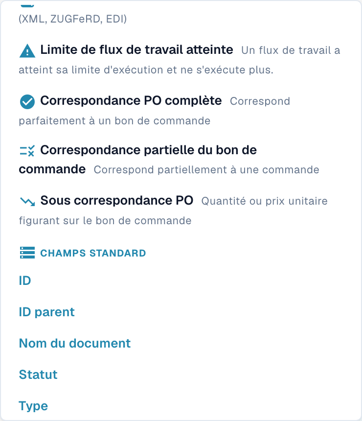

# Personnalisation des Filtres

Les filtres de recherche réduisent la liste de documents à examiner. Distinguez les critères d’une recherche des préférences administratives qui définissent l’affichage du tableau de bord.

## Rechercher des documents

Ouvrez le tableau de bord des documents et son menu de recherche ou de filtres. Choisissez les critères proposés, puis vérifiez les filtres actifs et les résultats réellement affichés. Combinez les critères selon la logique disponible dans votre version ; ne déduisez pas un résultat d’une requête incomplète.

<figure><figcaption>
Partie inférieure du menu de filtres de recherche, avec les correspondances de commande et les champs standard jusqu’à Type. Sous correspondance PO est le libellé natif maladroit du cas inférieur à la commande. Aucun filtre n’a été sélectionné.
</figcaption></figure>

La capture montre uniquement la partie inférieure du menu. **Sous correspondance PO** correspond au cas d’une quantité ou d’un prix unitaire inférieur à la valeur de la commande ; sa description native est imprécise. Les champs standard permettent d’examiner d’autres critères. Aucun filtre n’a été choisi pour l’illustration.

## Régler les filtres de statut du tableau de bord

Ouvrez **Paramètres → Tableau de bord**, puis **Filtres**. Le champ **Filtre d’état Style** est le libellé actuel du style de filtre de statut. **Custom**, encore en anglais, désigne le style personnalisé.

<figure><figcaption>
Réglages Filtres du tableau de bord. Custom reste en anglais et Filtre d’état Style est le libellé actuel. Appliquer enregistre cette préférence ; aucune préférence n’a été modifiée pendant la prise de vue.
</figcaption></figure>

Choisissez les valeurs adaptées et utilisez **Appliquer** pour enregistrer cette préférence administrative. Ce bouton ne représente pas toutes les opérations de recherche du tableau de bord.

## Vérifier et effacer une recherche

Après modification des critères, contrôlez le périmètre et les résultats. Pour élargir la recherche, retirez le critère ou son badge avec la commande proposée par votre version. Recharger une liste, effacer un filtre et enregistrer un style d’affichage sont des opérations distinctes. Aucune préférence n’a été modifiée pendant cette vérification.
