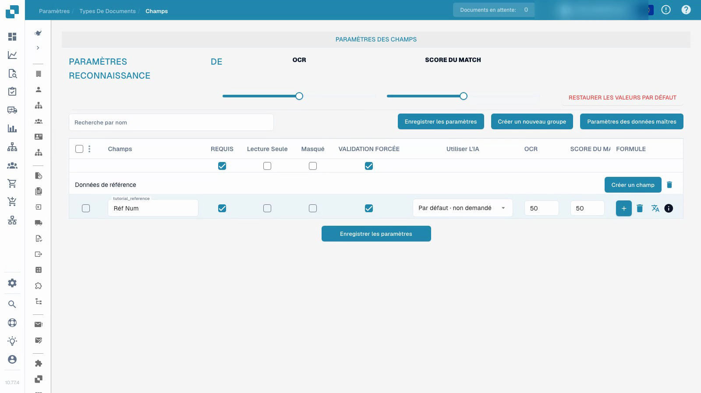

# Types de documents

La vidéo montre la configuration des champs dans un type de document de test personnalisé et isolé.


Types de documents


[Regarder avec des sous-titres](https://docbits-videos.fra1.cdn.digitaloceanspaces.com/settings-assistant/document-types-fields-admin/v1/fr.html)

Remarque : Certaines étiquettes de produits natifs peuvent ne pas être traduites. L'enregistrement préserve l'interface utilisateur réelle.

## Aperçu

Les types de documents définissent la configuration utilisée pour différents types de documents. DocBits fournit des types standard tels que les factures et les notes de crédit. Les types personnalisés permettent à un administrateur de configurer une autre catégorie de documents métier. Les types standard ne peuvent pas être supprimés ; gérez les types personnalisés dans le cadre des autorisations de l'organisation.

## Contrôles sur une carte de type de document

| Contrôle | Objectif |
| --- | --- |
| Activer | Activer ou désactiver le type de document pour le traitement. |
| Extraction | Choisissez le mode d'extraction affiché par le contrôle natif : Flex ou Fix. Il s'agit d'une sélection de mode, distincte du commutateur Activer. |
| Paramètres, affichés sous forme d'engrenage | Ouvrir une configuration supplémentaire pour ce type de document. |

Les liens disponibles dépendent du type, des autorisations et des modules activés. L'interface actuelle peut proposer des mises en page, des champs, des tableaux, des scripts, un entraînement de modèle et des sous-types de documents. Les règles de transformation, les règles de validation et la configuration des documents électroniques sont disponibles là où leurs fonctionnalités respectives s'appliquent. D'autres options de configuration peuvent se trouver dans les paramètres du type de document plutôt que dans un onglet séparé sous chaque carte.

## Configurer les champs et les informations requises

La vidéo utilise un type de document de test personnalisé, déjà créé dans un cadre séparé. Elle modifie le champ de référence de ce type ; elle ne modifie pas la configuration de facture existante.

1. Ouvrez le type de document et sélectionnez ses champs.
2. Vérifiez le groupe de champs et le nom technique stable du champ. Une étiquette d'affichage lisible est un paramètre distinct ; la modifier ne crée pas un nouvel ID de champ.
3. Rendez le champ de référence obligatoire tout en le gardant visible et modifiable. Les informations requises doivent être fournies ; le paramètre n'invente pas une valeur manquante ni ne garantit une extraction correcte.
4. Configurez la révision explicite des champs séparément de la valeur requise. La lecture seule, les éléments masqués, les seuils OCR et les seuils Match Score ont leurs propres effets ; ce ne sont pas des commutateurs interchangeables.
5. Enregistrez la configuration, rouvrez-la et vérifiez l'étiquette d'affichage et les indicateurs stockés.

<figure><figcaption>
Champs enregistrés dans un type de document de test isolé.
</figcaption></figure>

Le résultat démontré prouve que la configuration du champ a été enregistrée et rechargée. Il ne constitue pas un entraînement de modèle, une approbation de facture, une exportation ou un test de validation en aval. Avant d'utiliser une configuration en production, testez des documents représentatifs et le flux de travail prévu pour les utilisateurs ordinaires.

## Règles de validation personnalisées

Là où cette fonctionnalité est disponible, ouvrez les règles de validation du type de document. Pour réutiliser une règle existante, suivez [Dupliquer une règle de validation personnalisée](duplicate-a-custom-validation-rule.md). Ceci est distinct des indicateurs de champ individuels montrés dans la vidéo.

## Créer un type de document personnalisé

Ouvrez la section des types de documents personnalisés, choisissez Nouveau et entrez un nom clair. Terminez les étapes de configuration proposées pour le mode d'extraction prévu, les champs, les groupes et tous les tableaux. L’entraînement du modèle et la configuration de l'extraction sont distinctes du simple enregistrement d'un indicateur de champ obligatoire.


Voir [Configurer un type de document](../../../setup/document-types/) pour la procédure de configuration.


## Enregistrement supplémentaire


Types de documents

