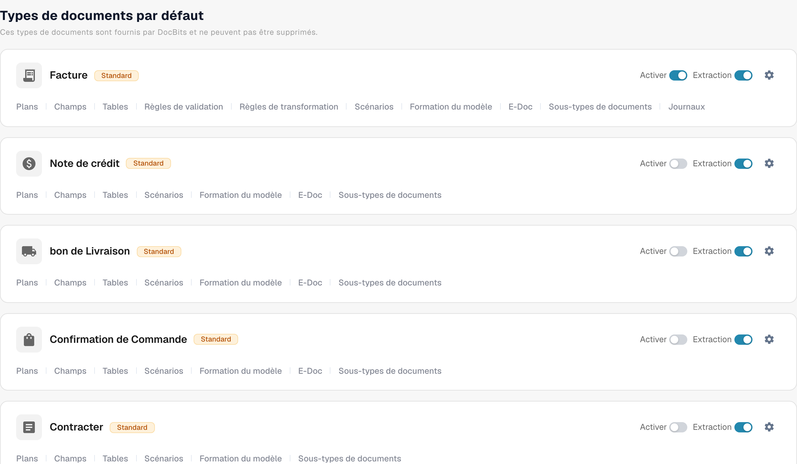

# Activer ou désactiver un type de document

Les administrateurs peuvent choisir quels types de documents sont disponibles pour leur organisation. Vous pouvez le modifier sur la page **Types de documents** sans supprimer le type ni sa configuration.

1. Ouvrez **Paramètres → Types de documents**.
2. Trouvez le type de document, par exemple **Facture**, sous **Types de documents par défaut** ou **Types de documents personnalisés**.
3. Utilisez l'interrupteur nommé **Activer** sur la carte de ce type. Un interrupteur coloré signifie que le type est actif ; un interrupteur gris signifie qu'il est inactif. Attendez le message de confirmation avant de quitter la page. Cet interrupteur n'a pas de bouton Save distinct.

<figure><figcaption>
Types de document et commandes d’activation.
</figcaption></figure>

L'interrupteur **Extraction** à côté de **Activer** est un paramètre différent. Il sélectionne le mode d'extraction (Flex ou Fix) ; il n'active ni ne désactive le type de document. L'icône d'engrenage ouvre d'autres paramètres pour ce type. Les liens sous le nom du type ouvrent ses mises en page, ses champs, ses tableaux, ses scripts et les autres zones de configuration disponibles.

DocBits fournit les types de documents par défaut, qui ne peuvent pas être supprimés. Vous pouvez également créer et gérer des types personnalisés. Consultez [Adding and Editing Document Types](adding-editing-document-types.md) pour les étapes de configuration suivantes et [Table Columns](table-columns/README.md) pour configurer les lignes d'articles extraites.
