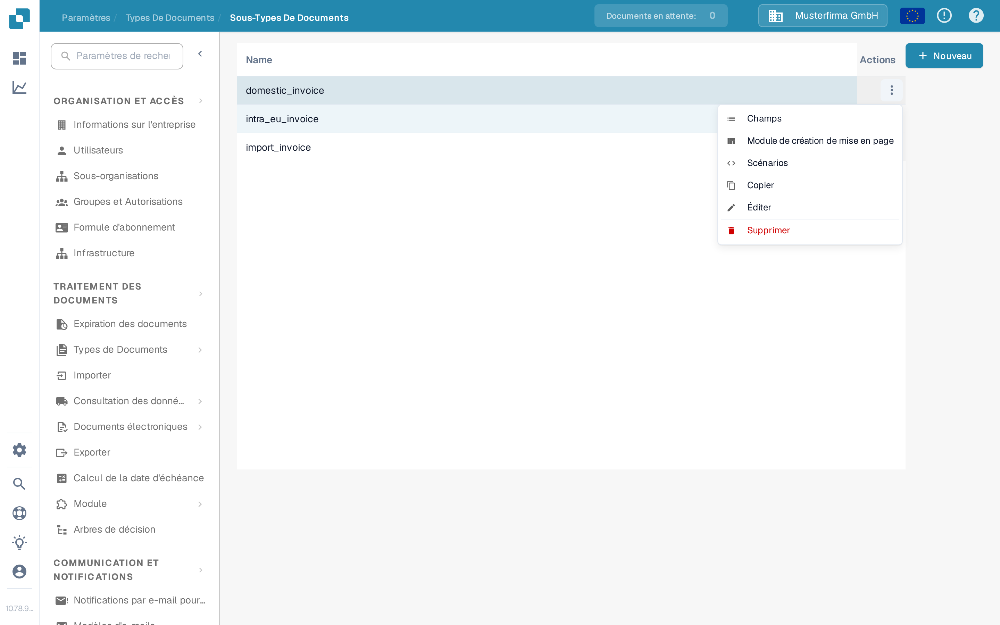
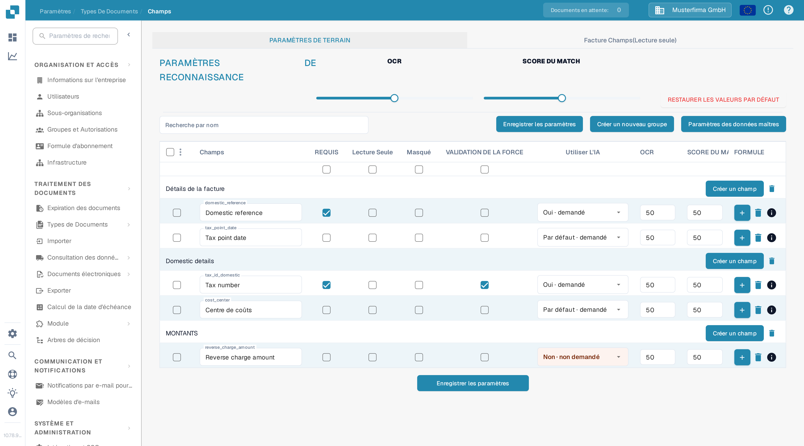
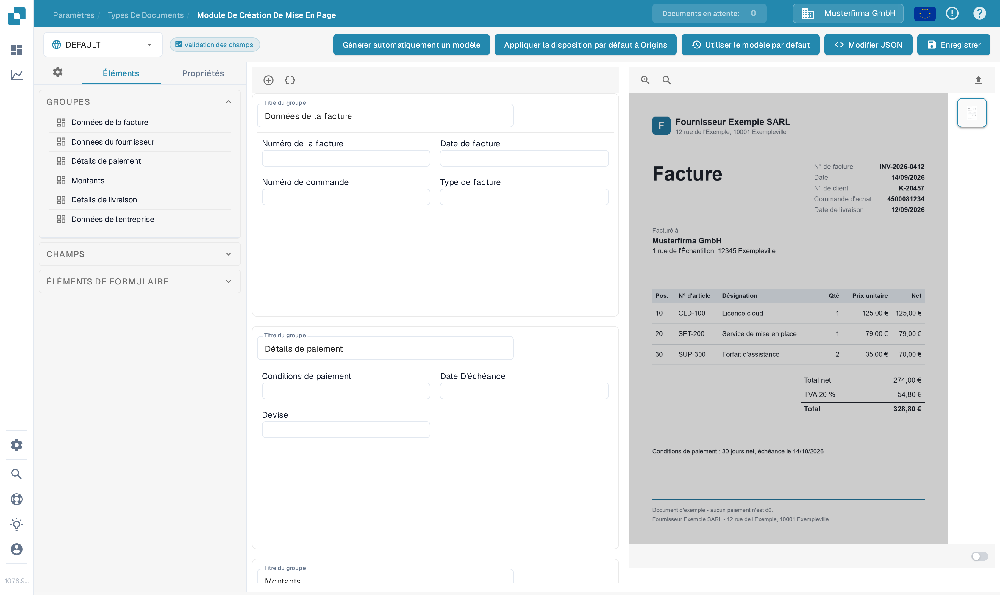
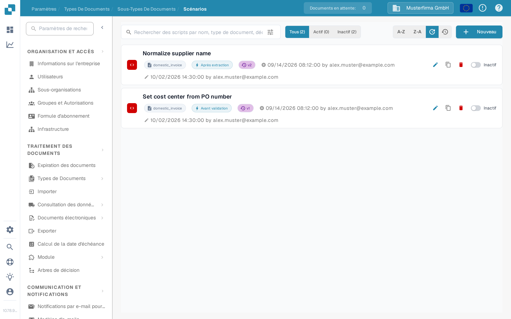

# Configurer les sous-types

Utilisez un sous-type de document lorsque des factures d'un même type de document nécessitent des champs différents, une mise en page de validation différente ou leurs propres scripts de traitement. Commencez par [créer un sous-type](creating-a-new-sub-type.md), puis ouvrez **Paramètres → Types de Documents**, choisissez le type de document et ouvrez **Sous-Types De Documents**. Dans la ligne du sous-type, ouvrez **Actions** (les trois points). Le menu propose **Champs**, **Module de création de mise en page** et **Scénarios** ; il contient également [Copier, Éditer et Supprimer](using-actions.md).

<figure><figcaption>
Choisissez la partie du sous-type que vous souhaitez configurer.
</figcaption></figure>

## Champs

Sélectionnez **Champs** pour décider des informations que les utilisateurs voient et saisissent pour ce sous-type. Vous pouvez créer un champ dans un groupe, marquer un champ existant comme requis, en lecture seule ou masqué, et ajuster les options de reconnaissance. Sélectionnez **Enregistrer les paramètres** après avoir effectué des modifications. Utilisez [Ajout et Édition de Champs](fields/adding-and-editing-fields.md) pour les étapes, [Configuration des propriétés de champ](fields/configuring-field-properties-1.md) pour les options de colonne, et [Réglages des données de base](fields/master-data-settings.md) lorsqu'un champ doit utiliser des données de recherche.

<figure><figcaption>
Paramètres de champ dans l'organisation de test de la documentation. Aucune donnée client n'est affichée.
</figcaption></figure>

## Module de création de mise en page

Sélectionnez **Module de création de mise en page** pour organiser les groupes et les champs sur l'écran de validation du document. La partie gauche liste les éléments ; la partie droite accepte un exemple de document pour l'aperçu. Vérifiez le résultat et sélectionnez **Enregistrer** lorsque la mise en page est prête. Le [guide du Constructeur de Mise en Page](../../../setup/document-types/layout-builder.md) explique les éléments, l'aperçu du document et l'enregistrement d'une mise en page.

<figure><figcaption>
Mise en page du sous-type avant l'ajout d'un exemple de document.
</figcaption></figure>

## Scénarios

Sélectionnez **Scénarios** pour afficher les scripts de ce sous-type. Dans une liste vide, sélectionnez **Nouveau** ou **Créer un script** pour commencer. La recherche et les filtres **Tous**, **Actif** et **Inactif** aident à trouver les scripts existants. Suivez [Création et modification de scripts](script/creating-and-editing-scripts.md) pour en créer un, et [Activation et gestion des scripts](script/script-activation-and-management.md) avant de l'activer pour le traitement.

<figure><figcaption>
Aucun script n'a été créé dans le sous-type de test de la documentation.
</figcaption></figure>
