# Règles de validation personnalisées



## Vue d'ensemble

Les règles de validation personnalisées permettent à un administrateur de définir **ses propres contrôles** sur les données que DocBits extrait d'un document, sans écrire de script et sans attendre une évolution du produit.

Une règle répond à trois questions :

1. **Où** le problème est-il affiché ? Sur un champ d'en-tête ou sur une cellule d'une ligne de tableau.
2. **Quand** la règle s'applique-t-elle ? Toujours, ou uniquement pour les documents (ou les lignes) qui remplissent une condition. Voir [Conditions de règle (Applies when)](rule-conditions-applies-when.md).
3. **Qu'est-ce qui doit être vrai ?** Un champ doit être renseigné, respecter un format, se situer dans une plage, correspondre à une liste, se comparer correctement à un autre champ, ou s'additionner correctement.

Lorsque le contrôle échoue, DocBits marque le champ ou la cellule sur l'**écran de validation** et affiche votre message, exactement comme pour un contrôle intégré. Avec la gravité **Erreur**, le document ne peut pas être validé tant que le problème n'est pas corrigé ; avec **Avertissement**, l'utilisateur ne reçoit qu'une indication.

Les règles sont définies par **type de document** et s'exécutent sur chaque document de ce type : pendant le traitement et à chaque enregistrement du document.

### Problèmes qu'elles résolvent

| Exigence métier | Sans règles personnalisées | Avec une règle personnalisée |
| --- | --- | --- |
| Les factures allemandes de plus de 250 EUR doivent indiquer le numéro fiscal du fournisseur | un script, ou les utilisateurs doivent y penser | **Obligatoire** sur Supplier Tax ID, *applies when* l'origine est DE et le montant total est supérieur à 250 |
| Les numéros de facture d'un fournisseur ressemblent toujours à `INV-123456` | les fautes de frappe arrivent jusqu'à l'ERP | **Modèle** `^INV-\d{6}$` sur Invoice Number pour ce fournisseur |
| Chaque ligne d'article doit avoir une quantité supérieure à zéro | des lignes avec une quantité de 0 sont exportées | **Gamme** (minimum 0.01) sur la colonne Quantity |
| La date d'échéance ne doit pas précéder la date de facture | exécutions de paiement erronées | **Comparer les champs** : Due Date égale ou postérieure à Invoice Date |
| Les lignes doivent s'additionner au montant net | seul le contrôle intégré fixe existe | **Formule** `sum(row.NET_AMOUNT) == header.total_net_amount` avec votre propre tolérance |
| Seules les devises connues de votre ERP sont autorisées | erreurs d'exportation dans l'ERP | **Liste des valeurs** sur Currency |
| Informer les utilisateurs de valeurs inhabituelles sans les bloquer | impossible | toute règle avec la gravité **Avertissement** |

## Activer les règles de validation personnalisées

Les règles de validation personnalisées s'activent **par type de document**. Il n'existe pas de commutateur à l'échelle de l'organisation.

1. Accédez à **Paramètres → Paramètres généraux → Types de documents**.
2. Sur la carte du type de document, cliquez sur l'icône **Paramètres** (engrenage).
3. Ouvrez la section **Règles de validation personnalisées** et activez le bouton.
4. Cliquez sur **Gérer les règles de validation** pour ouvrir la liste des règles.

<figure>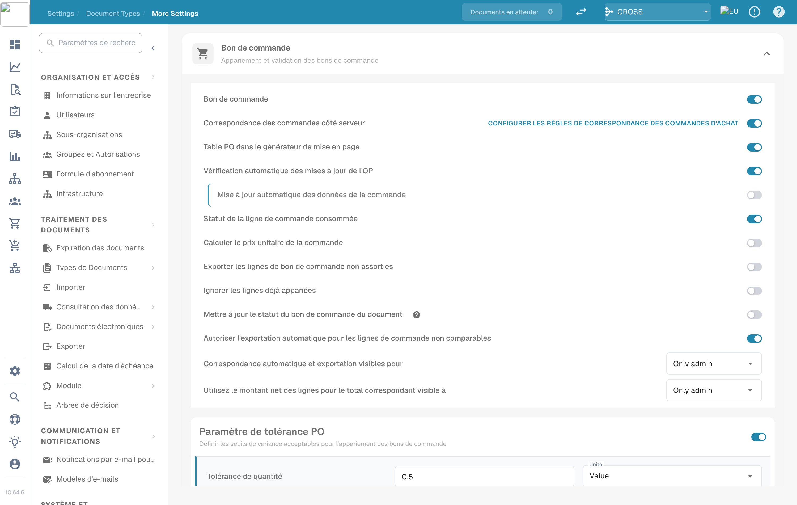<figcaption>
Les boutons pour Manage Layouts, Custom Validation Rules et Transformation Rules
</figcaption></figure>

Désormais, la carte du type de document affiche aussi un lien **Règles de validation**.

<figure><figcaption>
Les liens sur la carte du type de document
</figcaption></figure>


**Le bouton remplace les contrôles de montants intégrés.** Tant que les règles de validation personnalisées sont activées pour un type de document, les contrôles codés en dur « montant total = montant net + montant de la taxe » ainsi que les contrôles du montant des lignes et des remises ne sont **pas** exécutés pour ce type ; les règles configurables prennent leur place. Recréez les contrôles dont vous dépendez sous forme de règles (voir les [recettes](#recettes)) avant de l'activer. Désactiver le bouton rétablit les contrôles intégrés. Toutes les autres validations de champs (champs obligatoires, formats, données de base) continuent de s'exécuter.


## La liste des règles

**Types de documents → (type de document) → Règles de validation** répertorie toutes les règles du type de document.

<figure>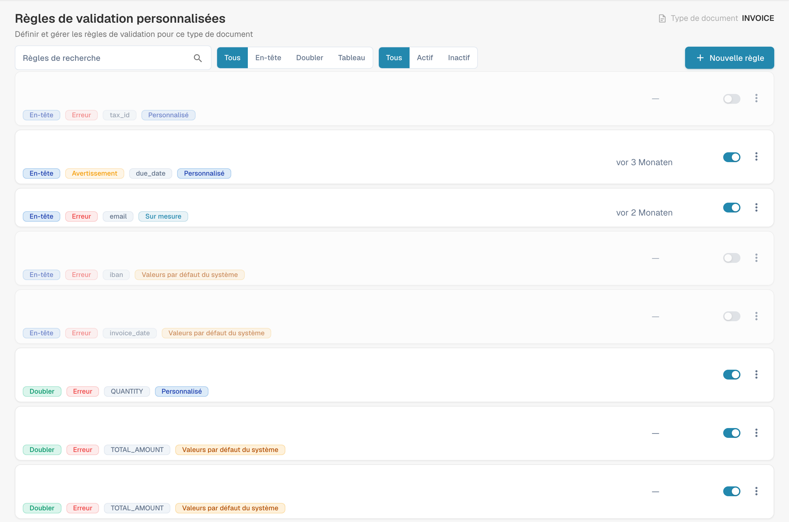<figcaption>
Gestion des règles de validation avec les noms configurés masqués.
</figcaption></figure>

Chaque carte affiche le nom et la description de la règle, ainsi que les badges de son **niveau** (Header / Line / Table), de sa **gravité** (Error / Warning), du **champ** auquel l'erreur est rattachée et de sa **source**. Utilisez l'interrupteur à droite pour activer ou désactiver une règle, et le menu **⋮** pour la dupliquer ou la supprimer. Filtrez la liste par niveau (**All / Header / Line / Table**) et par état (**All / Active / Inactive**), ou effectuez une recherche.

### Règles System default, Customized et Custom

| Source | De quoi s'agit-il | Ce que vous pouvez faire |
| --- | --- | --- |
| **Valeurs par défaut du système** | Une règle livrée avec DocBits pour toutes les organisations. | Elle ne peut pas être modifiée directement : le générateur affiche « This is a system default rule and cannot be edited. » Cliquez sur **Personnaliser** pour créer votre propre copie modifiable, ou désactivez-la pour l'arrêter dans votre organisation. |
| **Personnalisé** | Une règle système par défaut que votre organisation a modifiée ou désactivée. | Modifiez-la comme votre propre règle. **Réinitialiser par défaut** supprime votre copie et rétablit l'original. |
| **Coutume** | Une règle créée par votre organisation. | Modifier, **Dupliquer**, **Supprimer**. |

Les modifications apportées aux règles système par défaut n'affectent jamais les autres organisations.

## Créer une règle

Cliquez sur **Nouvelle règle**. Le générateur comporte trois étapes. **Règle de test** et **Enregistrer** se trouvent en haut à droite.

### Étape 1 : Nom et portée (Name & scope)

<figure>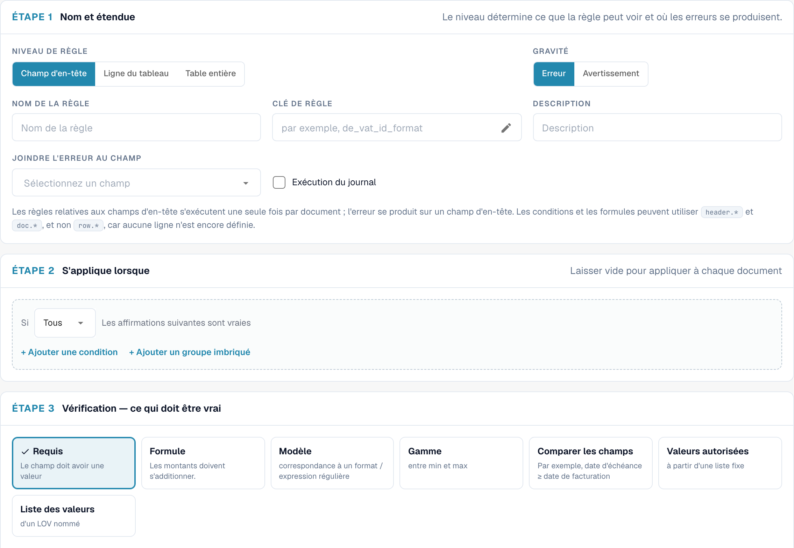<figcaption>
Étape 1 pour une règle sur un champ d'en-tête
</figcaption></figure>

| Paramètre | Ce qu'il fait |
| --- | --- |
| **Niveau de règle** | Ce que la règle examine et où l'erreur est affichée. Voir [Niveaux de règle](#niveaux-de-regle). |
| **Gravité** | **Erreur** marque le champ comme invalide et bloque la validation. **Avertissement** affiche le message mais ne bloque jamais. |
| **Nom de la règle** | Affiché dans la liste, dans les journaux et aux administrateurs. Faites-en une description de la règle (« Numéro fiscal du fournisseur obligatoire pour les factures allemandes »). |
| **Clé de règle** | Une clé technique générée à partir du nom. Elle reste identique si vous renommez la règle par la suite. Cliquez sur le crayon pour choisir votre propre clé avant le premier enregistrement ; ensuite, elle est figée. |
| **Description** | Explication facultative pour les autres administrateurs. |
| **Nom de la table** | *Table line uniquement.* Le tableau dont les lignes sont contrôlées, par exemple `INVOICE_TABLE`. |
| **Attach error to field / column** | Le champ (ou, pour les lignes de tableau, la colonne) qui affiche l'erreur sur l'écran de validation. |

#### Niveaux de règle

| Niveau | S'exécute | L'erreur est affichée sur | Peut lire | Règle typique |
| --- | --- | --- | --- | --- |
| **Champ d'en-tête** | une fois par document | un champ d'en-tête | `header.*`, `doc.*` | « Le numéro fiscal du fournisseur est obligatoire pour les factures allemandes » |
| **Ligne du tableau** | une fois pour chaque ligne du tableau sélectionné | la cellule de la ligne en échec | `row.*` (la ligne courante), `header.*`, `doc.*` | « La quantité doit être supérieure à zéro » |
| **Table entière** | une fois par document, en considérant toutes les lignes ensemble | un champ d'en-tête | totaux sur les lignes (`sum()`, `count()`, `min()`, `max()`), `header.*`, `doc.*` | « Les montants nets des lignes doivent s'additionner au montant net » |

<figure>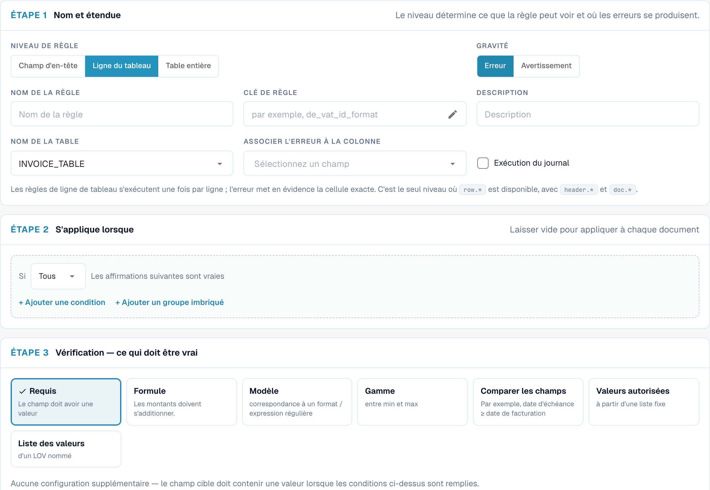<figcaption>
Une règle sur une ligne de tableau : le tableau et la colonne qui affiche l'erreur
</figcaption></figure>

### Étape 2 : Applies when

Décidez si la règle s'exécute pour chaque document ou seulement pour certains. Laissez vide pour contrôler tous les documents. Sinon, ajoutez des lignes de condition, par exemple « Document Origin is Deutsch » et « Total Amount greater than 250 », et combinez-les avec **Tous** / **N'IMPORTE LEQUEL** et des groupes imbriqués.

<figure>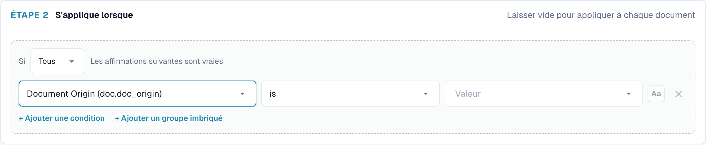<figcaption>
Le contrôle ne s'exécute que pour les documents allemands supérieurs à 250 avec EUR ou sans devise
</figcaption></figure>

Pour les règles sur les lignes de tableau, la condition peut aussi utiliser les colonnes de la ligne courante, et elle est évaluée **ligne par ligne** : les lignes qui ne correspondent pas ne sont tout simplement pas contrôlées.

<figure>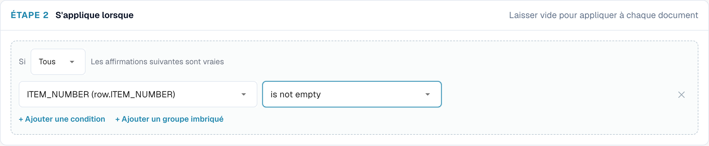<figcaption>
Seules les lignes d'article (lignes avec un numéro d'article) sont contrôlées
</figcaption></figure>

Les conditions sont expliquées en détail (chaque champ, opérateur et règle de comparaison, avec de nombreux exemples) sur la page [Conditions de règle (Applies when)](rule-conditions-applies-when.md).

### Étape 3 : Contrôle (Check) : ce qui doit être vrai

Choisissez un contrôle. Les paramètres sous les cartes changent selon le contrôle choisi.

<figure>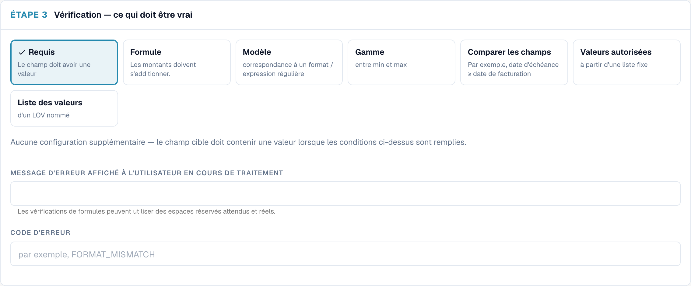<figcaption>
Les sept contrôles. Required ne nécessite aucun paramètre supplémentaire
</figcaption></figure>

#### Required : le champ doit avoir une valeur

<figure>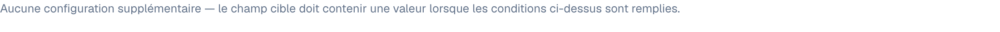<figcaption>
Un contrôle Required : aucune configuration supplémentaire
</figcaption></figure>

Échoue lorsque le champ est vide (absent ou ne contenant que des espaces). Aucun paramètre supplémentaire.

Utilisez-le avec **S'applique lorsque** pour rendre un champ obligatoire **sous condition**. Un champ qui doit toujours être renseigné se configure plutôt comme champ obligatoire dans les paramètres du champ.

> *Supplier Tax ID est obligatoire* : applies when *Document Origin is Deutsch* et *Total Amount greater than 250*.

#### Formula : les montants doivent s'additionner

Une comparaison arithmétique. L'expression contient exactement **une** comparaison (`==`, `!=`, `>`, `>=`, `<`, `<=`) ; les deux côtés peuvent utiliser `+ - * /`, des nombres, des parenthèses et des références de champs.

<figure><figcaption>
Une formule sur tout le tableau avec une tolérance et des espaces réservés dans le message
</figcaption></figure>

* Cliquez sur les puces sous l'expression pour insérer des fonctions et des préfixes de champ : `sum()`, `count()`, `min()`, `max()`, `default()`, `coalesce()`, `header.`, `doc.`. Pendant que vous saisissez un nom de champ, une liste des champs correspondants s'ouvre.
* `sum(row.NET_AMOUNT)`, `count(row.ITEM_NUMBER)`, `min(...)`, `max(...)` fonctionnent sur toutes les lignes et ne sont disponibles qu'au niveau **Table entière**. `count()` compte les lignes dans lesquelles la colonne est renseignée.
* `default(header.discount, 0)` utilise `0` lorsque le champ est vide ; `coalesce(header.a, header.b, 0)` utilise la première valeur renseignée.
* **Tolérance** : pour `==` et `!=`, les écarts jusqu'à ce montant sont considérés comme égaux. Utilisez `0.01` ou `0.05` pour absorber les arrondis. Elle n'a aucun effet sur `<`, `>`, `<=` et `>=`.
* Les montants vides ou illisibles comptent pour `0`. Une division par zéro ignore la règle au lieu de provoquer une erreur.
* Dans le message d'erreur, `{actual}` est remplacé par le résultat du côté gauche et `{expected}` par le résultat du côté droit.

Exemples :

| Objectif | Niveau | Expression | Tolérance |
| --- | --- | --- | --- |
| Les totaux d'en-tête sont cohérents | Header field | `header.total_amount == header.total_net_amount + header.total_tax_amount` | 0.01 |
| Les lignes s'additionnent au montant net | Whole table | `sum(row.NET_AMOUNT) == header.total_net_amount` | 0.05 |
| Montant de la ligne = quantité × prix unitaire | Table line | `row.NET_AMOUNT == row.QUANTITY * row.UNIT_PRICE` | 0.01 |
| Taxe non supérieure à 19 % du montant net | Header field | `header.total_tax_amount <= header.total_net_amount * 0.19` | – |
| Au moins une ligne | Whole table | `count(row.ITEM_NUMBER) >= 1` | 0 |

#### Pattern : correspondre à un format / une expression régulière

<figure>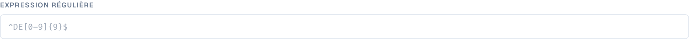<figcaption>
Un contrôle Pattern avec une expression régulière
</figcaption></figure>

La valeur doit correspondre à une **expression régulière**. L'expression recherche dans la valeur ; ancrez-la donc avec `^` (début) et `$` (fin) lorsque la valeur entière doit correspondre. Cochez **Correspondance insensible à la casse** si la casse n'a pas d'importance.

| Format | Expression régulière |
| --- | --- |
| `INV-` suivi de six chiffres | `^INV-\d{6}$` |
| Numéro de TVA allemand | `^DE\d{9}$` |
| Commande d'achat commençant par 45 et comportant 10 chiffres | `^45\d{8}$` |
| Uniquement des chiffres | `^\d+$` |
| IBAN (contrôle approximatif) | `^[A-Z]{2}\d{2}[A-Z0-9]{11,30}$` |

#### Range : entre un minimum et un maximum

<figure>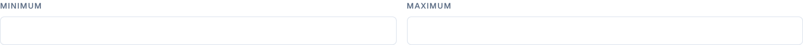<figcaption>
Range avec un minimum uniquement : les quantités doivent être d'au moins 0.01
</figcaption></figure>

La valeur doit être un nombre compris entre **Minimum** et **Maximum** (inclus). Renseignez l'un des deux ou les deux. Une valeur qui n'est pas un nombre échoue. Les montants formatés tels que `1.234,56` sont compris.

#### Compare fields : par exemple, date d'échéance ≥ date de facture

<figure>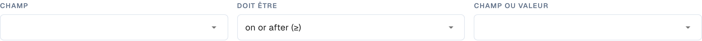<figcaption>
Compare fields : comparer un champ avec un autre champ, avec aujourd'hui ou une valeur fixe
</figcaption></figure>

Compare la valeur d'un champ avec un autre champ, avec **aujourd'hui** ou avec une valeur fixe, à l'aide de *equal to*, *not equal to*, *greater than*, *less than*, *on or after (≥)* ou *on or before (≤)*. Les nombres sont comparés comme des nombres et les dates comme des dates.

* Date d'échéance **à compter de (≥)** Date de facture
* Invoice Date **on or before (≤)** aujourd'hui : aucune facture datée dans le futur
* Discount **moins que** 100

#### Valeurs autorisées : à partir d'une liste fixe

<figure>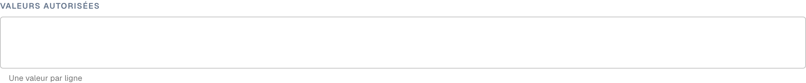<figcaption>
Allowed values : une valeur par ligne, éventuellement sans tenir compte de la casse
</figcaption></figure>

La valeur doit être l'une des valeurs que vous saisissez, **une valeur par ligne**. Insensible à la casse en option. Idéal pour les listes courtes et stables (`EUR`, `CHF`, `USD`).

#### List of Values : à partir d'une LOV nommée

<figure>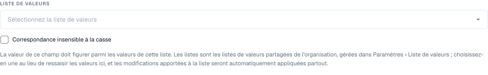<figcaption>
List of Values : les valeurs proviennent d'une liste nommée des paramètres
</figcaption></figure>

Comme *Allowed values*, mais les valeurs proviennent d'une **Liste des valeurs** partagée, gérée sous **Settings › List of Values**. Choisissez la liste au lieu de la ressaisir ; lorsque la liste change, la règle utilise les nouvelles valeurs (après un court délai de mise en cache). Seules les valeurs des entrées de la liste comptent, pas leurs libellés.


À l'exception de **Obligatoire**, chaque contrôle **réussit lorsque la valeur est vide**. Une règle Pattern sur le Purchase Order ne se plaint pas des factures sans commande d'achat. Si une valeur vide pose aussi problème, ajoutez une règle Required, ou limitez la règle avec *Applies when … is not empty*.


#### Message d'erreur et code d'erreur

* **Message d'erreur affiché à l'utilisateur en cours de traitement** : le texte affiché sur l'écran de validation. Indiquez ce qui ne va pas **et** ce qu'il faut faire : « Le numéro fiscal du fournisseur est manquant. Les factures allemandes de plus de 250 EUR doivent l'indiquer. »
* **Code d'erreur** : un court code technique, par exemple `REQUIRED_CONDITIONAL`, `FORMAT_MISMATCH`, `OUT_OF_RANGE`, `DATE_ORDER`, `LINES_HEADER_MISMATCH`, `VALUE_NOT_ALLOWED`. Il apparaît dans les exportations et les journaux et permet de regrouper les erreurs.

## Tester la règle

Cliquez sur **Règle de test** pour exécuter la version actuelle de la règle (enregistrée ou non) sur un document. Saisissez un **ID du document**, ou passez à **Par document JSON** et collez des données extraites. **Rien n'est enregistré**, et le document n'est pas modifié.

Le résultat correspond à l'un des trois cas suivants :

| Résultat | Signification |
| --- | --- |
| **Règle non respectée — erreur signalée** | La condition correspondait et le contrôle a échoué. Le message est affiché exactement comme l'utilisateur le verrait. |
| **La règle a été adoptée.** | La condition correspondait et le contrôle a réussi. Les règles sur les lignes de tableau affichent le résultat par ligne (« 4 of 4 checked rows passed »). |
| **Règle ignorée — portée non correspondante** | La condition *Applies when* était fausse pour ce document ; rien n'a donc été contrôlé et aucune erreur n'a été levée. |

<figure>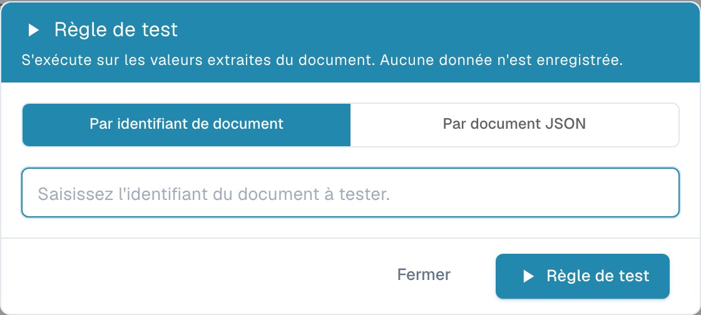<figcaption>
La facture allemande n'a pas de numéro fiscal du fournisseur : la règle échoue avec le message configuré
</figcaption></figure>

<figure>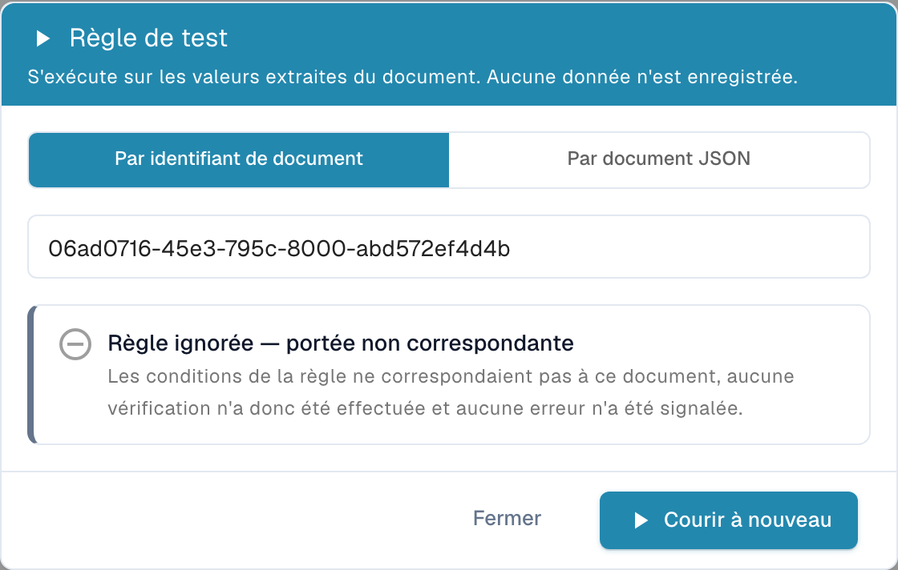<figcaption>
La même règle avec le seuil relevé à 1000 : la facture (469.18) n'entre pas dans la portée, la règle est donc ignorée
</figcaption></figure>

<figure>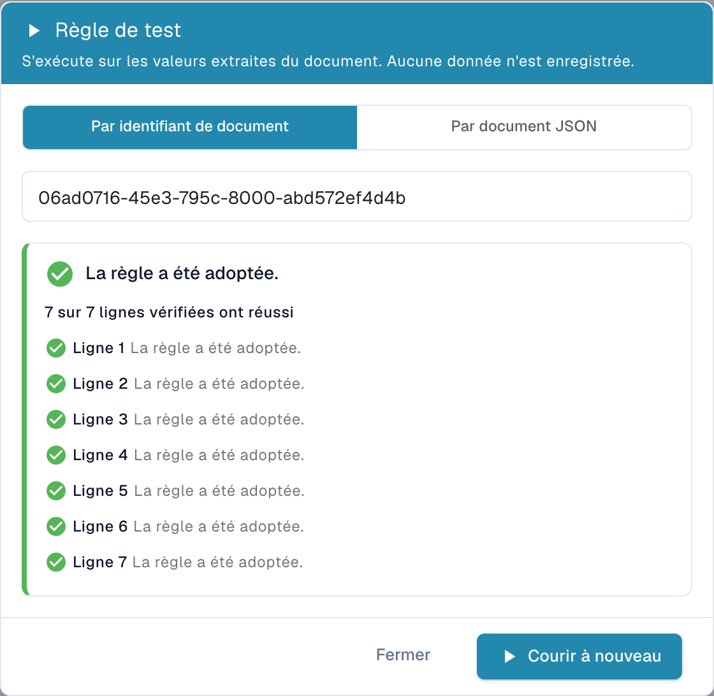<figcaption>
Une règle sur les lignes de tableau indique chaque ligne contrôlée
</figcaption></figure>

Testez chaque nouvelle règle sur au moins un document qui doit échouer, un qui doit réussir et un qui doit être ignoré.

## Quand les règles s'exécutent

* **Pendant le traitement**, avec les autres validations, après l'extraction et les règles de transformation.
* **À chaque enregistrement** du document sur l'écran de validation.
* **Après une modification de règle**, les documents existants ne sont **pas** tous recontrôlés d'un seul coup. Chaque document est recontrôlé avec les nouvelles règles à son prochain enregistrement ou retraitement. Les documents déjà exportés ne sont pas concernés.
* Les règles s'exécutent par ordre de priorité (puis par clé). Un champ n'affiche qu'**une** erreur : si deux règles échouent sur le même champ, la première l'emporte ; les suivantes ne l'écrasent pas.
* Les avertissements sont collectés séparément et ne masquent jamais une erreur.
* Si une règle ne peut pas être évaluée (par exemple une division par zéro dans une formule), elle est ignorée. Une règle défectueuse ne marque jamais un document comme invalide par erreur.

## Recettes

Copiez ces règles comme point de départ. Les clés de champs et de colonnes sont celles du type de document standard **Facture** ; adaptez-les à vos types de documents.

**1. Numéro fiscal du fournisseur pour les factures allemandes supérieures à 250 EUR**
Header field · Error · rattaché à *Supplier Tax ID* · Applies when **Tous** : *Document Origin* is *Deutsch*, *Total Amount* greater than *250* · Contrôle **Obligatoire** · Message « Le numéro fiscal du fournisseur est manquant. Les factures allemandes de plus de 250 EUR doivent l'indiquer. » · Code `REQUIRED_CONDITIONAL`.

**2. Les totaux d'en-tête s'additionnent** (remplace le contrôle intégré)
Header field · Error · rattaché à *Total Amount* · toujours · **Formule** `header.total_amount == header.total_net_amount + header.total_tax_amount`, tolérance `0.01` · Message « Le total {actual} ne correspond pas au net plus la taxe ({expected}). »

**3. Les lignes s'additionnent au montant net** (remplace le contrôle intégré)
Whole table · Error · rattaché à *Total Net Amount* · toujours · **Formule** `sum(row.NET_AMOUNT) == header.total_net_amount`, tolérance `0.05` · Message « Les montants nets des lignes totalisent {actual}, mais le montant net de la facture est {expected}. » · Code `LINES_HEADER_MISMATCH`.

**4. La quantité doit être positive sur les lignes d'article**
Table line · Error · tableau `INVOICE_TABLE`, colonne `QUANTITY` · Applies when *row.ITEM_NUMBER* is not empty · **Gamme** minimum `0.01` · Code `OUT_OF_RANGE`.

**5. Montant de la ligne = quantité × prix unitaire**
Table line · Warning · colonne `NET_AMOUNT` · toujours · **Formule** `row.NET_AMOUNT == row.QUANTITY * row.UNIT_PRICE`, tolérance `0.01`.

**6. Format du numéro de facture d'un fournisseur**
Header field · Error · *Invoice Number* · Applies when *Supplier ID* is *20723* · **Modèle** `^INV-\d{6}$`.

**7. Date d'échéance non antérieure à la date de facture**
Header field · Error · *Due Date* · toujours · **Comparer les champs** Due Date *on or after (≥)* Invoice Date · Code `DATE_ORDER`.

**8. Aucune facture datée dans le futur**
Header field · Error · *Invoice Date* · toujours · **Comparer les champs** Invoice Date *on or before (≤)* aujourd'hui.

**9. Uniquement les devises approuvées (simple avertissement)**
Header field · **Avertissement** · *Currency* · toujours · **Liste des valeurs** *approved_currencies* · Code `VALUE_NOT_ALLOWED`.

**10. Commande d'achat obligatoire au-dessus de 5 000**
Champ d'en-tête · Erreur · *Bon de commande* · S'applique lorsque *Montant total* supérieur à *5000* · **Obligatoire**.

## Bonnes pratiques

* **Commencez par un avertissement.** Enregistrez une nouvelle règle avec la gravité **Avertissement**, observez-la pendant quelques jours (Test rule, journaux), puis passez-la en **Erreur**.
* **Une règle, un message.** Plusieurs petites règles avec des messages clairs sont plus faciles à comprendre qu'une grande formule.
* **Utilisez Applies when plutôt que des copies.** Une règle avec une condition vaut mieux que cinq copies pour cinq fournisseurs.
* **Soyez tolérant avec les montants.** Donnez toujours une tolérance aux formules de montants.
* **Nommez les règles d'après la règle métier**, pas d'après la technique (« Date d'échéance non antérieure à la date de facture », et non « Règle de comparaison 3 »).

## Dépannage

| Symptôme | Ce qu'il faut vérifier |
| --- | --- |
| La règle ne lève jamais d'erreur | La fonctionnalité est-elle activée pour le type de document et la règle **Actif** ? Exécutez **Règle de test** sur le document : « skipped » signifie que *Applies when* était faux. |
| Un champ vide n'est pas signalé | Seul **Obligatoire** signale les valeurs vides. Ajoutez une règle Required. |
| Les contrôles de totaux intégrés ont disparu | Comportement attendu tant que les règles personnalisées sont activées. Recréez-les sous forme de règles Formula (recettes 2 et 3). |
| Une règle modifiée n'a aucun effet sur un document | Les documents sont recontrôlés à leur prochain enregistrement. Enregistrez ou retraitez le document. |
| Un Pattern correspond à des valeurs qu'il ne devrait pas | Les motifs recherchent à l'intérieur de la valeur. Ancrez avec `^` et `$`. |
| Une seule de deux erreurs est affichée sur un champ | Un champ n'affiche que la première règle en échec. Ajustez les priorités ou rattachez l'une des règles à un autre champ. |
| Les colonnes de tableau manquent dans *Applies when* | Elles ne sont disponibles qu'au niveau **Ligne du tableau**. |
| La règle système par défaut ne peut pas être modifiée | Cliquez sur **Personnaliser** pour créer votre propre copie. |

## Voir aussi

* [Conditions de règle (Applies when)](rule-conditions-applies-when.md) : les conditions en détail
* [Règles de transformation](transformation-rules.md) : corrigez les valeurs avant leur validation
* [Règles de sélection de mise en page](layout-manager/layout-selection-rules.md) : choisissez la mise en page utilisée par un document
* [Paramétrage de la validation et du score de correspondance](fields/setting-validation-and-match-score.md) : paramètres de validation par champ
