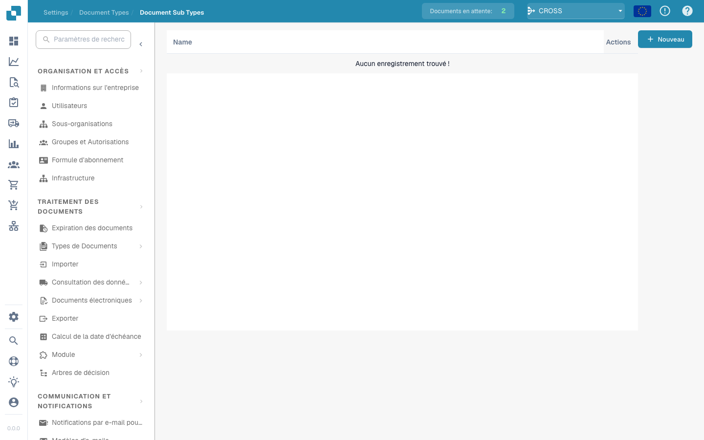

# Sous-Types de Document

<figure><figcaption></figcaption></figure>

#### Aperçu

Les types de documents sont essentiellement des versions spécialisées des principaux types de documents. Par exemple, sous le type de document principal "Facture", il peut y avoir des sous-types comme "Facture standard", "Facture pro forma" et "Avoir", chacun ayant des exigences de données ou des règles de traitement légèrement différentes.

#### Fonctionnalités clés et options

1. **Liste des sous-types**:

* Chaque ligne représente un sous-type d'un type de document principal.
* Inclut le nom du sous-type et un ensemble d'actions pouvant être effectuées sur celui-ci.

2. **Actions**:

* **Champs**: Configurez quels champs de données sont inclus dans le sous-type et comment ils sont gérés.
* **Modifier la mise en page**: Modifiez la mise en page visuelle pour afficher et saisir les informations pour ce sous-type.
* **Scripts**: Attachez ou modifiez des scripts qui exécutent des opérations spécifiques lorsque des documents de ce sous-type sont traités.
* **Copier**: Dupliquez une configuration de sous-type existante pour l'utiliser comme base pour une nouvelle.
* **Supprimer**: Supprimez le sous-type s'il n'est plus nécessaire.

3. **Ajout de nouveaux sous-types**:

* Le bouton "+ Nouveau" permet aux administrateurs de créer de nouveaux sous-types, en définissant des propriétés et des règles uniques selon les besoins.

Les sous-types de documents dans Docbits offrent un moyen flexible et puissant de gérer une variété de documents au sein d'un seul système, garantissant que chaque type et sous-type est traité avec précision et efficacité selon ses spécifications uniques.


