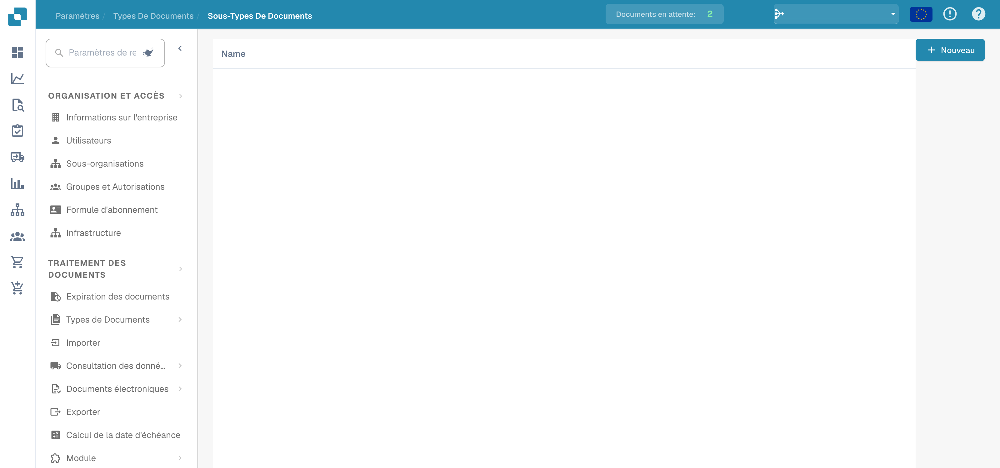
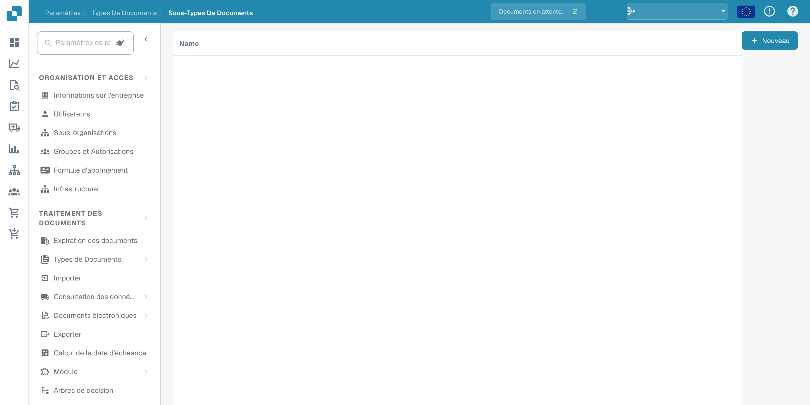

# Sous-types de document

Les sous-types distinguent des catégories au sein d’un type de document. Ouvrez les types de document dans les paramètres et choisissez le lien des sous-types du type prévu.

<figure><figcaption>
Vue d’ensemble des sous-types de document.
</figcaption></figure>

La liste présente les sous-types configurés. Certaines en-têtes peuvent rester en anglais dans l’interface.

<figure><figcaption>
Liste des sous-types de document dans l’administration.
</figcaption></figure>

Créez un nouveau sous-type et vérifiez son nom et sa configuration avant de l’enregistrer. Ces exemples présentent la vue d’ensemble et la liste ; ils ne démontrent pas un sous-type créé ni des paramètres enregistrés.
