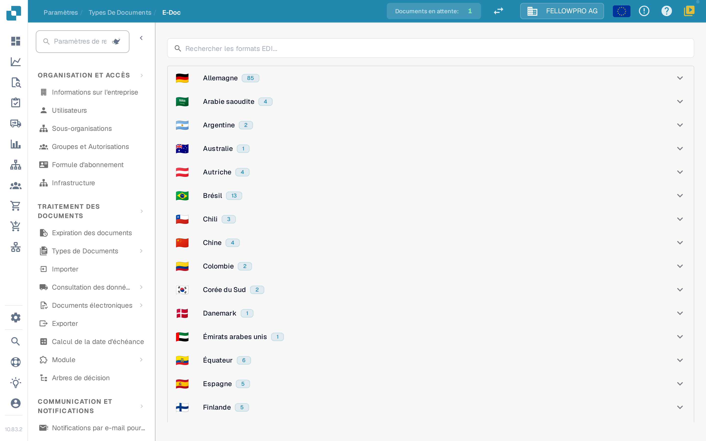
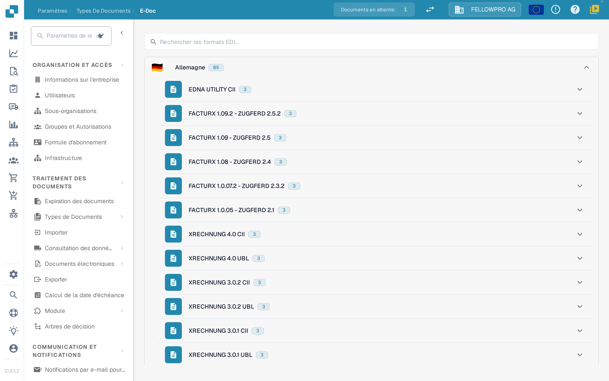
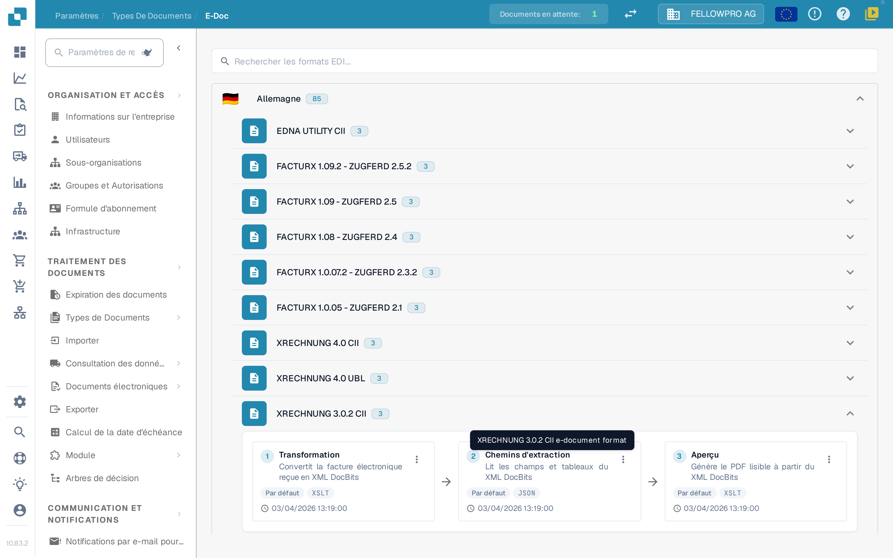
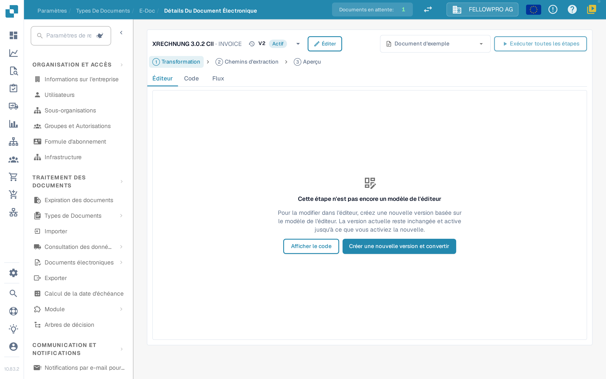
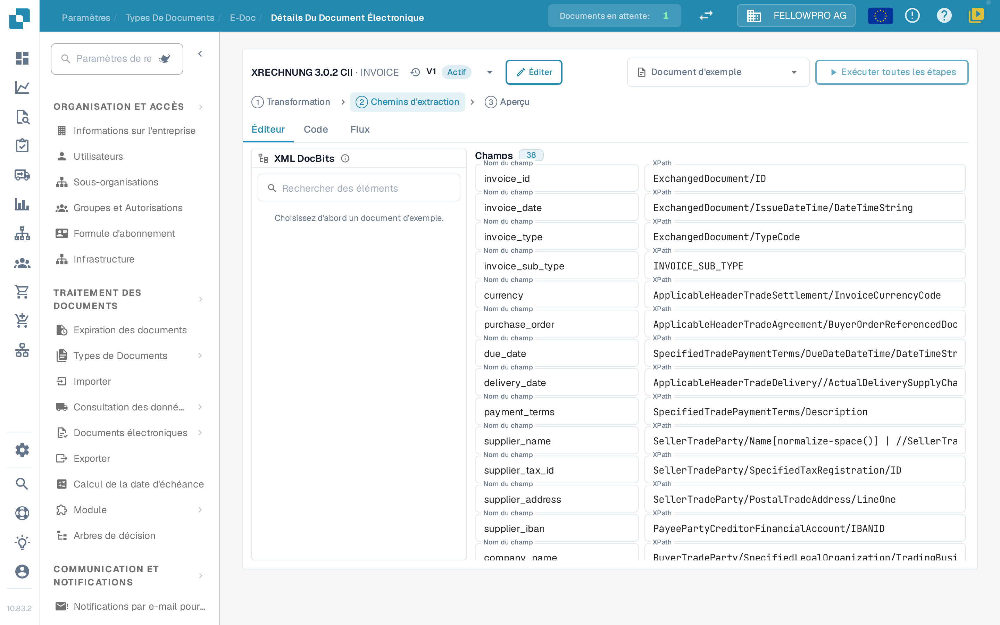

# Documents électroniques et configuration EDI


DocBits Tutoriel sur la facture électronique : traiter XRechnung / ZUGFeRD (Factur-X), valider les données et automatiser les flux de travail


Les documents électroniques tels que XRechnung, ZUGFeRD/Factur-X, CFDI ou FatturaPA arrivent en XML ou en PDF hybride. DocBits lit le fichier, extrait les données de la facture et génère un PDF lisible. Les paramètres **E-Doc** contiennent les règles de chaque format utilisé par votre organisation.

## Ouvrir l'administration E-Doc

1. Ouvrez **Paramètres → Types de documents**.
2. Sélectionnez le type de document, par exemple **Facture**, puis ouvrez **E-Doc**.

Les formats sont regroupés par pays. Chaque pays affiche son drapeau, son nom et le nombre de formats qu'il contient.

<figure><figcaption>
Les formats sont regroupés par pays et repliés au départ.
</figcaption></figure>

Sélectionnez un pays pour ouvrir ses formats. Dans un pays, la version la plus récente vient en premier. Les formats combinés comme Factur-X / ZUGFeRD se trouvent sous l'Allemagne. Le champ de recherche parcourt en même temps les noms de formats et de pays.

<figure><figcaption>
Ouvrez un pays pour voir ses formats.
</figcaption></figure>

## Les formats et leurs étapes

Chaque format affiche ses étapes sous forme de trois cartes reliées par des flèches, dans l'ordre où DocBits les exécute :

| Étape | Ce qu'elle fait |
| --- | --- |
| **Transformation** | Met en correspondance le XML entrant avec le XML DocBits. |
| **Chemins d'extraction** | Définit les valeurs que DocBits récupère dans le XML transformé. |
| **Aperçu** | Définit la mise en page du PDF lisible que DocBits génère. |

Les autres attributs du format sont listés sous les cartes.

<figure><figcaption>
Les trois étapes d'un format : Transformation, Chemins d'extraction et Aperçu.
</figcaption></figure>

Sélectionnez une carte pour ouvrir cette étape.

## Modifier une étape

La page de détail a la même structure pour les trois étapes :

* L'en-tête affiche le format et une liste déroulante avec ses versions, y compris le statut de chaque version. Depuis cette liste, vous pouvez activer, modifier ou supprimer une version.
* **Éditeur**, **Code** et **Flux** permettent de basculer entre l'éditeur visuel, la feuille de style ou le JSON sous-jacent, et le résultat du pipeline.
* **Document d'exemple** propose les derniers documents de ce format ; vous pouvez aussi coller un ID ou une URL de document.
* **Exécuter toutes les étapes** exécute transformation, extraction et aperçu pour le document d'exemple en une seule fois.
* **Ctrl + S** enregistre un brouillon.

Modifier une version active ou déjà utilisée ne la change pas : DocBits crée une copie en brouillon et ouvre celle-ci. Un brouillon inutilisé est modifié directement. Une étape écrite à la main reste dans **Code** jusqu'à ce que l'éditeur puisse la reprendre sans modification.

<figure><figcaption>
La page de détail : liste déroulante des versions dans l'en-tête, onglets Éditeur, Code et Flux, document d'exemple et l'étape elle-même.
</figcaption></figure>

### Transformation

L'**Éditeur** affiche le XML source à gauche, le mapping au milieu et le XML résultant à droite. Sélectionnez un élément dans l'arborescence source et déposez-le sur un champ, ou ajoutez une valeur de texte fixe.

Un champ peut être construit à partir de plusieurs parties, et chaque partie peut avoir une condition : **existe**, **est absent**, **égal à**, **différent de** ou une expression XPath libre, reliées par **tous** ou **au moins un**. Les trois zones peuvent être redimensionnées, et la zone de résultat propose une liste **Champs** et la vue **XML**.

### Chemins d'extraction

L'éditeur des chemins d'extraction affiche le XML DocBits à gauche, les champs au milieu et le chemin utilisé par chaque champ à droite. Sélectionnez un champ et définissez son chemin ; les entrées existantes, y compris les anciennes entrées plates, continuent de fonctionner.

<figure><figcaption>
L'éditeur des chemins d'extraction : XML DocBits, champs et leurs chemins.
</figcaption></figure>

### Aperçu

L'éditeur d'aperçu organise le PDF avec des blocs en glisser-déposer et affiche le résultat à côté. Taille de page, marges, taille de police, couleurs et espacement des blocs sont définis pour tout le document et s'appliquent à chaque bloc.

### Flux

**Flux** montre l'ensemble du pipeline pour le document d'exemple choisi : ce que la transformation a produit, les valeurs trouvées par les chemins d'extraction et la façon dont l'aperçu les affiche. Utilisez-le pour vérifier un changement de bout en bout sans quitter la page.

## Pages liées

* [Formats eDocs, versions et guides par pays](supported-electronic-documents/README.md)

Les captures d'écran de cette page montrent l'interface en français.
