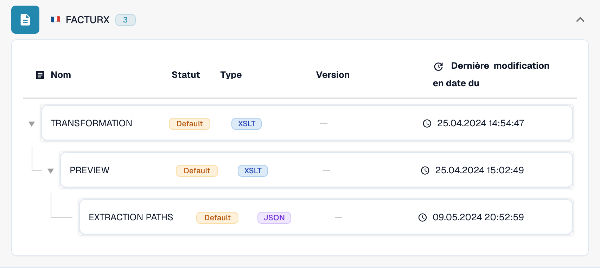

# Un avoir électronique est reconnu comme une facture

Un avoir électronique peut apparaître comme **Invoice** alors que son XML d’origine contient un code d’avoir. Vérifiez la configuration effectivement utilisée avant de considérer ce comportement comme un défaut du produit. Une **TRANSFORMATION** propre à l’organisation a priorité sur celle par défaut pour le format eDoc concerné. Une constante telle que `<INVOICE_TYPE>Invoice</INVOICE_TYPE>` peut donc remplacer la classification par défaut.

## Vérifier la classification des avoirs électroniques


Vérifier la classification des avoirs électroniques



WebVTT


## Vérifier le code du document

Lisez le code de type dans le XML d’origine, et pas seulement dans le PDF ou le titre du document. Son emplacement dépend de la syntaxe XML. CII utilise `ExchangedDocument/TypeCode` ; UBL utilise `InvoiceTypeCode` ou `CreditNoteTypeCode`. Tenez compte des espaces de noms XML lorsque vous vérifiez une expression XPath.

| Code | Signification | Classification à vérifier |
| --- | --- | --- |
| `380` | Facture commerciale | Invoice |
| `381` | Avoir | Credit Note |
| `261` | Avoir émis en autofacturation | Credit Note dans la correspondance par défaut (FACTURX/ZUGFeRD) |
| `383` | Note de débit | Ne pas associer à Credit Note au seul motif que le document ajuste une facture |
| `384` | Facture rectificative | Ne pas associer à Credit Note au seul motif que le document corrige une facture |

La correspondance par défaut des avoirs FACTURX/ZUGFeRD comprend **381 et 261**. Une exigence métier qui ne mentionne que 381 ne fait pas de 383 ou 384 des codes d’avoir. Faites valider tout écart souhaité par la personne responsable de votre intégration comptable.

## Repérer où la valeur change

1. **Identifier le format réel.** Ouvrez **Paramètres → Types de documents → Invoice → E-Doc**. Sélectionnez le format détecté pour le document concerné, par exemple **FACTURX**. Un PDF ZUGFeRD peut contenir du XML Factur-X ; vérifier les règles d’un autre format n’expliquera pas le comportement de ce document.
2. **Vérifier la source et la version effectivement utilisées.** Examinez **TRANSFORMATION**. La liste distingue **Default** et **Custom**. Ouvrez la règle et relevez la version active ainsi que sa source. Un brouillon plus récent n’est pas nécessairement actif. Pour un document historique, identifiez la source et la version utilisées lors de son traitement ; la version active aujourd’hui peut être différente. Comparez la source personnalisée de l’organisation avec celle par défaut ; ne supposez pas que cette dernière est utilisée.

<figure><figcaption>Le statut indique la source de chaque règle. Cet exemple utilise les valeurs par défaut.</figcaption></figure>

3. **Examiner le XML transformé.** Pour FACTURX/ZUGFeRD, recherchez `INVOICE_TYPE` dans la feuille XSLT effectivement utilisée. Pour un code d’origine égal à 381, une sortie fixe `<INVOICE_TYPE>Invoice</INVOICE_TYPE>` révèle un problème de configuration. Testez la transformation proposée et examinez sa sortie ; le résultat attendu pour un avoir est `Credit Note`. Préservez toutes les autres correspondances nécessaires propres à l’organisation.
4. **Vérifier Extraction Paths.** Assurez-vous que le champ DocBits d’identifiant `invoice_type` lit le nœud de classification prévu dans le **XML transformé**. FACTURX/ZUGFeRD utilise souvent `INVOICE_TYPE` ; XRechnung peut conserver `TypeCode` (CII), `InvoiceTypeCode` ou `CreditNoteTypeCode` (UBL). Examinez la source effective et sa sortie avant de choisir un chemin. Après une restructuration du XML, les chemins qui pointaient vers le fichier d’origine peuvent ne plus être valides. Consultez le [guide Extraction Paths](edi/edi-extraction-paths-file-guide.md).
5. **Vérifier les traitements suivants.** Examinez les scripts susceptibles d’affecter une valeur à `invoice_type`, puis comparez le champ enregistré, le tableau de bord et les données exportées. Une transformation correcte ne prouve pas à elle seule qu’un script exécuté ensuite conserve la valeur. Le rendu **Preview** montre la présentation ; il ne prouve pas la classification enregistrée.

<figure><figcaption>Examinez la source et la version sélectionnées avant de créer ou d’activer une modification.</figcaption></figure>

Les [outils MCP eDocs](../../../../../advanced-functions-and-tools/edocs-mcp/README.md) permettent les mêmes vérifications : `list_edoc_custom_attributes`, `get_edoc_attribute_source` et `list_edoc_attribute_versions` identifient la source ; `compare_edoc_extraction` compare le comportement par défaut, personnalisé et proposé. Utilisez `test_electronic_document` pour une simulation avant l’activation.

## Corriger et activer en toute sécurité

1. Relevez la version actuellement active et conservez sa source afin de pouvoir revenir en arrière.
2. Créez un **brouillon** à l’aide de l’icône en forme de crayon. Modifiez la condition de classification ou le chemin d’extraction identifié lors du diagnostic. Évitez de remplacer toute la transformation pour corriger un seul champ.
3. Sélectionnez le brouillon et enregistrez-le avec **Save**. L’enregistrement d’un brouillon ne l’active **pas**.
4. Testez le brouillon dans une organisation de développement ou de test avec des documents représentatifs : codes 380 et 381. Ajoutez 261, 383 et 384 lorsque le format détecté et votre processus les acceptent. Vérifiez la classification, les montants et les autres champs personnalisés. Comparez les résultats avec ceux de la version active.
5. Une fois les vérifications réussies, utilisez la **coche** du brouillon pour l’activer. Confirmez que la version voulue affiche désormais **Active**. Avec MCP, l’activation utilise `activate_edoc_attribute_version` ; il s’agit d’une modification distincte de la simulation.
6. Traitez un nouveau document de test. Vérifiez la valeur enregistrée de `invoice_type`, le tableau de bord, les montants et l’export vers **Infor ERP / SAP** ou votre système cible. Conservez la version précédente pour pouvoir revenir en arrière.


Ne rétablissez pas les règles par défaut d’une organisation sans avoir comparé et préservé les personnalisations dont elle a besoin. Ne relancez pas en masse le traitement des documents historiques. Une relance supprime les données extraites et les journaux d’export et peut répéter les approbations ou les exports. Vérifiez l’état d’export, les approbations et les modifications manuelles de chaque document avant de décider comment le retraiter.


## Vérifier séparément le signe des montants

La classification et le signe des montants sont deux vérifications liées. Le paramètre [Set Negative Sign for Credit Notes](../../../document-processing/module/set-negative-sign-for-credit-notes.md) est activé par défaut, mais peut être désactivé. Lorsqu’il est activé, les montants des avoirs sont enregistrés sous forme de valeurs négatives. Vérifiez le paramètre réel de l’organisation et la convention de signe du système destinataire ; ne déduisez pas le type de document de son seul signe.

Si le résultat reste incorrect avec la source active vérifiée, conservez le XML d’origine, le format détecté, les identifiants de version, la sortie transformée, la correspondance d’extraction et les éventuelles modifications apportées par les scripts suivants pour l’assistance. Ces éléments permettent de déterminer si l’écart provient de la configuration ou nécessite une investigation supplémentaire du produit.

<!-- Éléments internes : TRL-72. La constante propre à l’organisation est une cause probable ; les scripts suivants et les versions historiques effectivement utilisées n’ont pas été définitivement exclus. -->
