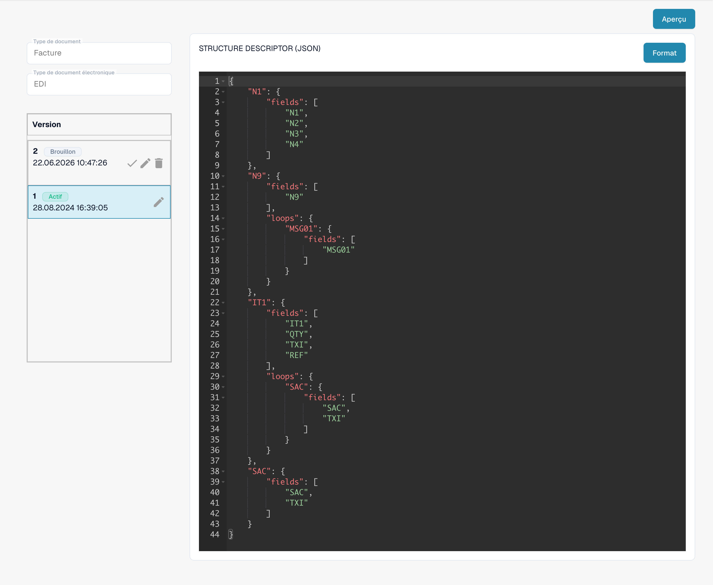

# Guide du fichier de description de la structure EDI

## **1. Aperçu**

Le **Fichier de Description de la Structure** définit comment les segments EDI répétitifs (par exemple, `N1`–`N4`) sont regroupés en JSON structuré. Il garantit :

* **Analyse précise** des éléments liés en tant qu'unités uniques.
* **Sortie cohérente** pour les systèmes en aval.

_Pour un exemple complet avec des détails de segment, consultez_ [_Exemple de Description de la Structure_](edi-structure-descriptor.md)_._

## **2. Accès et Édition de Base**

#### **Accéder au Fichier**

1.  **Paramètres** → **Type de Document** → \[Votre Document (par exemple, _Bon de Commande_)] → **E-Doc.**

    
2. Sous **E-Doc**, sélectionnez votre format (par exemple, _EDI_ ).
3.  Cliquez sur **Description de la Structure**.

    

#### **Gestion des Brouillons**

* **Créer un Brouillon** : Cliquez sur l'icône ✏️ pour commencer l'édition.
* **Supprimer les Brouillons** : Utilisez l'icône 🗑️ pour supprimer les brouillons inutilisés.
* **Activer les Modifications** : Cliquez sur l'icône ✅ pour approuver et publier vos modifications.
  * **Remarque** : Activer une nouvelle version désactivera **automatiquement** la précédente.

## 3. Fonction d'Aperçu (Aperçu XML analysé)

La **Fonction d'Aperçu** vous permet de tester et de prévisualiser comment un fichier EDI téléchargé est analysé en utilisant le Fichier de Description de la Structure actuel.

#### Utilisation

* Téléchargez un fichier EDI via le flux de téléchargement standard.
* Copiez l'**ID du Document** du fichier téléchargé.
* Accédez à l'interface du **Fichier de Description de la Structure**.
*   Ouvrez la **Fonction d'Aperçu**.\

    

* Entrez l'**ID du Document** dans le champ et appuyez sur **Tester**.
* La **sortie XML structurée résultante** sera affichée.

Ceci est particulièrement utile pour le débogage des mappages et la validation des regroupements structurels en temps réel.

## 6. Guide Vidéo

Un guide vidéo pour ce type de fichier est disponible sur la [page Vidéos.](https://docs.docbits.com/administration-and-setup/settings/global-settings/document-types/edi/edi/edi-videos) Utilisez-le pour suivre la configuration, l'édition et la prévisualisation.

<figure><figcaption>
Format EDI existant avec ses quatre attributs configurés.
</figcaption></figure>

<figure><figcaption>
Attribut STRUCTUREDESCRIPTOR actif : descripteur de structure JSON dans l’éditeur en lecture seule.
</figcaption></figure>

Les vues montrent une configuration et une version existantes. Les paramètres varient selon le type de document et le format. Validez les modifications dans un brouillon avant leur activation.

Dans la version de l’interface illustrée, certaines mentions, telles que Custom et Default, restent en anglais. Les identifiants techniques des attributs et le code de configuration restent inchangés.
