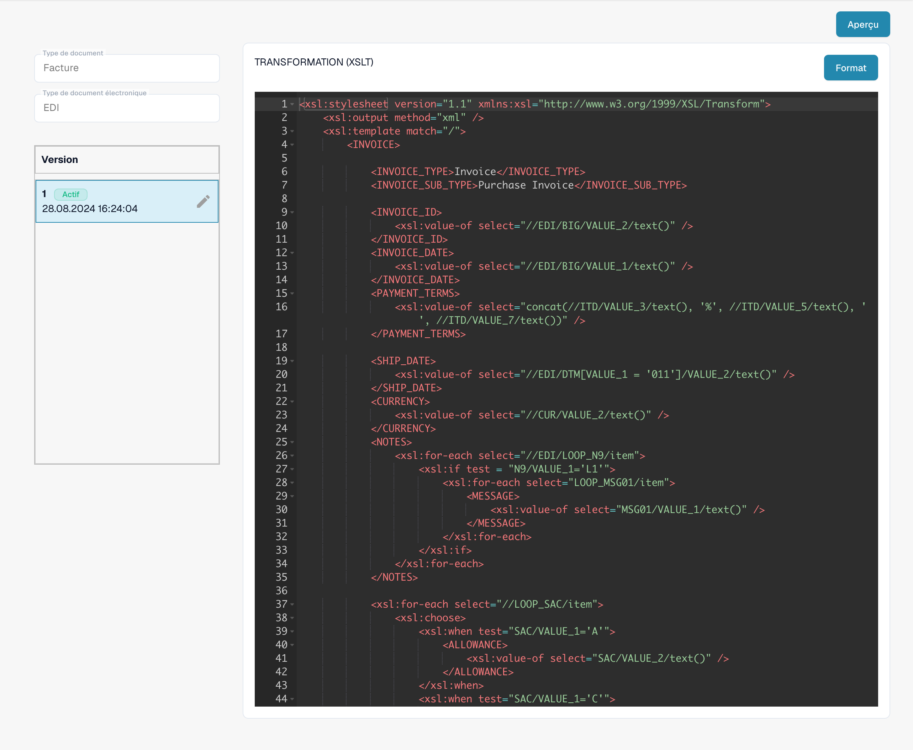
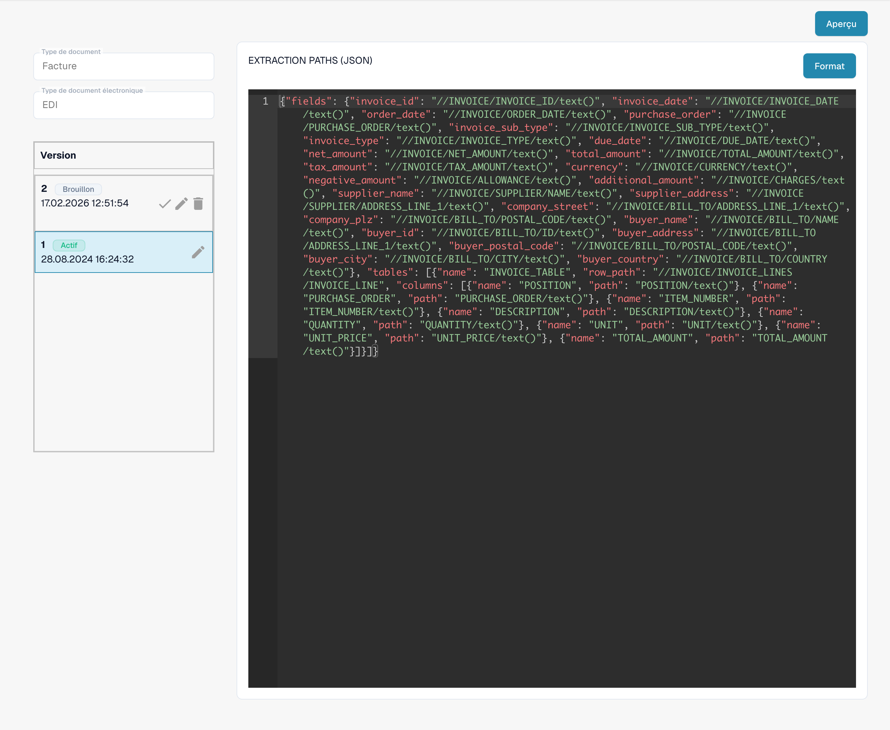

# Configurer les attributs EDI

Sélectionnez le format réel du message et le type de document. Vérifiez les attributs existants et les versions actives avant de modifier la configuration.

<figure><figcaption>
Format EDI existant avec ses quatre attributs configurés.
</figcaption></figure>

Définissez les segments, éléments et boucles dans un descripteur de structure JSON. Testez des messages représentatifs et inspectez le XML intermédiaire produit.

<figure><figcaption>
Attribut STRUCTUREDESCRIPTOR actif : descripteur de structure JSON dans l’éditeur en lecture seule.
</figcaption></figure>

Utilisez TRANSFORMATION avec XSLT pour convertir le XML intermédiaire en XML standard attendu. Configurez PREVIEW séparément pour la présentation ; XSLT ne traite pas directement le JSON.

<figure><figcaption>
Attribut TRANSFORMATION actif : code source XSLT pour transformer le XML intermédiaire.
</figcaption></figure>

Configurez EXTRACTIONPATHS en JSON avec des expressions XPath pour le XML obtenu. Vérifiez les champs, lignes et montants sur des exemples réels. Validez un brouillon avant son activation ; les captures montrent une configuration active existante.

<figure><figcaption>
Attribut EXTRACTIONPATHS actif : configuration JSON contenant des expressions XPath d’extraction.
</figcaption></figure>

Dans la version de l’interface illustrée, certaines mentions, telles que Custom et Default, restent en anglais. Les identifiants techniques des attributs et le code de configuration restent inchangés.
