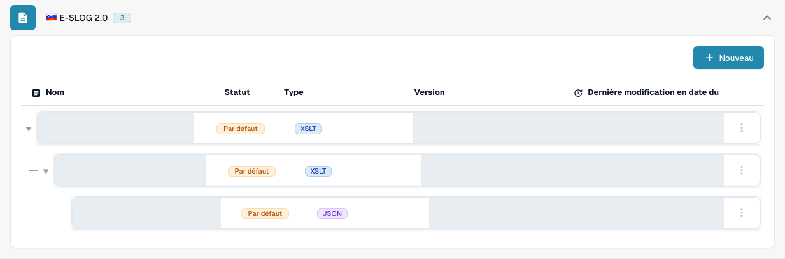

# eSLOG 1.6 et 2.0

**eSLOG 1.6** et **eSLOG 2.0** apparaissent dans DocBits comme des formats de facture électronique distincts. Choisissez la version utilisée par votre facture slovène entrante. Les captures montrent l'interface française dans une organisation de test de documentation. Les noms, versions et dates existants sont masqués ; les images ne prouvent pas qu'une facture de l'une ou l'autre version a été traitée avec succès.

## Trouver les configurations

1. Allez dans **Paramètres → Types de Documents → Facture → E-Doc**.
2. Développez **E-SLOG 1.6** ou **E-SLOG 2.0**. Chaque format a ses propres trois entrées.

<figure><figcaption>E-SLOG 1.6 : de haut en bas, Transformation, Prévisualisation et Chemins d'extraction. Cette vue de test contient deux lignes Par défaut et une ligne Personnalisé existante. Les noms, versions et dates sont masqués.</figcaption></figure>

<figure><figcaption>E-SLOG 2.0 : des entrées distinctes pour les trois mêmes étapes, toutes indiquées ici comme Par défaut. Les noms, versions et dates sont masqués.</figcaption></figure>

| Entrée | Ce qu'elle contrôle | Guide suivant |
| --- | --- | --- |
| **TRANSFORMATION (XSLT)** | Convertit les données sources du format en XML structuré. | [Transformation](edi/edi-transformation-file-guide.md) |
| **PREVIEW (XSLT)** | Définit la vue lisible du document. | [Prévisualisation](edi/edi-preview-file-guide.md) |
| **EXTRACTION PATHS (JSON)** | Mappe les valeurs XML aux champs et aux colonnes de tableau DocBits. | [Chemins d'extraction](edi/edi-extraction-paths-file-guide.md) |

Cliquez sur une ligne pour afficher ses versions et sa configuration. **Par défaut** identifie l'entrée fournie ; **Personnalisé** désigne une variante propre à l'organisation. **Dernière modification en date du** indique quand cette entrée a été modifiée pour la dernière fois. Le bouton **Nouveau** ouvre le formulaire d'une entrée de configuration supplémentaire. Le menu à trois points d'une ligne par défaut propose **Personnaliser**, qui crée une copie propre à l'organisation, et **Supprimer** ; vérifiez attentivement la ligne sélectionnée avant d'utiliser Supprimer.

Dans une configuration, le crayon à côté d'une version active crée un brouillon. Vérifiez un brouillon avec le panneau de test **Preview** et l'ID d'un document téléversé représentatif avant de l'activer avec la coche. L'icône de corbeille d'un brouillon supprime ce brouillon. Les noms de champs et les chemins XML réels dépendent de votre fichier eSLOG ; utilisez le guide correspondant ci-dessus pour les détails de l'éditeur.
