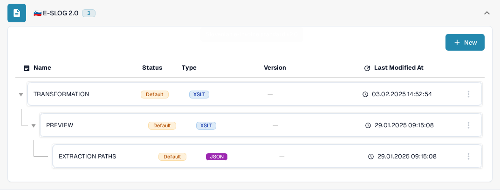

# eSLOG 1.6 et 2.0

**eSLOG 1.6** et **eSLOG 2.0** apparaissent dans DocBits comme des formats de facture électronique distincts. Choisissez la version utilisée par votre facture slovène entrante. Les captures d'écran ci-dessous montrent l'interface Sandbox anglaise actuelle dans une organisation de test de documentation ; elles ne prouvent pas qu'une facture de l'une ou l'autre version a été traitée avec succès.

## Trouver les configurations

1. Allez dans **Settings → Document Types → Invoice → E-Doc**.
2. Développez **E-SLOG 1.6** ou **E-SLOG 2.0**. Chaque format a ses propres trois entrées.

<figure><figcaption>E-SLOG 1.6 dans la liste E-Doc de Invoice.</figcaption></figure>

<figure><figcaption>E-SLOG 2.0 dispose de configurations distinctes pour les trois mêmes étapes.</figcaption></figure>

| Entrée | Ce qu'elle contrôle | Guide suivant |
| --- | --- | --- |
| **TRANSFORMATION (XSLT)** | Convertit les données sources du format en XML structuré. | [Transformation](edi/edi-transformation-file-guide.md) |
| **PREVIEW (XSLT)** | Définit la vue lisible du document. | [Preview](edi/edi-preview-file-guide.md) |
| **EXTRACTION PATHS (JSON)** | Mappe les valeurs XML aux champs et aux colonnes de tableau DocBits. | [Extraction Paths](edi/edi-extraction-paths-file-guide.md) |

Cliquez sur une ligne pour afficher ses versions et sa configuration. **Default** identifie l'entrée fournie. **Last Modified At** indique quand cette entrée a été modifiée pour la dernière fois. Le bouton **New** démarre une entrée de configuration supplémentaire. Le menu à trois points d'une ligne par défaut propose **Customize**, qui crée une copie propre à l'organisation, et **Delete** ; vérifiez attentivement la ligne sélectionnée avant d'utiliser Delete.

Dans une configuration, le crayon à côté d'une version active crée un brouillon. Vérifiez un brouillon avec le panneau de test **Preview** et l'ID d'un document téléversé représentatif avant de l'activer avec la coche. L'icône de corbeille d'un brouillon supprime ce brouillon. Les noms de champs et les chemins XML réels dépendent de votre fichier eSLOG ; utilisez le guide correspondant ci-dessus pour les détails de l'éditeur.
