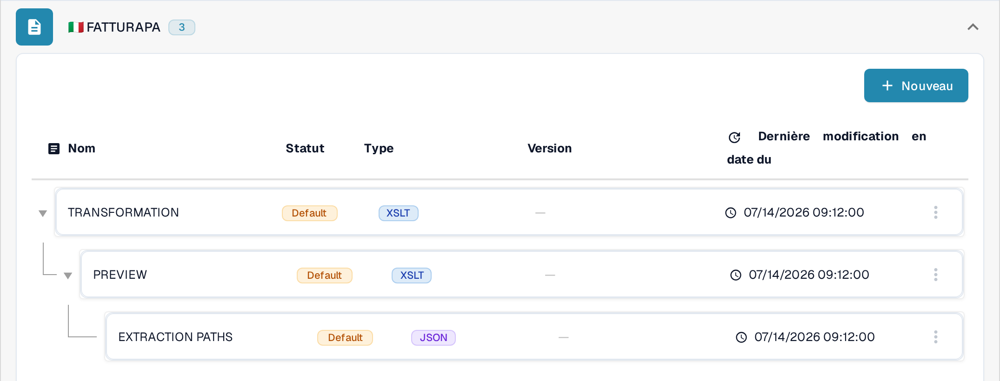
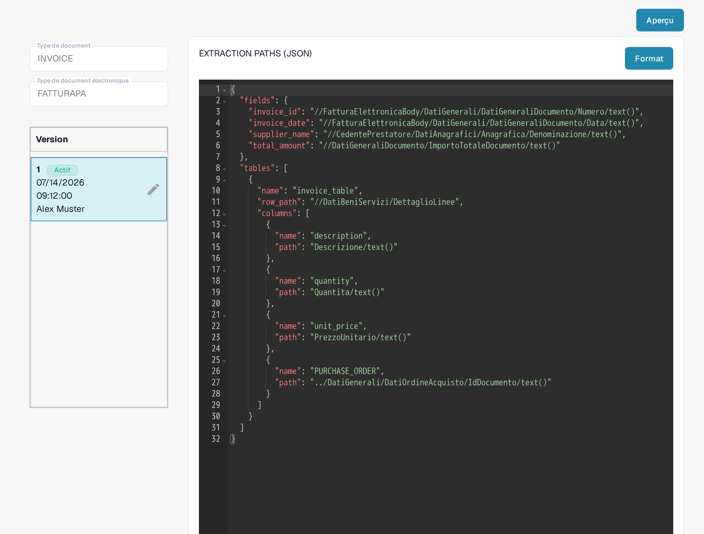
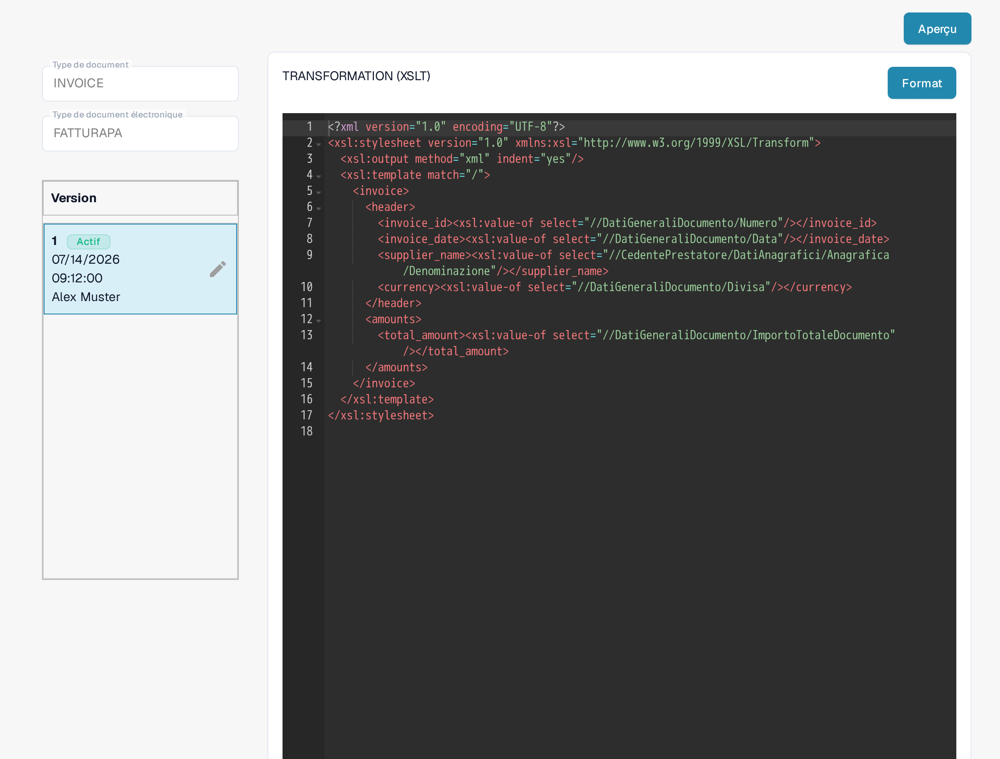
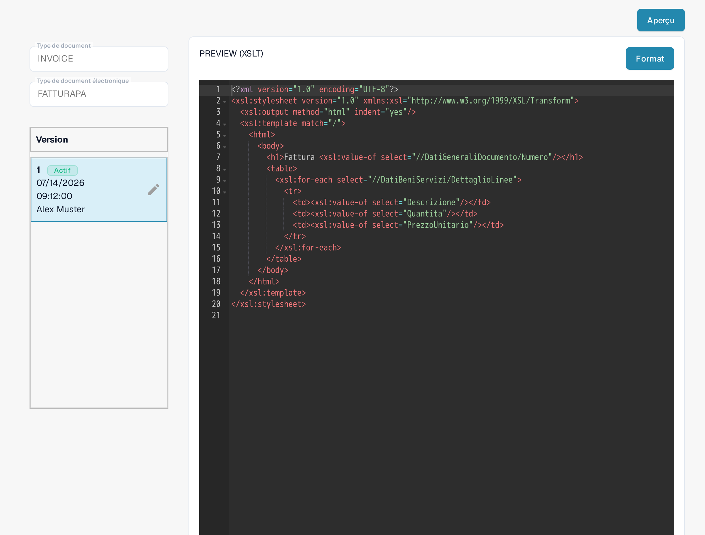

# FatturaPA : afficher un attribut sur les lignes de facture

FatturaPA est le format italien de facture électronique. Cette page explique où vérifier un attribut de ligne, tel qu'un numéro de bon de commande, avant de modifier son extraction ou l'aperçu de la facture. **N'ajoutez pas une deuxième colonne `PURCHASE_ORDER` sans avoir d'abord vérifié le mappage actif :** le mappage actuel de la Sandbox en contient déjà une.

## Trouver les trois fichiers FatturaPA

Ouvrez **Paramètres → Types De Documents → E-Doc**, sélectionnez **Invoice**, puis développez **FATTURAPA**. La liste actuelle contient trois fichiers différents :

* **TRANSFORMATION (XSLT)** lit le XML FatturaPA source et produit les données de facture normalisées.
* **PREVIEW (XSLT)** construit l'aperçu visuel de la facture (style HTML/PDF) à partir de ces données.
* **EXTRACTION PATHS (JSON)** mappe les valeurs normalisées vers les champs DocBits et les colonnes de tableau.

<figure><figcaption>
La liste actuelle des fichiers FATTURAPA dans la Sandbox en français.
</figcaption></figure>

## Vérifier la valeur de ligne extraite

Ouvrez **EXTRACTION PATHS (JSON)**. Dans la version active, recherchez le tableau `tables` et ses `columns`. La version visible dans la Sandbox contient déjà `{"name": "PURCHASE_ORDER", "path": "PURCHASE_ORDER"}`. Vérifiez la valeur sur une vraie facture de test avant de la modifier. Si vous avez besoin d'un autre attribut, identifiez sa valeur dans les données normalisées, puis ajoutez un nom de colonne distinct et le chemin correspondant dans une version brouillon.

<figure><figcaption>
Le mappage d'extraction JSON actif contient déjà une colonne bon de commande.
</figcaption></figure>

## Ne modifier la transformation ou l'aperçu qu'en cas de besoin

Si la valeur normalisée manque, examinez **TRANSFORMATION (XSLT)** et le chemin XML source qui doit la produire. Une modification ici affecte les données utilisées par les étapes ultérieures de mappage et d'aperçu. Si la valeur est correctement extraite mais absente de la facture visuelle, examinez **PREVIEW (XSLT)** et la ligne de tableau correspondante dans ce modèle. Les deux fichiers XSLT ont des finalités différentes.

<figure><figcaption>
La transformation lit le XML source et construit les champs de facture normalisés.
</figcaption></figure>

<figure><figcaption>
L'aperçu contrôle la sortie visuelle de la facture.
</figcaption></figure>

Utilisez le crayon sur une carte de version pour préparer une modification. Vérifiez le brouillon et utilisez **Aperçu** avec une facture FatturaPA représentative avant de l'activer. Les captures d'écran montrent les versions actuelles ; aucun brouillon n'a été enregistré ni testé dans cette session Sandbox.

L'ancienne consigne selon laquelle tous les documents électroniques ont le Royaume-Uni comme origine n'est pas une règle générale fiable. Vérifiez le pays, la devise et le format numérique de la facture par rapport au document source et à la configuration de votre organisation.
