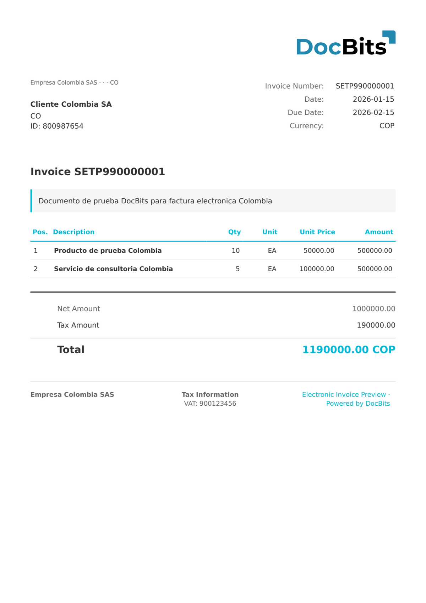

# 🇨🇴 Colombia DIAN

<!-- edocs-country-scope -->


Consultez le guide du pays pour connaître les limites de version, la configuration effectivement utilisée et la vidéo explicative du pays. [Colombie](countries/colombia.md). L’entrée de classification des avoirs ne possède pas d’ensemble d’extraction dédié dans l’état examiné. Confirmez la correspondance effectivement utilisée au lieu de déduire la prise en charge de l’entrée de facture.


| Propriété | Valeur |
|-----------|--------|
| **Pays / Région** | Colombia |
| **Types de documents** | Facture (Factura Electrónica), Avoir (Nota de Crédito), Documento Soporte |
| **Format** | XML (UBL 2.1) |
| **Standard** | DIAN 2.1 (Dirección de Impuestos y Aduanas Nacionales) |
| **Paramètres régionaux** | `es_CO` |

Le standard colombien de facturation électronique est réglementé par la **DIAN** (Dirección de Impuestos y Aduanas Nacionales). Il est basé sur UBL 2.1 avec des extensions spécifiques à la DIAN (`sts:DianExtensions`). DocBits détecte les documents Colombia DIAN via le namespace DIAN et les achemine selon la `CustomizationID` :

| CustomizationID | Type de document |
|-----------------|-----------------|
| 10 | Factura Electrónica de Venta (FACTURA ELECTRONICA) |
| 20 | Nota de Crédito (Avoir) |
| 91 | Nota de Crédito por devolución |
| 92 | Nota de Débito |
| DS | Documento Soporte (DOCUMENTO SOPORTE) |

L'identifiant DIAN (**NIT** — Número de Identificación Tributaria) utilise `schemeID="31"` dans l'élément UBL `CompanyID`.

## Statut de prise en charge

| Composant | Statut |
|-----------|--------|
| Aperçu | ✅ Pris en charge |
| Extraction des champs | ✅ Pris en charge |
| Transformation | ✅ Pris en charge |

## Aperçu par défaut

<figure><figcaption>
Aperçu DocBits par défaut pour une COLOMBIA FACTURA ELECTRONICA (CustomizationID 10)
</figcaption></figure>

## Mappage des champs

### Champs d'en-tête

| Champ DocBits | Élément XML source | Remarques |
|---|---|---|
| `invoice_id` | `cbc:ID` | Numéro de facture avec préfixe (ex. `SETP990000001`) |
| `invoice_date` | `cbc:IssueDate` | Date d'émission (ISO 8601) |
| `due_date` | `cbc:DueDate` | Date d'échéance du paiement |
| `currency` | `cbc:DocumentCurrencyCode` | Toujours `COP` (Peso colombien) |
| `total_amount` | `cac:LegalMonetaryTotal/cbc:PayableAmount` | Montant total TTC (IVA inclus) |
| `net_amount` | `cac:LegalMonetaryTotal/cbc:TaxExclusiveAmount` | Montant net HT (IVA exclu) |
| `tax_amount` | `cac:TaxTotal/cbc:TaxAmount` | Montant total IVA (taux standard 19 %) |
| `supplier_name` | `cac:AccountingSupplierParty//cbc:RegistrationName` | Raison sociale du fournisseur |
| `supplier_id` | `cac:AccountingSupplierParty//cbc:CompanyID` | NIT du fournisseur (schemeID=31) |
| `buyer_name` | `cac:AccountingCustomerParty//cbc:RegistrationName` | Raison sociale de l'acheteur |
| `buyer_id` | `cac:AccountingCustomerParty//cbc:CompanyID` | NIT de l'acheteur (schemeID=31) |

### Tableau des lignes (`INVOICE_TABLE`)

Chemin de ligne : `cac:InvoiceLine` (ou `cac:CreditNoteLine`)

| Colonne | Élément XML source | Remarques |
|---|---|---|
| `POSITION` | `cbc:ID` | Numéro de ligne |
| `DESCRIPTION` | `cac:Item/cbc:Description` | Description du produit ou du service |
| `QUANTITY` | `cbc:InvoicedQuantity` | Quantité avec attribut de code d'unité |
| `UNIT_PRICE` | `cac:Price/cbc:PriceAmount` | Prix unitaire HT (IVA exclu) |
| `NET_AMOUNT` | `cbc:LineExtensionAmount` | Total de ligne HT (IVA exclu) |

## Règles de classification

DocBits détecte les documents Colombia DIAN grâce à la chaîne de namespace DIAN :

| Type de document électronique | Modèle |
|-------------------------------|--------|
| COLOMBIA FACTURA ELECTRONICA | `http://www.dian.gov.co/contratos/facturaelectronica/v1/Structures` + `DianExtensions` |
| COLOMBIA DOCUMENTO SOPORTE | `http://www.dian.gov.co/contratos/facturaelectronica/v1/Structures` + `CustomizationID=DS` |

L'élément racine est `<Invoice>` (UBL 2.1) pour les factures et `<CreditNote>` pour les avoirs. Tous les documents contiennent un bloc `<sts:DianExtensions>` avec les données d'autorisation DIAN (`InvoiceAuthorization`, UUID `CUFE`/`CUDE`, QR code).

## Liens connexes

- [Standards de facturation électronique pris en charge](../currently-supported-e-invoice-standards/README.md)
- [Documents électroniques pris en charge](./)
