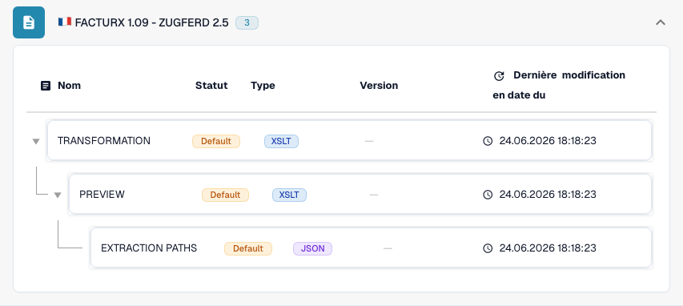

# France

Utilisez ce guide pour identifier la famille configurée et le périmètre des versions avant de tester un fichier source.

[Tous les pays et périmètre de prise en charge](../README.md)

## Variantes et limites de version

Factur-X possède des entrées génériques et propres à certaines publications, notamment 1.0.05, 1.08 et 1.09. VRBL FR CIUS 1.0 est distinct.

**Syntaxe:** CII / PDF + XML

Le marqueur XML 1p0 et Factur-X XMP Version 1.0 n’identifient pas une version de publication. Conservez le libellé générique lorsque la publication est inconnue.

Les tableaux consignent une vérification du catalogue de développement effectuée le 17 octobre 2026 et du code de traitement correspondant. Ils décrivent les règles et composants de configuration disponibles, sans certifier chaque fichier, exigence légale ou déploiement en production. Votre organisation peut remplacer les valeurs par défaut.

## Matrice des règles et composants examinés

| Libellé exact du format | Clé de document de la règle | Composants disponibles |
| --- | --- | --- |
| `FACTURX` | `INVOICE` | C / T / P / E |
| `FACTURX 1.0.05 - ZUGFERD 2.1` | `INVOICE` | C / T / P / E |
| `FACTURX 1.0.05 BASIC` | `INVOICE` | C / T / P / E |
| `FACTURX 1.0.05 EN16931` | `INVOICE` | C / T / P / E |
| `FACTURX 1.0.05 EXTENDED` | `INVOICE` | C / T / P / E |
| `FACTURX 1.08 - ZUGFERD 2.4` | `INVOICE` | C / T / P / E |
| `FACTURX 1.09 - ZUGFERD 2.5` | `INVOICE` | C / T / P / E |
| `VRBL FR CIUS 1.0` | `INVOICE` | C / T / P / E |

C = classification, T = Transformation, P = Preview, E = Extraction Paths. La clé de document sert à rechercher la règle ou la configuration ; elle ne garantit pas la valeur finale enregistrée de invoice_type. Une transformation peut classifier un avoir au moyen d’une correspondance INVOICE.

Un tiret signifie que la vérification de l’état n’a pas signalé de composant dédié pour cette combinaison exacte de format et de clé de document. Cela n’exclut pas une correspondance partagée ou de repli. Vérifiez le mécanisme de résolution effectivement utilisé et un fichier représentatif avant de vous appuyer sur ce chemin.

### Libellés de configuration supplémentaires

Ces libellés possèdent des entrées de configuration, mais aucune règle de classification autonome dans le catalogue examiné. Une famille générique ou une identification plus précise peut sélectionner un chemin compatible. Leur seule présence ne prouve pas la détection automatique de cette publication ou de ce profil.

- `FACTURX 1.0.05 BASIC WL`
- `FACTURX 1.0.05 MINIMUM`
- `FACTURX 1.0.06 BASIC`
- `FACTURX 1.0.06 BASIC WL`
- `FACTURX 1.0.06 EN16931`
- `FACTURX 1.0.06 EXTENDED`
- `FACTURX 1.0.06 MINIMUM`
- `FACTURX 1.0.07 BASIC`
- `FACTURX 1.0.07 BASIC WL`
- `FACTURX 1.0.07 EN16931`
- `FACTURX 1.0.07 EXTENDED`
- `FACTURX 1.0.07 MINIMUM`
- `FACTURX 1.0.07.2 - ZUGFERD 2.3.2`
- `FACTURX 1.0.07.2 BASIC`
- `FACTURX 1.0.07.2 BASIC WL`
- `FACTURX 1.0.07.2 EN16931`
- `FACTURX 1.0.07.2 EXTENDED`
- `FACTURX 1.0.07.2 MINIMUM`
- `FACTURX 1.08 BASIC`
- `FACTURX 1.08 BASIC WL`
- `FACTURX 1.08 EN16931`
- `FACTURX 1.08 EXTENDED`
- `FACTURX 1.08 MINIMUM`
- `FACTURX 1.09 BASIC`
- `FACTURX 1.09 BASIC WL`
- `FACTURX 1.09 EN16931`
- `FACTURX 1.09 EXTENDED`
- `FACTURX 1.09 MINIMUM`

### Factur-X / ZUGFeRD : ne pas inventer de version de publication

Un Guideline ID CII harmonisé peut identifier une famille et un profil tout en partageant le même marqueur 1p0 entre plusieurs versions. Factur-X XMP Version 1.0 est un marqueur de schéma, et non une publication telle que 1.08 ou 1.09. Les métadonnées XMP de ZUGFeRD peuvent déclarer sa version. En l’absence de métadonnées faisant autorité, conservez le résultat de famille générique et confirmez le fichier d’origine avec l’émetteur.

MINIMUM et BASIC WL peuvent omettre des informations de lignes nécessaires aux traitements suivants. BASIC, EN16931/COMFORT et EXTENDED offrent des couvertures de données différentes. Un profil plus complet peut contenir des champs que votre correspondance d’extraction n’utilise pas. Vérifiez les champs requis à l’aide d’exemples réels.

## Trouver la correspondance dans DocBits

<figure><figcaption>
Interface réelle de développement : le format représentatif et ses composants de configuration disponibles. Les autres versions figurent dans la matrice.
</figcaption></figure>

## Vidéo explicative du pays

La narration localisée et les sous-titres WebVTT expliquent le choix du format, la configuration et les vérifications d’acceptation.


France — Vidéo explicative du pays



WebVTT


## Vérifications d’acceptation

La vérification d’un composant confirme la présence d’une configuration. Ce n’est pas un test de traitement de bout en bout pour chaque version. Testez le contenu exact et le chemin de traitement de facture ou d’avoir requis par votre intégration.

## Vérifier un format dans votre organisation

1. Conservez le XML d’origine ou le PDF avec son XML intégré. Relevez l’espace de noms, le schéma ou l’identifiant de personnalisation, ainsi que la version et le profil déclarés.

2. Ouvrez Paramètres → Types de documents → E-Doc pour le document métier concerné. Recherchez le format exact de document électronique indiqué dans le guide.

3. Vérifiez la source Default ou Custom effectivement utilisée et sa version de configuration active. Examinez Transformation, Preview et Extraction Paths. Enregistrer un brouillon ne l’active pas.

4. Testez des fichiers source représentatifs pour chaque syntaxe, version et document métier dont vous avez besoin. Vérifiez les champs clés, les montants, les taxes, la classification facture/avoir et l’export ERP.

5. Confirmez séparément la politique de validation et le transport. Préservez les correspondances personnalisées et vérifiez les approbations ainsi que l’historique des exports avant de relancer des documents existants.

## Référence de format associée

- [🇫🇷 FACTURX](../facturx.md)
- [🇫🇷 FACTURX 1.0.05 - ZUGFERD 2.1](../facturx-1-0-05-zugferd-2-1.md)
- [🇫🇷 FACTURX 1.0.07.2 - ZUGFERD 2.3.2](../facturx-1-0-07-2-zugferd-2-3-2.md)
- [🇫🇷 FACTURX 1.09 - ZUGFERD 2.5](../facturx-1-09-zugferd-2-5.md)
