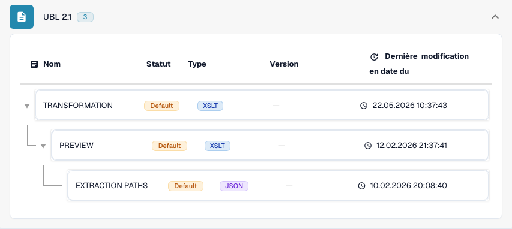

# International

Utilisez ce guide pour identifier la famille configurée et le périmètre des versions avant de tester un fichier source.

[Tous les pays et périmètre de prise en charge](../README.md)

## Variantes et limites de version

Les entrées internationales comprennent Peppol BIS 3.0, UBL 2.1, CII pur, EDI, INVOIC02, cXML, OCI, BOD et SPS Commerce RSX 7.7.4.

**Syntaxe:** UBL / CII / EDI / cXML

Les correspondances de facture, de commande, de réponse et d’expédition sont distinctes. Le traitement des fichiers ne fournit pas, à lui seul, de point d’accès Peppol ni de connexion aux partenaires commerciaux.

Les tableaux consignent une vérification du catalogue de développement effectuée le 17 octobre 2026 et du code de traitement correspondant. Ils décrivent les règles et composants de configuration disponibles, sans certifier chaque fichier, exigence légale ou déploiement en production. Votre organisation peut remplacer les valeurs par défaut.

## Matrice des règles et composants examinés

| Libellé exact du format | Clé de document de la règle | Composants disponibles |
| --- | --- | --- |
| `BOD` | `PURCHASE_ORDER` | C / — / — / — |
| `CXML ORDER CONFIRMATION` | `ORDER_CONFIRMATION` | C / T / P / E |
| `CXML PURCHASE ORDER` | `PURCHASE_ORDER` | C / T / P / E |
| `EDI` | `PURCHASE_ORDER` | C / T / P / E |
| `EDI` | `ORDER_CONFIRMATION` | C / T / P / E |
| `EDI` | `INVOICE` | C / T / P / E |
| `INVOIC02` | `INVOICE` | C / T / P / E |
| `OCI CATALOG ORDER` | `PURCHASE_ORDER` | C / T / P / E |
| `PEPPOL BIS 3.0` | `INVOICE` | C / T / P / E |
| `PEPPOL DESPATCH ADVICE 3.0` | `DELIVERY_NOTE` | C / T / P / E |
| `PEPPOL ORDER 3.0` | `PURCHASE_ORDER` | C / T / P / E |
| `PEPPOL ORDER RESPONSE 3.0` | `ORDER_CONFIRMATION` | C / T / P / E |
| `PURCHASE ORDER BOD` | `PURCHASE_ORDER` | C / T / P / E |
| `PURE CII D16B EU` | `INVOICE` | C / T / P / E |
| `PURE CII D16B EU CREDITNOTE` | `CREDIT_NOTE` | C / T / P / E |
| `PURE CII D16B NON-EU` | `INVOICE` | C / T / P / E |
| `PURE CII D16B NON-EU CREDITNOTE` | `CREDIT_NOTE` | C / T / P / E |
| `PURE CII D22B EU` | `INVOICE` | C / T / P / E |
| `PURE CII D22B EU CREDITNOTE` | `CREDIT_NOTE` | C / T / P / E |
| `PURE CII D22B NON-EU` | `INVOICE` | C / T / P / E |
| `PURE CII D22B NON-EU CREDITNOTE` | `CREDIT_NOTE` | C / T / P / E |
| `PURE CII D23B EU` | `INVOICE` | C / T / P / E |
| `PURE CII D23B EU CREDITNOTE` | `CREDIT_NOTE` | C / T / P / E |
| `PURE CII D23B NON-EU` | `INVOICE` | C / T / P / E |
| `PURE CII D23B NON-EU CREDITNOTE` | `CREDIT_NOTE` | C / T / P / E |
| `PURE CII D24B EU` | `INVOICE` | C / T / P / E |
| `PURE CII D24B EU CREDITNOTE` | `CREDIT_NOTE` | C / T / P / E |
| `PURE CII D24B NON-EU` | `INVOICE` | C / T / P / E |
| `PURE CII D24B NON-EU CREDITNOTE` | `CREDIT_NOTE` | C / T / P / E |
| `PURE CII V1 EU` | `INVOICE` | C / T / P / E |
| `PURE CII V1 EU CREDITNOTE` | `CREDIT_NOTE` | C / T / P / E |
| `PURE CII V1 NON-EU` | `INVOICE` | C / T / P / E |
| `PURE CII V1 NON-EU CREDITNOTE` | `CREDIT_NOTE` | C / T / P / E |
| `SPS COMMERCE RSX 7.7.4` | `PURCHASE_ORDER_ACKNOWLEDGMENT` | C / T / P / E |
| `SPS COMMERCE RSX 7.7.4` | `ADVANCE_SHIP_NOTICE` | C / T / P / E |
| `SPS COMMERCE RSX 7.7.4` | `PURCHASE_ORDER` | C / T / P / E |
| `SPS COMMERCE RSX 7.7.4` | `INVOICE` | C / T / P / E |
| `SPS COMMERCE RSX 7.7.4` | `PURCHASE_ORDER_CHANGE` | C / T / P / E |
| `UBL 2.1` | `INVOICE` | C / T / P / E |
| `UBL 2.1 CREDITNOTE` | `CREDIT_NOTE` | C / T / P / E |
| `UBL 2.1 DESPATCH ADVICE` | `DELIVERY_NOTE` | C / T / P / E |
| `UBL 2.1 ORDER` | `PURCHASE_ORDER` | C / T / P / E |
| `UBL 2.1 ORDER RESPONSE` | `ORDER_CONFIRMATION` | C / T / P / E |

C = classification, T = Transformation, P = Preview, E = Extraction Paths. La clé de document sert à rechercher la règle ou la configuration ; elle ne garantit pas la valeur finale enregistrée de invoice_type. Une transformation peut classifier un avoir au moyen d’une correspondance INVOICE.

Un tiret signifie que la vérification de l’état n’a pas signalé de composant dédié pour cette combinaison exacte de format et de clé de document. Cela n’exclut pas une correspondance partagée ou de repli. Vérifiez le mécanisme de résolution effectivement utilisé et un fichier représentatif avant de vous appuyer sur ce chemin.

## Trouver la correspondance dans DocBits

<figure><figcaption>
Interface réelle de développement : le format représentatif et ses composants de configuration disponibles. Les autres versions figurent dans la matrice.
</figcaption></figure>

## Vidéo explicative du pays

La narration localisée et les sous-titres WebVTT expliquent le choix du format, la configuration et les vérifications d’acceptation.


International — Vidéo explicative du pays



WebVTT


## Vérifications d’acceptation

La vérification d’un composant confirme la présence d’une configuration. Ce n’est pas un test de traitement de bout en bout pour chaque version. Testez le contenu exact et le chemin de traitement de facture ou d’avoir requis par votre intégration.

## Vérifier un format dans votre organisation

1. Conservez le XML d’origine ou le PDF avec son XML intégré. Relevez l’espace de noms, le schéma ou l’identifiant de personnalisation, ainsi que la version et le profil déclarés.

2. Ouvrez Paramètres → Types de documents → E-Doc pour le document métier concerné. Recherchez le format exact de document électronique indiqué dans le guide.

3. Vérifiez la source Default ou Custom effectivement utilisée et sa version de configuration active. Examinez Transformation, Preview et Extraction Paths. Enregistrer un brouillon ne l’active pas.

4. Testez des fichiers source représentatifs pour chaque syntaxe, version et document métier dont vous avez besoin. Vérifiez les champs clés, les montants, les taxes, la classification facture/avoir et l’export ERP.

5. Confirmez séparément la politique de validation et le transport. Préservez les correspondances personnalisées et vérifiez les approbations ainsi que l’historique des exports avant de relancer des documents existants.

## Référence de format associée

- [INVOIC02](../invoic02.md)
- [🇪🇺 PEPPOL BIS 3.0](../peppol-bis-3-0.md)
- [SPS COMMERCE RSX 7.7.4](../sps-commerce-rsx-7-7-4.md)
- [UBL 2.1](../ubl-2-1.md)
