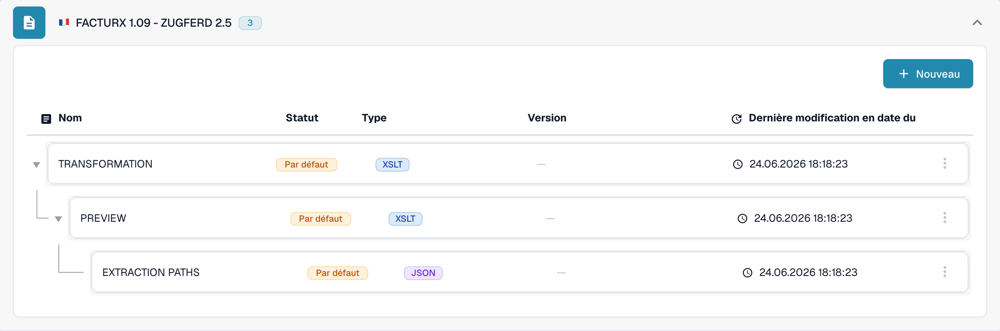

# 🇫🇷 FACTURX 1.09 - ZUGFERD 2.5

<!-- edocs-country-scope -->


Consultez le guide du pays pour connaître les limites de version, la configuration effectivement utilisée et la vidéo explicative du pays. [France](countries/france.md). Le marqueur XML 1p0 et Factur-X XMP Version 1.0 n’identifient pas une version de publication. Conservez le libellé générique lorsque la publication est inconnue.


| Propriété | Valeur |
|----------|-------|
| **Pays / Région** | France / Allemagne |
| **Types de documents** | Facture, Avoir (vérifier la correspondance effective) |
| **Format** | XML CII incorporé dans un PDF/A-3 |
| **Norme** | Factur-X 1.09 / ZUGFeRD 2.5 |
| **Basée sur** | EN 16931 |

ZUGFeRD 2.5 et Factur-X 1.09 sont des publications équivalentes. Le format hybride incorpore du XML CII D22B dans un PDF/A-3 ; UBL n’est pas sa syntaxe XML. Consultez la [référence de publication FeRD](https://www.ferd-net.de/publikationen-produkte/publikationen/detailseite/zugferd-25-english).

Le standard définit les profils MINIMUM, BASIC WL, BASIC, EN16931 et EXTENDED. Un nom de profil dans le catalogue ne prouve ni sa détection automatique ni une couverture complète des champs. MINIMUM et BASIC WL peuvent omettre des informations de lignes nécessaires à votre intégration.

Cette page décrit la publication de juin 2026. La [publication ultérieure Factur-X 1.09.2 / ZUGFeRD 2.5.2](https://fnfe-mpe.org/factur-x/factur-x_en/) doit être identifiée séparément ; le seul identifiant de famille `1p0` ne suffit pas.

## Statut de prise en charge

La vérification en lecture seule du catalogue de développement, le 31 octobre 2026, a trouvé `FACTURX 1.09 - ZUGFERD 2.5` pour `INVOICE`.

| Composant | Configuration observée |
|-----------|------------------------|
| Aperçu | `PREVIEW` (XSLT) |
| Extraction des champs | `EXTRACTION_PATHS` (JSON) |
| Transformation | `TRANSFORMATION` (XSLT) |

Ces entrées confirment une configuration disponible, pas le traitement réussi de chaque fichier ou profil. Vérifiez la source par défaut ou personnalisée et la version active dans votre organisation. La rétrocompatibilité du standard ne garantit pas des résultats d’extraction ou de transformation inchangés. Testez séparément des factures et avoirs représentatifs, les champs nécessaires et l’export ERP ; la validation légale et les exigences du réseau de transmission nécessitent leur propre recette.

<figure><figcaption>
Interface de développement en français, consultée en lecture seule le 31 octobre 2026 : l’entrée du catalogue pour INVOICE et ses composants par défaut disponibles. Cette capture ne montre pas un test de traitement de fichier.
</figcaption></figure>

## Voir aussi

- [ZUGFeRD 2.5](zugferd-2-5.md)
- [Configuration de ZUGFeRD](../zugferd/configuration.md)
- [Mappage des champs ZUGFeRD](../zugferd/README.md)
- [Documents électroniques pris en charge](./)
