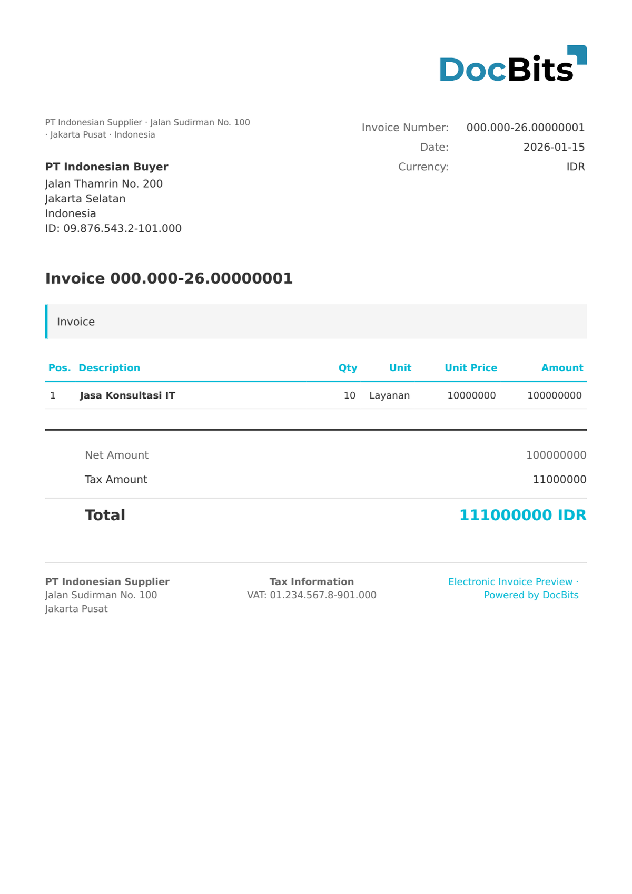

# 🇮🇩 INDONESIA E-FAKTUR

| Propriété              | Valeur                                     |
| ---------------------- | ------------------------------------------ |
| **Pays / Région**      | Indonésie                                  |
| **Types de documents** | Facture fiscale (Faktur Pajak)             |
| **Format**             | XML/CSV                                    |
| **Norme**              | e-Faktur (DJP - Direktorat Jenderal Pajak) |

e-Faktur est le système indonésien de facture fiscale électronique exploité par la Direction générale des impôts (DJP). Il est obligatoire pour tous les contribuables PKP (Pengusaha Kena Pajak) et comprend le numéro de série NSFP (Nomor Seri Faktur Pajak), les identifiants fiscaux NPWP et les calculs de PPN (TVA).

## Statut de prise en charge

| Composant             | Statut           |
| --------------------- | ---------------- |
| Aperçu                | ✅ Pris en charge |
| Extraction des champs | ✅ Pris en charge |
| Transformation        | ✅ Pris en charge |

## Aperçu par défaut

<figure><figcaption>
Aperçu DocBits par défaut d'une facture indonésienne E-Faktur
</figcaption></figure>

## Voir aussi

* [Documents électroniques pris en charge](./)
