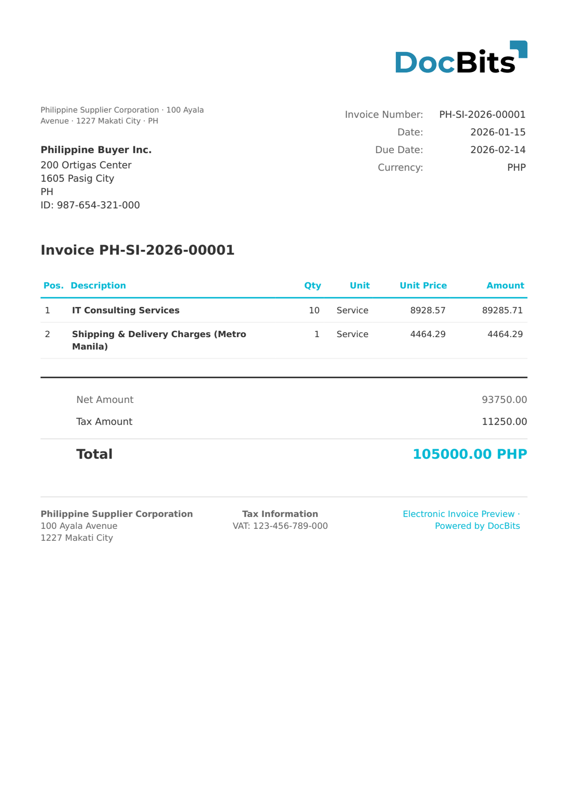

# 🇵🇭 PHILIPPINES EIS

<!-- edocs-country-scope -->


Consultez le guide du pays pour connaître les limites de version, la configuration effectivement utilisée et la vidéo explicative du pays. [Philippines](countries/philippines.md). Le libellé ne précise pas de version. Vérifiez le schéma du contenu et le type de document concerné avant de vous fier à un libellé EIS générique.


| Propriété | Valeur |
| --------- | ------ |
| **Pays / Région** | Philippines |
| **Types de documents** | Facture, Reçu officiel |
| **Format** | XML/JSON |
| **Norme** | EIS (Electronic Invoicing System - BIR) |

Philippines EIS est le système de facturation électronique (Electronic Invoicing System) du Bureau of Internal Revenue (BIR). Il vise à dématérialiser la facturation et l'émission de reçus pour les entreprises philippines, en exigeant la transmission électronique des données de vente au système du BIR afin de surveiller la conformité fiscale.

## Statut de prise en charge

| Composant | Statut |
| --------- | ------ |
| Aperçu | ✅ Pris en charge |
| Extraction des champs | ✅ Pris en charge |
| Transformation | ✅ Pris en charge |

## Aperçu par défaut

<figure><figcaption>
Aperçu DocBits par défaut d'une facture Philippines EIS
</figcaption></figure>

## Voir aussi

* [Documents électroniques pris en charge](./)
