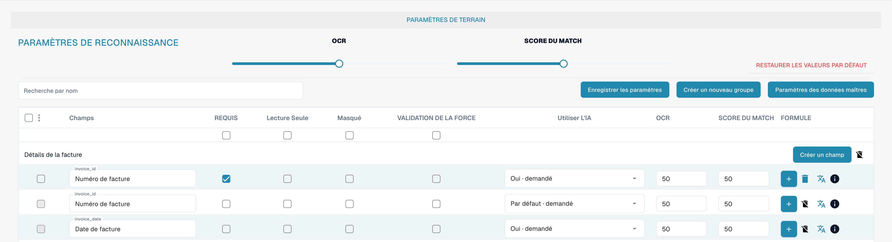

# Champs

Les champs définissent les données recueillies pour un type de document et leur contrôle. Ouvrez le type de document dans les paramètres, puis ses champs.

<figure><figcaption>
Vue des champs du type de document Facture.
</figcaption></figure>

## Propriétés et reconnaissance

* **Obligatoire** exige une valeur pour la validation.
* **Lecture seule** empêche la modification ; **Masqué** retire le champ de la vue habituelle.
* La **validation forcée** exige un contrôle explicite du champ. Elle ne crée ni règle de comparaison ni expression régulière ; configurez les règles de validation personnalisées séparément.
* **OCR** définit un seuil numérique de confiance de reconnaissance. Ce n’est pas un interrupteur d’activation d’OCR.
* **Score de correspondance** définit un seuil numérique de correspondance. Ce n’est ni un texte de référence ni une liste de valeurs.
* L’option **IA** contrôle l’extraction demandée pour le champ.

Recherchez un champ par son nom et vérifiez sa ligne avant de modifier ses propriétés. Vous pouvez organiser les groupes, ajouter des champs et ouvrir les options de formule ou de données de référence. Les actions dépendent du champ et des droits ; la suppression des champs standard peut être limitée.

Enregistrez uniquement les modifications prévues et vérifiez la validation sur des documents représentatifs. Les images ne prouvent aucune modification enregistrée.

Consultez les [propriétés des champs](configuring-field-properties-1.md), la [validation et Match Score](setting-validation-and-match-score.md) et les [champs avec frais](new-fields-with-charges.md).
