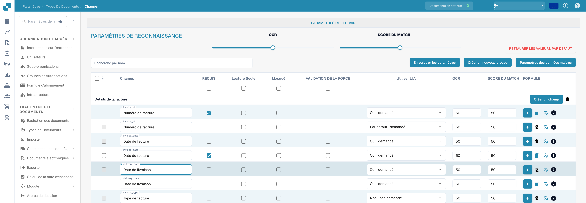
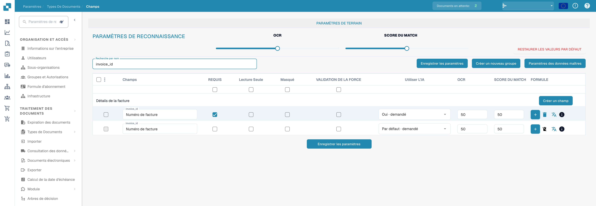

# Configuration des propriétés de champ

Ouvrez **Paramètres → Types de documents → Champs** et sélectionnez le type de document. Les images montrent Facture dans l’interface française ; les identifiants techniques comme `invoice_id` restent inchangés.

<figure><figcaption>
Propriétés des champs : obligatoire, lecture seule, masqué et validation forcée.
</figcaption></figure>

## Trouver un champ et modifier ses propriétés

1. Dans **Recherche par nom**, saisissez le nom ou le libellé du champ. Cela filtre la liste ; cela ne modifie pas le champ.
2. Trouvez la ligne du champ. Par exemple, **Numéro de facture** a pour nom technique `invoice_id`.
3. Ajustez les contrôles de cette ligne, puis sélectionnez **Enregistrer les paramètres**. Le même bouton d'enregistrement est disponible au-dessus et en dessous du tableau.

<figure><figcaption>
Champs filtrés par invoice_id avec les seuils OCR et Match Score.
</figcaption></figure>

| Contrôle | À quoi il sert |
| --- | --- |
| **Obligatoire** | Marque les informations qui doivent être présentes pour la validation. Vérifiez le résultat de validation du document après avoir modifié ce paramètre. |
| **Lecture seule** | Affiche un champ sans permettre aux utilisateurs de modifier sa valeur. |
| **Caché** | Garde le champ hors de la vue normale du document. |
| **Validation forcée** | Exige un contrôle explicite du champ. Elle ne crée ni règle de comparaison ni expression régulière ; configurez les règles de validation personnalisées séparément. |
| **Utiliser l'IA** | Demande ou arrête l'extraction par IA pour ce champ. La ligne indique si l'extraction est demandée. |
| **OCR** | Saisissez le seuil de confiance OCR du champ. Il s'agit d'un nombre, et non d'un interrupteur ni d'un paramètre de langue. |
| **Score de correspondance** | Saisissez le seuil de correspondance du champ. Il s'agit d'un nombre, et non d'un interrupteur. |

Les curseurs **OCR** et **Score de correspondance** sous **Paramètres de reconnaissance** appliquent des valeurs à l'ensemble de la liste des champs. Les cases à cocher situées directement sous les titres de colonnes appliquent **Obligatoire**, **Lecture seule**, **Caché** ou **Validation forcée** à l'ensemble de la liste. Vérifiez les lignes concernées avant de sélectionner **Enregistrer les paramètres**. **Restaurer les valeurs par défaut** réinitialise la configuration des champs ; utilisez-le uniquement si vous avez l'intention de remplacer vos modifications.

## Autres contrôles de cette vue

- **Créer un nouveau groupe** et **Créer un champ** ajoutent un groupe ou un champ. Voir [Ajouter et modifier des champs](adding-and-editing-fields.md).
- **Paramètres des données maîtres** ouvre la [configuration des données de base](master-data-settings.md).
- Les cases à cocher tout à gauche sélectionnent des champs. Le menu adjacent propose **Réaffecter le groupe de champ** pour les champs sélectionnés.
- Le bouton plus **Formule** ouvre l'éditeur de formules pour ce champ. L'icône **info** affiche les informations du champ. L'icône de suppression n'est pas disponible pour les champs standard.

Pour en savoir plus sur la validation et la correspondance, voir [Validation et Match Score](setting-validation-and-match-score.md).
